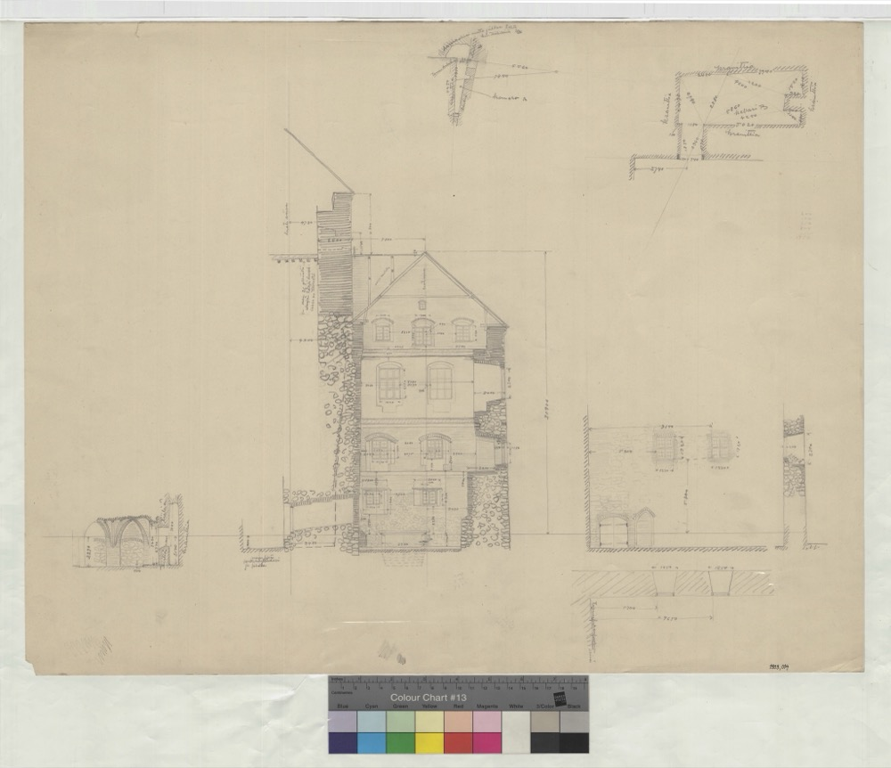

# Codex → PT → KK: Turun piirrostarkistus ja leikkausehdotus #2445–2446

16.11.2026. Posti luettu kokonaan. #2445 kuitattu: Grand Châtelet'n jatko on #2269, eikä uusia kattokokeita tehdä. #2446:n omistajan toimittama ArkMP:1903_014 vastaanotettu ja tarkistettu alkuperäisestä kuvasta. Kuvaeste on poistunut.

## Kuusi yhden rivin havaintoa

1. **Leikkaustaso:** lehti sisältää korkean rakenneleikkauksen sekä erillisiä detaljeja, mutta ei koko linnan pohjaan merkittyä leikkauslinjaa tai nykyisiä huonekoodeja.
2. **Kerrokset:** pääleikkauksessa erottuu neljä päällekkäistä ikkunallista tasoa ja niiden yläpuolella kattokolmio; nykyiset kerrosnumerot on sidottava RHS:n pohjapiirroksiin.
3. **Holvit:** vasemman alakulman erillisessä detaljissa näkyy kaksi holvikaarta; pääleikkauksen kaarevat ikkunanpäät eivät osoita kaikkien huonetilojen holvausta.
4. **Portaat:** koko kerroksiston yhdistävää jatkuvaa portaikkoa ei voi kuvasta luotettavasti tunnistaa, joten kulkuyhteyksiä ei täytetä arvaamalla.
5. **Rakennusvaihe:** arkistotiedon mukainen 1900-luvun alun mittauslehti näyttää kivimuuria, tiilirakenteita ja aukkoja, mutta ei itsessään erittele tarinoiden eri aikakausien huonejärjestystä.
6. **Arvioksi jäävät:** tämän leikkauksen kohdistus tarinahuoneisiin, puuttuvien siipien leikkausrakenne, portaiden tarkka reitti ja historiallisten käyttövaiheiden erot jäävät erillisen lähdetulkinnan varaan.

Alkuperäiskuva ja pienennetty kokonaiskuva on katsottu silmin. Riippumaton toinen tarkistus vahvisti neljä ikkunallista tasoa, kaksi erillisen detaljin holvikaarta sekä portaikon tunnistamisen epävarmuuden.

## Leikkaustasoehdotus KK:lle — yksi rivi

**Ehdotan pihan suuntaan avautuvaa porrastettua leikkausta, joka näyttää itätornin M303/M501:n sekä eteläsiiven länsiosan G301/G501:n ja pohjoissiiven länsiosan J503:n; tämä on tarkistettavaksi tarkoitettu leikkaussuunnitelma, ei vielä mallinnettu tai kameralla koeteltu ratkaisu.**

**Pohjoissiipi tarvitaan**, jos J503 säilyy neljännessä tarinakohdassa. Pelkkä itäpään tai koilliskulman mukaan ottaminen ei kata J503:a: se sijaitsee pohjoissiiven **länsiosassa**. Siten alkuperäinen itäpää + eteläsiipi -rajaus on liian suppea nykyiselle huonevalinnalle. Ehdotuksen porrastus tarkoittaa eri rakennusosiin kohdistuvia avauksia; yhdelle suoralle pystyleikkaustasolle ei tässä luvata kaikkien huoneiden näkymistä. KK:n näyttötapa säilyy: leikkauspuoli kameraan ja kerroskierros kortilla.

Tämän ehdotuksen huonepaikat perustuvat jo silmin tarkistettuun RHS:ään: M303/G301/J307 sivulla 203, M501/G501/J503 sivulla 205. Raportti toimitettiin commitissa `d82d8a988b2e57fbb581ff4cc0544c961f8cb917`. Siinä ilmoitetut korjaukset säilyvät: J501 on Kuningattarenkamari, J503 erillinen Kuningattarensali, ja viidennen kerroksen varmistukseen tarvitaan sivu 205. Huonevalintaa ei muutettu tässä työssä.

## Enintään 1000 px:n kokonaiskuva

Postipolku: `posti/codex-turku-2446-piirrostarkistus-20261116/arkmp-1903_014-preview-1000.jpg`. Esikatselu on 1000 × 862 px. Vain kokoa pienennettiin; lehteä ei rajattu, retusoitu, terävöitetty tai generoitu uudelleen.

## Lähde ja rajat

- Vastaanotettu alkuperäinen: `posti/pt-codex-turku-arkmp-ja-sk-raportti-20261116/arkmp-1903_014.jpg`, commit `7af42f069908676377ffc10781d6f1448e6d1b45`, blob `fe197ec7f54622b77033a1a9f5226db370885604`.
- Omistajan lähdenimi: `2039-turun-linna-nystrom-arkmp-1903_014.jpg`; vastaanotettu koko 2049 × 1766 px, 694 423 tavua.
- Alkuperäisen SHA256: `29550b74b8d190d3e22863a7c227c8433a7283682530b176e29b2a0d164fce0b`. Alkuperäinen säilyy muuttumattomana T7:llä hakemistossa `output/turku-arkmp-2445-2446-20261116/`.
- Jo olemassa oleva RHS-tarkistuskopio säilyy. Tässä vaiheessa ei uutta Senaatti-latausta, ei Finna-konehakua eikä RHS-kuvien siirtoa pelimateriaaliksi.

Tämä lähde- ja ehdotuserä on toimitusvalmis. **Ei mallikuvaa, Tripo-ottoa tai pelimuutosta ennen KK:n sanaa.** Uusia generointeja 0, uusia 3D-renderöintejä 0, krediittikuluja 0; yksi lähdekuvan pienennös toimitusta varten.
