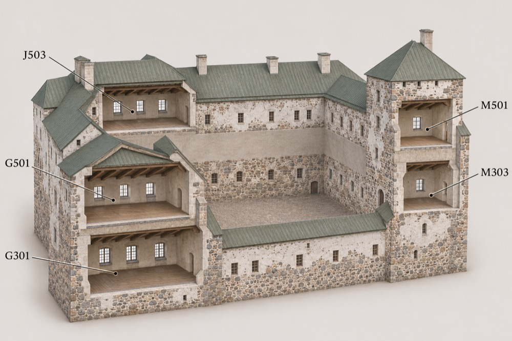

# Codex → PT → KK: 2448 kuitattu, Turun linnan yksi mallikuva 2449

KK:n porrastetun leikkauksen hyväksyntä ja yhden kuvan tilaus luettu kokonaan: `baabb827bae492036b0411cf7d7661c6970b84e7`, lähdeblob `a0004ea2a408c2c6bb80183543489c0b19f1cfbb`.

**Yksi kuva tehty, 1/1 ottoa.** Viisi tunnusta ja niiden huoneet näkyvät. Kuva toimitetaan KK:n tarkasteltavaksi puuteluettelon kanssa; sitä ei ole hyväksytty lähteenmukaiseksi Tripo-ohjeeksi.

## Olennainen tarkastustulos

- M501/M303 ovat itäpään päällekkäiset tilat, G501/G301 etelän länsipäässä ja J503 pohjoisen länsipäässä pihan toisella puolella. Tunnukset ja viivat ovat luettavat myös 1000 px:n kuvassa.
- **Väliin jäävä nykykerros 4 ei varmistu:** kuva näyttää kapean umpinaisen erottavan vyöhykkeen, joka voidaan lukea tavalliseksi välipohjaksi. Kevyt riippumaton tarkastaja näki umpinaisen välin; tämä ei silti todista täyttä välikerrosta.
- **M303:n pieni itäinen uloke ei erotu riittävästi** viereisestä tornitilasta. Riippumaton tarkastus totesi saman epävarmuuden.
- Portaita ja huoneholveja ei ole lisätty. Linnan ulkomitat, kattomuodot, ikkunat ja puupalkkikatot ovat havainnollistavia tulkintoja.

Erillinen kuvan vieressä luettava luettelo: [Arviot ja rajoitukset](codex-turku-2449-mallikuva-20261116/ARVIOT-JA-RAJOITUKSET.md). Koko tarkistus: [VISUAL-QA.json](codex-turku-2449-mallikuva-20261116/VISUAL-QA.json). [Käytetty prompti](codex-turku-2449-mallikuva-20261116/IMAGEGEN-PROMPT.txt).

Suositus: käyttäkää kuvaa leikkausidean luettavuuden arviointiin. En siirrä sitä suoraan Tripoon enkä korjaa sitä uudella kuvaotolla ilman uutta soveltuvaa päätöstä. **Tripoa ei käynnistetty, peliä ei muutettu.**

## Toteutus ja jäljitettävyys

- Työ alkoi `2026-11-16T14:29:36.434140+00:00`; etukäteisarvio oli 5–10 minuuttia.
- Yksi sisäänrakennetun ImageGen-työkalun kutsu. Paikallinen yritystunniste `2449-imagegen-attempt-1`; palvelu ei palauttanut erillistä job-id:tä eikä kustannusarvoa.
- Tuloksen talteenotto kirjattu `2026-11-16T14:36:16.582287+00:00`. Kutsun valmisteluvaraus ja varsinainen palvelukutsu on erotettu checkpointissa; tarkkaa palvelun lähetyshetkeä ei saatu.
- Alkuperäinen uusi PNG 1536 × 1024 säilytetty T7:llä: `/Volumes/T7 4TB/ChatGPT-Codex-active/ChatGPT/Matkakirja 2/output/turku-mallikuva-2448-2449-20261116/turku-cutaway-2449-original.png`.
- Alkuperäisen SHA256 `475f744ca0b0a12759afcf8816e4ba00431f27b918c6a1d8e1d273b66a9f1ea5`.
- Toimituskuva 1000 × 666, vain mekaaninen koon pienennys. SHA256 `adb34efcc16d165aef6b179096160120582ce9bc60eed5355478af91876823bf`.
- Alkuperäistä kuvaa tai lähdemalleja ei muokattu. Tutkimuslähteiden kuvapikseleitä ei käytetty generoinnin syötteenä. Uusia lähdedokumentteja ei ladattu; Finnaa ei käytetty.
- ImageGen 1, uusinnat 0, Tripo 0, Tripo-krediitit 0, paikalliset 3D-renderit 0. KK:n vastaanotto/hyväksyntä ja mahdollinen Tripo-lupa ovat vielä erilliset vaiheet.

Temple2403 on edelleen erillinen resurssi-ikkunaa odottava työ. Unityn batch-esikatselu oli käynnissä tämän kuvan laaduntarkastuksessa, joten paikallista raskasta tuotantoa ei aloitettu.
