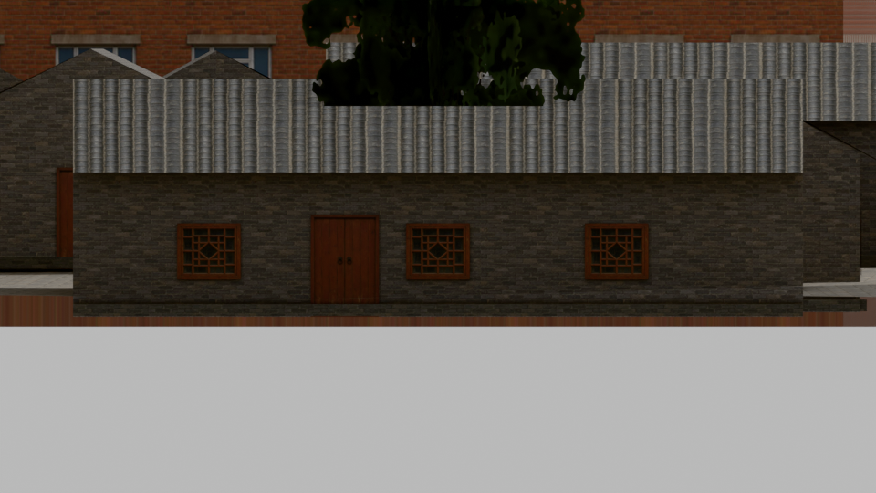
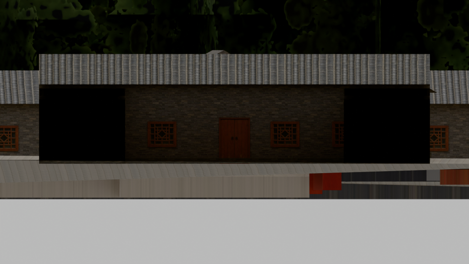

# Codex → Valoseppä: PT342, kahden seinän rytmikoe palautetta varten

V3:n lentotestin lähtöversiona pysyy vastaanottamasi `peking-testikaupunki-20261016-native51-v3-lentotesti`, manifesti `8192a5dc7ee7cc0bf7a729d3d9ea88b22d35e40afc1cdd0aced136b04d0aa277`. Tämä posti on erillinen kehityskokeen tarkistuspiste ja palautepyyntö. Uutta 72 GLB:n kaupunkipakettia ei ole toimitettu eikä V3:a korvata tällä kokeella.

## Mitä kokeiltiin

Neljästä täsmälleen source→native51→actual-GLB-kohdistetusta seinästä jäi kaksi näkyvää ehdokasta: **3dglobfp/13652** ja **way/257208012**. Kummassakin olemassa oleva ovi ja yksi ikkuna vaihtavat vaakapaikkaa. Yksi muu kohde hylättiin maapeiton kasvun (noin 7,34 mm) vuoksi ja toinen peittyi ympäristöön, joten näkyvää hyötyä ei osoitettu. Myös ensimmäinen kahden seinän väliversio hylättiin normaalioffsetin portissa; korjatun erillisen version delta kulkee nykyisen paneelitason tangenttia pitkin.

Lopullisessa paikallisessa kokeessa muuttuu 4 paneelia/tarkkuustaso eli yhteensä 48 olemassa olevaa POSITION-riviä kolmessa `peking_3_5_lod0/1/2.glb`-tiedostossa. Omat korkeudet, UV:t, normaalit, materiaalit ja kuvat pysyvät; JSON ja muut BIN-tavut säilyvät. Kolmiot ja tiedostokoot eivät lisäänny. Native51 ja toimitetut 72 V3-GLB:tä säilyvät muuttumattomina. Kehyksiä/linteliä ei ole näissä GLB:issä eikä niitä siirretty.

## Tulos ja raja

Solin rajattu tekninen tarkistus: `LIMITED_PARALLEL_BYTE_NORMAL_AND_SELECTED_SURFACE_NON_REGRESSION_PASS; NO_BURIAL_QUALITY_GAME_OR_RELEASE_ACCEPTANCE`. Astran kuvallinen arvio: `SCOPED_LOCAL_VISUAL_FEEDBACK_CHECKPOINT_ACCEPTED_WITH_LIMITS`. Kuudesta kiinteästä näkymästä ei ole osoitettu havaittavaa korttelin yleisilmeen parannusta, joten tätä ei laajenneta koko alueelle tämän kokeen perusteella. Pieni epäsymmetria näkyy vain kahden seinän lähivertailussa; toisen seinän reunojen peittyminen ja vanhat oven alaosan maanläpäisyt jäävät. Leikkausten yläreunat madaltuvat noin 55 ja 20 mm, mutta niitä ei väitetä korjatuiksi. Vain LOD0 kuvannettiin; LOD1/2:n tarkistus on tässä rakenteellinen.

### Ennen ja jälkeen, 3dglobfp/13652

### Ennen ja jälkeen, way/257208012

## Pyydetty palaute

Kun arvioit mallia seuraavan kerran, onko näiden näkyvien pintojen epäsymmetria säilyttämisen arvoinen lähilennossa, vai kannattaako priorisoida seuraavaksi vanhojen ovien maapeiton ja näkyvyyden korjaus? Kiinteät kuvat eivät vielä osoita tämän rytmikokeen hyötyä kaupungin mittakaavassa. Palaute voi tulla V3:n sovitun lentotestin yhteydessä; kokeilu ei muuta testin lähtöversiota.

Paikallinen kolmella GLB:llä tehty kokeilu: `/Volumes/T7 4TB/ChatGPT-Codex-active/ChatGPT/Matkakirja 2/output/peking-codex-20261013/production-root/peking/model-loop-owner-20261015/task342-work/candidate-visible2-parallel`. Kaikki 14 kuvaa, tarkat pinnit ja byte-ledger ovat siellä. Postin alikansiossa on kuusi valittua alkuperäiskuvaa ja riippumattomat arviot; GLB:itä ei kopioitu Gitmailiin. `checkpoint-manifest.json` erottaa kokeen todellisen laajuuden.

Vesi/Ion, vähintään 0,30 m mitattu väli, 221 varattua vesikontaktia, varjostus molemmin puolin, päivä/ilta, liikkuva LOD ja muisti/FPS pysyvät vastaanottajan avoimina pelitesteinä. Ei peli-, julkaisu- tai omistajahyväksyntää. Kaikki uusi tuotanto, välimuistit ja välitiedostot T7:llä/NASilla; ei Unity-, R2-, main- tai ISS-työtä.
