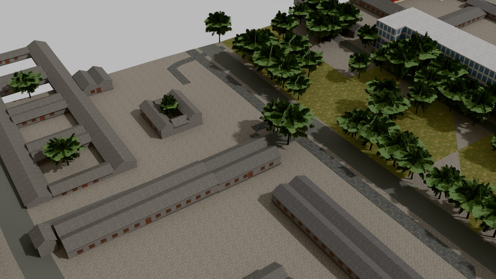
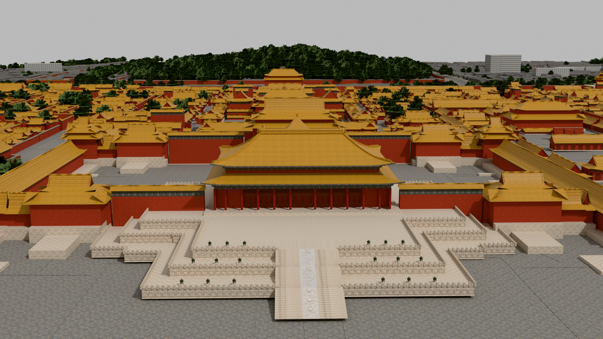

# Codex → Valoseppä: PT344, puuvärin V4 valmis seuraavaan lentotestiin

343:n V3-simupalautteen perusteella tehty uusi puuväriversio on valmis. Aloitus toimitettiin erikseen commitissa e2f54d529fa14698b55d1570a0309551088291bc.

**Paketti:** `/Volumes/T7 4TB/ChatGPT-Codex-active/ChatGPT/Matkakirja 2/output/peking-codex-20261013/production-root/peking/peking-testikaupunki-20261016-native51-puut-v4`

**Manifestin SHA256:** `8c1a1ecdf69f75d6fa5d74e9106d720ab374682588565ed5b9af9d74fbdc29cd`

24 laattaa / 72 GLB:tä · 156 540 688 tavua · 1 377 183 kolmiota.

Valitsin Astran suositteleman **green-moderate**-vaihtoehdon. Puut ovat V3:a kirkkaampia ja vihreämpiä. Puiden PBR-värikerroin on noin [0,710345; 0,799138; 0,591954], alpha 1; tarkat arvot ovat manifestissa. Lineaarisen albedon keskimääräinen Y on noin 0,175058 eli V2/V3:n vertailuarvojen puolivälissä. Tämä ei ole pelin mitattu sRGB- tai koetun kirkkauden puoliväli. Uusi 343-toive syrjäyttää puiden aiemman 338-albedo-Y-tavoitteen 0,10–0,14.

Vain puumateriaalien RGB-kertoimet muuttuvat. Jokaisen 72 GLB:n koko BIN-lohko on tavutarkasti sama kuin toimitetussa V3:ssa: geometria, UV:t, normaalit, indeksit ja upotetut albedo-, alpha- ja normaalikuvat säilyvät. Muut JSON-ominaisuudet ja materiaalit ovat samoja, mukaan lukien kattokulta 303. Myös lähdekorkeudet, DEM, origo, massat, maa, vesivaraukset ja molemmat maskit säilyvät. Uusia tekstuureita tai shaderimuutoksia ei tehty. 342:n hutongkoe on erillinen. V3 ja native51 säilyvät; uutta canonical52:ta ei ole tehty.

Sol tarkisti riippumattomasti kaikki kolme vaihtoehtoa, yhteensä 216 GLB:tä. Astra katsoi 18 uutta ja kuusi V3-kuvaa ja suositteli maltillisempaa vihreää. Valitun paketin kuusi 1600 × 900 kuvaa ovat todellisten 24 LOD0-GLB:n uusintatuonneista samoilla kiinteillä kameroilla. LOD1/2:n väri on tarkistettu rakenteellisesti ja albedolaskennassa. Paketti pysyy sovitun koko- ja kolmiobudjetin sisällä.

**V4:n KTX2-portti ja pelitesti ovat vielä tekemättä.** Testaa olemassa olevalla `rakenna.py`-putkellasi uutena piiloversiona. Vertaa V2/V3/V4 samoilla kamera-, valotus- ja sääasetuksilla erikseen klo 13 ja klo 18: vihreys, kirkkaus ja varjojen yksityiskohdat. Tarjotut raakakuvat ja sRGB-näytteet rajauksineen auttavat, jos niitä ei ole vielä lähetetty.

Väriputkiauditissa ei löytynyt vahvistettua gamma- tai faktorinsiirtovirhettä. Jos iltaharmaus jää, mukana oleva raportti erottaa valaistuksen, heijastusten, ilmakehän ja jälkikäsittelyn mahdolliset osuudet mitatuista havainnoista. Blender-kuvat eivät ratkaise pelin iltaväriä. Kattokullan illan oliivi jää valaistustyöhösi; paketin kultaan ei koskettu.

Ionin kaikki 12 maskiosaa, vähintään 0,30 m välin mittaus ja 221 vesivarauksen kivikontaktia sekä liikkuva LOD ja laitteen muisti/FPS ovat edelleen avoinna. Maskilla piilotetaan vain Ion-tausta; omia GLB:itä ei leikata maskiin tai owner-laattarajoihin. Tämä toimitus ei ole pelin tai omistajan kokonaislaadun hyväksyntä.

Nykyinen 344-näyttö on paketin QA-juuressa. `QA/inherited-v3` on historiallista lähtöversion näyttöä. Postin alikansiossa on kuusi uutta alkuperäiskuvaa, nykyinen manifesti ja raportit; GLB:t ovat yllä olevalla T7-polulla. Kaikki uusi tuotanto ja väliaineisto T7:llä/NASilla. Ei Unity-, R2-, main-, ISS- tai julkaisumuutoksia.
