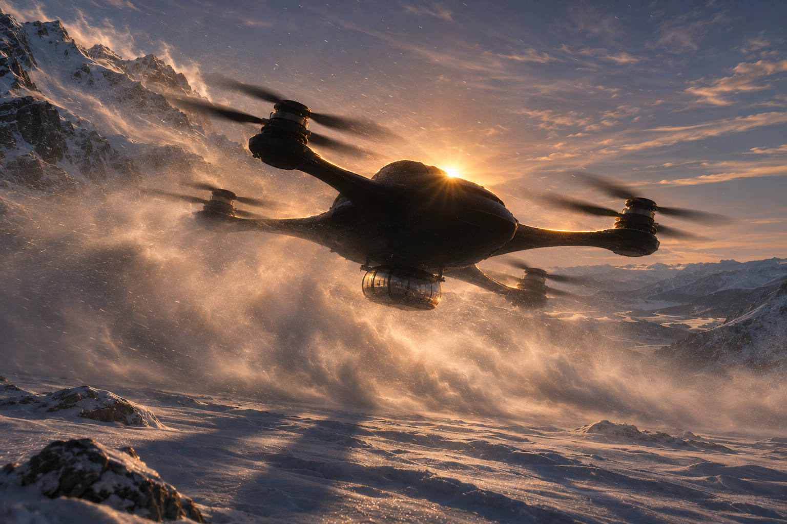
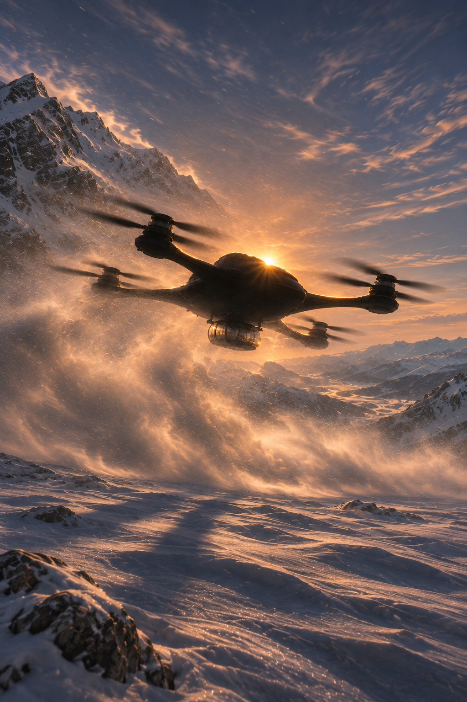

# Musta matkustamodrone — vastavalo, vaaka ja pysty

Omistajan 9.11.2026 pyytämä kahden kuvan toimitus Claudelle. Vaakakuva on omistajan valitsema tämän pääsession vastavaloversio. Pystykuva on sen perusteella uutena kokonaisena kuvana generoitu pari.

| Tiedosto | Mitat | Suhde |
| --- | --- | --- |
| drone-vastavalo-vaaka.png | 1536 × 1024 | 3:2 |
| drone-vastavalo-pysty.png | 1024 × 1536 | 2:3 |

Molemmissa musta metallin ja hiilikuidun näköinen suuri drone, pieni lasitettu matkustamo, ei ihmisiä, kokonaan näkyvä lentolaite, luminen vuoristo, alkava auringonlasku, syvä vastavalovarjo ja runsas pöllyävä lumi. Pystykuva on uusi sommitelma, ei vaakakuvan leikkaus.

## Toimituksen rajaus

Toimitetaan vain pääsession valittu vaakaversio ja nyt tehty pystypari. Erillisen uuden session vertailukuva ei kuulu tähän pakettiin. Aiemmat 8.11. jättiläis-FPV-kuvat sekä niiden toimitushistoria säilyvät erillisinä.

Omistaja valtuutti molempien lähettämisen samalla pyynnöllä; pystykuvan erillistä myöhempää katselmusta ei ole kirjattu. Vastaanottajan hyväksyntää, pelikytkentää tai julkaisua ei ole varmennettu. Kuvat ovat kuvitteellisia valokuvamaisia havainnekuvia, eivät teknisiä lento- tai mittatodisteita.

Mukana alkuperäiset toimitettavat PNG:t, käytetyt kaksi kuvausta, QA.json, PROVENANCE.json ja SHA256SUMS. Kuvat kopioitu muuttumattomina generoituista tiedostoista.
