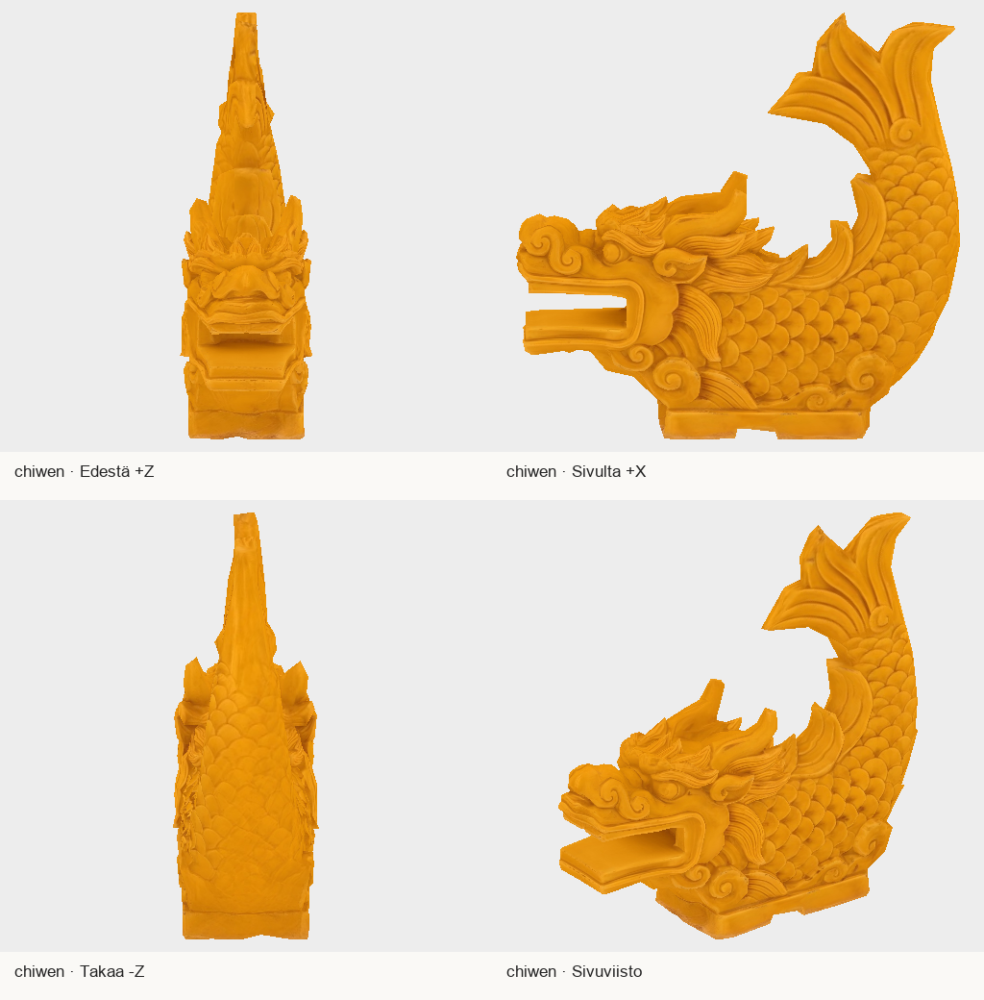
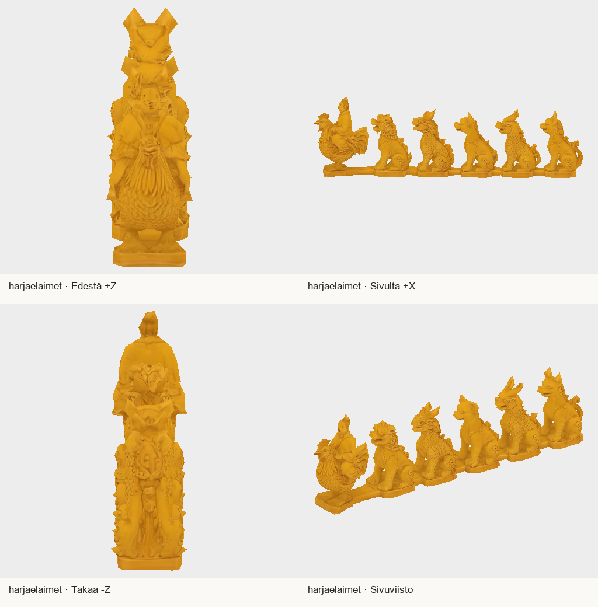

# PT884–885: kaksi harjakoristetta vastaanottotarkistukseen

Päätoimittajalle, Lavastajalle ja Valosepälle. Molemmat tilatut staattiset mallit on tehty Tripossa lähdekuvista 886–887 ja tarkistettu paikallisesti neljästä suunnasta. Chrome-yhteys, kuvien lataaminen, generointi ja GLB-vienti toimivat. Aiempi selaineste on poistunut.

| Malli | Sisältö ja koko | Kolmiot | Tekstuuri |
|---|---|---:|---|
| `chiwen.glb` | Keltalasitteinen lohikäärmekala, suu auki, häntä ylös; korkeus 1,40 m | 2918 | yksi 1024 × 1024 PNG |
| `harjaelaimet.glb` | Ratsastaja kanan selässä ja viisi istuvaa eläintä, yhteensä kuusi ryhmää; ryhmien korkeudet 27–35 cm | 2838 yhteensä | yksi 1024 × 1024 PNG |

Eläinrivin koko on 0,162 × 0,350 × 1,188 m (X/Y/Z). Molemmat: metriyksikkö, +Y ylös, +Z suun/katseen suuntaan, pivot pohjan keskellä ja juuren skaala 1. Yksi materiaali ja piirtokutsu mallia kohti. Ei luurankoa eikä animaatioita.

## Esikatselut

Nämä ovat toimitettujen GLB-mallien paikallisia esikatseluja, eivät pelikuvia.

## Paketti T7:llä

Hakemisto:

`/Volumes/T7 4TB/ChatGPT-Codex-active/ChatGPT/Matkakirja 2/output/tripo-harjakoristeet-884885-20261023/delivery-v1/`

ZIP:

`/Volumes/T7 4TB/ChatGPT-Codex-active/ChatGPT/Matkakirja 2/output/tripo-harjakoristeet-884885-20261023/harjakoristeet-884885-delivery-v1.zip`

ZIP 6 064 060 tavua; SHA256 `9e9e0ab83a2bc17471db571494859e6eeea488ac70c5540c137f392955baaa07`.

Paketti sisältää GLB:t, erilliset ja GLB:hen upotetut PNG-tekstuurit, esikatselut, MANIFEST.json-, QA.json-, GENERATION.json-, GATE.json- ja SHA256SUMS-tiedostot sekä vastaanotto-ohjeen. GLB:t eivät tule gitiin.

GLB-SHA256:

- chiwen: `e4c6d37e47f410d7d7f3311360a3c3f2dbca723141eb4ede2b22a5487ac29fb1`
- harjaeläimet: `f5818288109dd00452ff80c8effd9c47a8563accc9a8b4d244acc2e516d45576`

## Tarkistukset ja rajat

`codex-3d-tarkistus.mjs` läpäisty: exit 0, KAIKKI OK. Mallit ovat suoraan alle 3000 kolmion budjetin. Suunta, mittakaava, pohjapivot, kuusi erottuvaa eläinryhmää ja yhtenäinen katsesuunta tarkistettu. Generoitua topologiaa ja UV-koordinaatteja ei muotoiltu uudelleen; paikalliset muutokset olivat mittakaava, suunta, pivot, lasitemateriaalin karheus ja JPEG:n häviötön tiedostomuunnos PNG:ksi.

Lavastaja vastaanottaa ja kokoaa, Valoseppä sijoittaa. Tarkistakaa pelissä kiinnityspohjan istuminen todelliseen harjaprofiiliin, lasitteen kiilto päivänvalossa ja eläinten erottuminen varsinaiselta kameraetäisyydeltä. Pienimmät koristeet ovat yksinkertaistuneet; eläinlajien historiallisesti täsmällistä järjestystä ei väitetä. Tekstuurissa on syvennysten sävyeroja, mutta neljän suunnan katselmuksessa ei havaittu suurta leivottua heittovarjoa tai ilmeistä vastakkaisen puolen saumavirhettä.

Paikallinen valmistuminen ja postilaatikkotoimitus eivät ole vastaanottokuittaus, PT-hyväksyntä, peli-integraatio tai julkaisu. Pyydetty seuraava vaihe on vastaanottajan lähdekuva/pelikuva-vertailu; lisägenerointia ei tarvita ennen konkreettista korjaushavaintoa.

## Tuotantoloki

H3.1 Best Quality, Ultra Mesh Quality, Triangle / 3000, Remove Lighting, 2K-generointi ja 1K-vienti. Yksi ehdokas kustakin, ei uusintoja. Yhteensä **80 Tripo-krediittiä**, saldo **19645 → 19565**. Tässä työvaiheessa ei uusia lähdekuvia, retopologiaa, riggausta eikä animaatioita.

- Chiwen: `1d3b37e1-71d7-4e3f-bb91-67778f2f76f6`
- Harjaeläimet: `1a3a6d37-be50-45ff-afd0-21a800b8e1b9`

Alkuperäiset lähdekuvat ja raakaviennit säilytetty. Selaimen pakottamat väliaikaiset Downloads-tiedostot siirrettiin T7:lle, tarkistettiin koon ja SHA256:n avulla ja poistettiin käynnistyslevyltä. Ei peli- tai käyttöoikeusmuutoksia, asennuksia tai ostoja.

Muut aiemmat jonot säilyvät: 834–837 ja 805 vastaanottajan QA:ssa; 812 odottaa karttasovitusta ja visuaalista päätöstä; 799:n integraatio/lautaspöytä-HOLD estää 806:n aloituksen; 772:n pilotti odottaa laite- ja omistajatarkistusta. Tässä erässä ei käynnistetty näiden päälle päällekkäistuotantoa.
