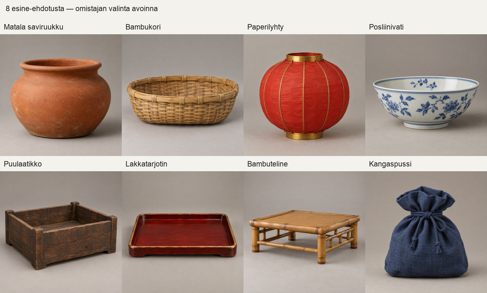

# Rikkoutuvat esineet — 12 ehjä/rikki-parin suunnitelma omistajalle

Suunnitelma on valmis arvioitavaksi. Uusi jonotarkennus #784 nosti tämän ensimmäiseksi. Aiempi 12 parin luonnos ja #770:n kahdeksan ehjää kuvaa säilyvät: samoja kuvia ei generoitu uudelleen.

Suunnitelmassa on 12 esinettä, kullekin ehjä lähtötila, saman esineen rikkoutunut tavoitetila ja liike-ehdotus. Kahdeksan ensimmäisen ehjät kuvareferenssit ovat jo toimitettuja. Neljä viimeistä ovat uusia sanallisia ehdotuksia. Rikkoutuneiden tilojen kuvia tai malleja ei tässä toimiteta.

| # | Esine | Ehjä lähtötila | Rikkoutunut tavoitetila | Liike-ehdotus |
|---:|---|---|---|---|
| 1 | [Matala saviruukku](</Volumes/T7 4TB/ChatGPT-Codex-active/ChatGPT/Matkakirja 2/output/juoksupeli-yojono-767772-20261021/task770/delivery/native/savi-ruukku.png>) | Nykyinen matala, avoin terrakottaruukku. | Sama suu, pohja ja väri tunnistuvat; runko jaetaan 4–5pääpalaan. | Pieni kallistus, rungon erkaneminen ja palojen asettuminen paikalleen. |
| 2 | [Bambukori](</Volumes/T7 4TB/ChatGPT-Codex-active/ChatGPT/Matkakirja 2/output/juoksupeli-yojono-767772-20261021/task770/delivery/native/bambu-kori.png>) | Nykyinen matala, soikea punottu kori. | Korin reuna painuu kasaan, kaksi punontapintaa irtoaa; sävy ja punontarytmi säilyvät. | Kaatuu ja litistyy; ei keraamisten sirujen liikettä. |
| 3 | [Paperilyhty](</Volumes/T7 4TB/ChatGPT-Codex-active/ChatGPT/Matkakirja 2/output/juoksupeli-yojono-767772-20261021/task770/delivery/native/paperilyhty.png>) | Nykyinen sammuksissa oleva punainen paperilyhty. | Samat kultaiset kehät ja punainen paperi; runko litistyy ja kaksi paperipaneelia repeää. | Paperi painuu kasaan ja kehät kallistuvat; ei tulta. |
| 4 | [Sinivalkoinen tarjoilukulho](</Volumes/T7 4TB/ChatGPT-Codex-active/ChatGPT/Matkakirja 2/output/juoksupeli-yojono-767772-20261021/task770/delivery/native/posliini-vati.png>) | Nykykuva on kulho, vaikka vanha nimi on posliinivati. | Sinivalkoinen kuvio jatkuu 4–6suureen reuna-/pohjapalaan. | Kulho kallistuu, erkaantuu osiin ja palat pysähtyvät alustalle. |
| 5 | [Puulaatikko](</Volumes/T7 4TB/ChatGPT-Codex-active/ChatGPT/Matkakirja 2/output/juoksupeli-yojono-767772-20261021/task770/delivery/native/puu-laatikko.png>) | Nykyinen matala kanneton puulaatikko. | Pohja jää tunnistettavaksi, 3–4sivulautaa irtoaa; sama puunsyy. | Sivut kääntyvät liitoksista auki ja putoavat lyhyesti. |
| 6 | [Lakkatarjotin](</Volumes/T7 4TB/ChatGPT-Codex-active/ChatGPT/Matkakirja 2/output/juoksupeli-yojono-767772-20261021/task770/delivery/native/lakka-tarjotin.png>) | Nykyinen punainen puutarjotin kultaisella reunalla. | Sama muoto ja reunaväri, tarjotin halkeaa 2–3suureen osaan. | Yksi kallistus ja osien lyhyt liukuminen. |
| 7 | [Bambuteline](</Volumes/T7 4TB/ChatGPT-Codex-active/ChatGPT/Matkakirja 2/output/juoksupeli-yojono-767772-20261021/task770/delivery/native/bambu-teline.png>) | Nykyinen matala bambuteline. | Päällystaso kallistuu, 2–3tukiosaa irtoaa; sama bambun sävy. | Nivelet pettävät ja teline painuu alas. |
| 8 | [Kangaspussi](</Volumes/T7 4TB/ChatGPT-Codex-active/ChatGPT/Matkakirja 2/output/juoksupeli-yojono-767772-20261021/task770/delivery/native/kangas-pussi.png>) | Nykyinen sidottu kangaspussi. | Sama kangas ja säkki, suu aukeaa ja runko rojahtaa; erillistä saalista ei ehdoteta tässä. | Sidonta löystyy, kangas painuu maahan. |
| 9 | Matala puujakkara (sanallinen ehdotus) | Uusi sanallinen ehdotus: yksinkertainen puuistuin ja neljä jalkaa. | Istuimen pinta säilyy, kaksi jalkaa irtoaa ja muut taittuvat sivuun. | Kallistuu ja painuu yhdelle kyljelle. |
| 10 | Keraaminen teekannu (sanallinen ehdotus) | Uusi sanallinen ehdotus: pieni ruskea kannellinen teekannu. | Kansi irti, kahva ja 3 runkopalaa erottuvat; sama kaatonokka ja pinta. | Kansi putoaa ensin, runko erkaantuu ja pysähtyy. |
| 11 | Kannellinen posliiniastia (sanallinen ehdotus) | Uusi sanallinen ehdotus: sinivalkoinen korkea kannellinen säilytysastia. | Kansi ja 4 isoa pystyrungon palaa; ehjästä tuttu kuvio säilyy. | Kallistuu, kansi putoaa ja runko avautuu osiksi. |
| 12 | Puusanko (sanallinen ehdotus) | Uusi sanallinen ehdotus: matala puusanko kaarevalla kahvalla. | Samat pystylaudat ja vyöt; kahva kallistuu ja 3 lautaa irtoaa. | Kaatuu kyljelleen, laudat aukeavat ja jäävät lähelle. |

## Mitä omistaja arvioi

Valittavat esineet ja niiden ehjä/rikki-ulkoasut sekä liikkeet. Esineen sama muoto, mittakaava, materiaali ja koristelu säilyvät parin molemmissa tiloissa. Rikkoutuminen ei vaihda esinettä toiseksi. Lopullinen palamäärä ja liike ovat tässä ehdotuksia, joita ei ole testattu pelissä.

12 loogista esineparia tarkoittaa 24 suunniteltua ulkoasutilaa. Se ei tarkoita 24 valmista kuvaa, GLB-tiedostoa tai maksettua generointikutsua. Omistajan valinta ja mallinnuslupa ovat edelleen avoinna. Tuotantotapa, mahdollinen kutsumäärä, mallien tarkistus, animaatiot ja pelikytkentä sovitaan valinnan perusteella. Tämä suunnitelma ei käynnistä niitä.

## Olemassa olevat kuvareferenssit

Ensimmäisten kahdeksan ehjän esineen esikatselu on jo toimitetusta erästä. Kaikkien kahdeksan alkuperäisen kuvan SHA256-tarkisteet täsmäsivät tätä suunnitelmaa varten. REUSE-INDEX.json sisältää alkuperäiset absoluuttiset polut ja tarkisteet.

## Työnjako ja rajat

Tämän suunnitelman jälkeen jonossa ovat PT733:n Louvren kulmakoristeet nykyisellä Tripo 3D -tekijällä. Jo aloitettu työ ja sen tarkat tuotantorajat säilyvät. Niken tarkistuspaketin valmistuminen ei osoita visuaalista hyväksyntää tai pelikytkentää. #769:n neljä rakennusosaa pysyvät erillisenä KK:n omistajakorttiehdotuksena; tämä suunnitelma ei anna niille mallinnuslupaa. #772:n videorenderöinti on edelleen vasta 21.–22.10. yöllä resurssiportin mukaan.

Tämän suunnitelman uusia kuvia: 0. Uusia malleja: 0. Uusia Tripo-kutsuja: 0. Suunnitelman toimitus, omistajan hyväksyntä ja pelikytkentä kirjataan erikseen.
