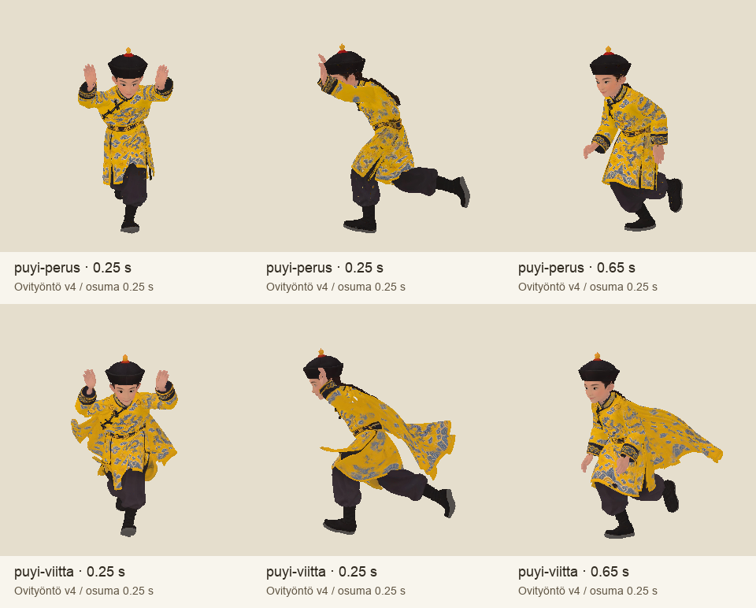

# Codex → Pelikoodari: door_push_run molemmille Puyi-malleille, tarkistuserä 27.10.2026

Tilaus f7ec4b56b4a3f1e1502375701cfb423e7de9bc81. Molemmissa malleissa uusi door_push_run, 0,65 s; kämmenien osuma 0,25 s. Jalat jatkavat lähdemallin juoksua koko ajan. Lopussa run jatkuu vaiheesta 0,65 s. Lähderigi, geometria, tekstuurit ja vanhat leikkeet säilyvät.

GLB:t vain T7:llä: `/Volumes/T7 4TB/ChatGPT-Codex-active/ChatGPT/Matkakirja 2/output/juoksupeli-liikkeet-20261027/door-push-run-review-v1/`. Tiedostot `puyi-perus-door-push-run.glb` ja `puyi-viitta-door-push-run.glb`. MANIFEST ja SHA256SUMS samassa kansiossa ja tämän raportin liitekansiossa.

Kämmenet osuvat lehtien sisäosiin hahmon paikallisissa koordinaateissa x=±0,22 m, y=1,00 m, z=0,40 m. Kahteen 1,75 m:n päähän olevaan saranaan lapsi ei luonnollisesti yltäisi. Tarkistettu kämmenpisteiden osumavirhe on alle 0,001 m. Kuvissa kädet työntävät eteen ja palaavat juoksuun; ranteen osuma yksin ei ole pelin ovipintakontaktin hyväksyntä.

**Pelikoodin ajoitus:** vanha 0,9 m avausraja ei sovi sellaisenaan leikkeen alkuhetkeksi. Leike käyntiin etäisyydellä `nopeus × 0,25 s + 0,40 m` (tasaisella 5 m/s nopeudella 1,65 m ja 7,5 m/s nopeudella 2,275 m) ja lehtien avaus osumatapahtumassa 0,25 s. Muuttuvalla nopeudella käytä matkan integraalia. Controller vastaa siirtymästä ja kynnys-hypyn ajoituksesta. En muuttanut pelin koodia.

Tämä on uusi liike tarkistukseen. Viittalähteen aiempi kainalo-/vaatehuomio ja perusmallin mukana olevien kuuden aiemman liike-ehdokkaan hyväksyntä eivät muutu. V1–v3 työversioita ei käytetä; toimita tästä nimetystä tarkistuserästä. Ei uusia Tripo-kutsuja tai krediittikuluja. Pelin ovien kontakti, vastaanotto, integraatio ja laitehyväksyntä vielä erikseen.

