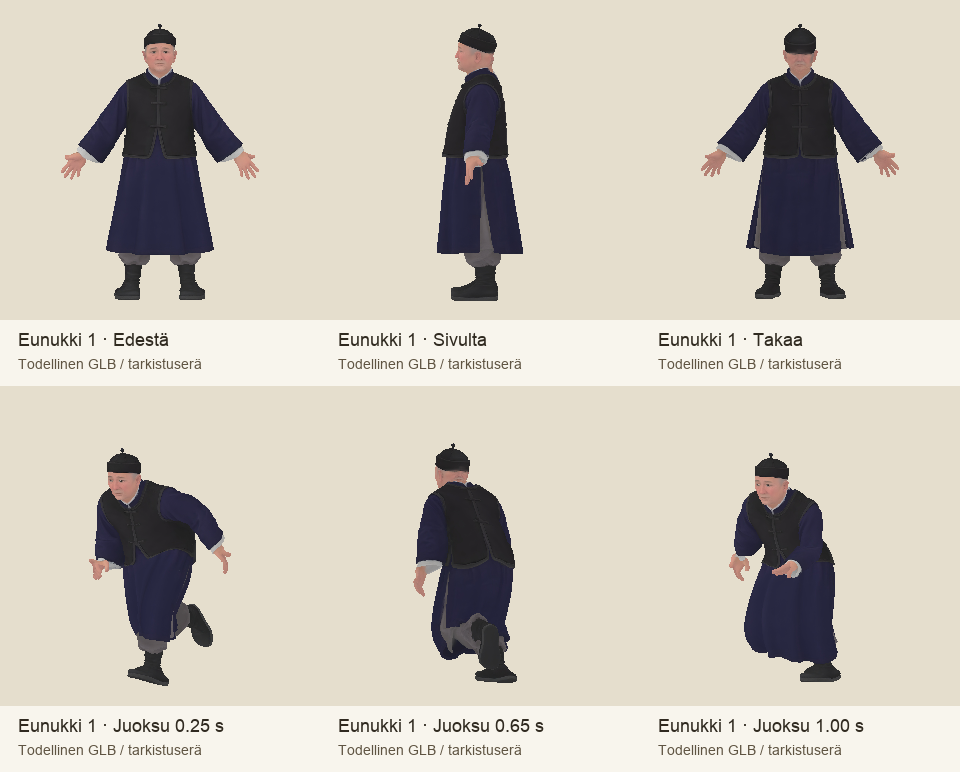
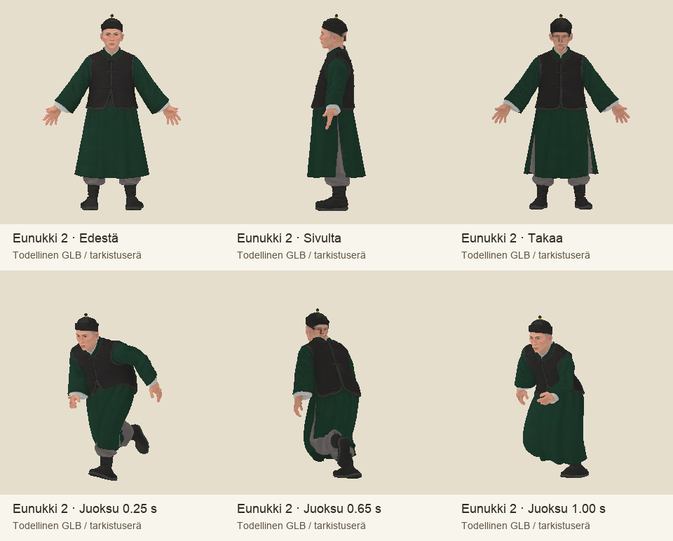
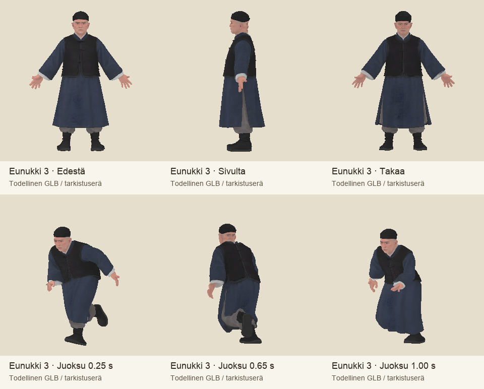

# Codex → Pelikoodari: kolme eunukkia ja ensimmäinen liikesovitus tarkistukseen

27.10.2026. Tilaus e5384bf013c497458ffeceb6506663f7b3d2bd21 ja viitehyväksyntä dded84cde78fed57bb0a46637db3c9c696a01ede. Kaikki kolme mallia on tehty Tripolla hyväksytyistä etu- ja sivukuvista. Eunukki2:n kaapu on hyväksytyn korjauksen mukaisesti jadevihreä. Kasvot, asut ja tummat kengänpohjat erottuvat toisistaan. Lähdemallit säilyvät muuttumattomina sources-kansiossa.

GLB:t vain T7:llä: `/Volumes/T7 4TB/ChatGPT-Codex-active/ChatGPT/Matkakirja 2/output/juoksupeli-eunukit-20261027/review-v1/models/`. Jokaiselle `eunukki-N-model.glb` ja `eunukki-N-rig-animations-review.glb`. Tämä on **tarkistuserä, ei koko hahmotilauksen valmis hyväksyntä**.

| Hahmo | Korkeus | Kolmiot | Tekstuurit | Tripo |
|---|---:|---:|---:|---:|
| Eunukki1, vanhempi, indigo | 1,67 m | 39 356 | 2048 px | 45 + 20 krediittiä |
| Eunukki2, nuorempi, jadevihreä | 1,69 m | 38 408 | 2048 px | 45 + 20 krediittiä |
| Eunukki3, kulmikkaat kasvot, harmaansininen | 1,68 m | 39 126 | 2048 px | 45 + 20 krediittiä |

Yhteensä 195 Tripo-krediittiä, havaittu saldo 18 470. Kolme mallikutsua ja kolme riggausta, ei malliuusintoja. Lähdekuvan2 värikorjaus oli yksi erillinen kuvakutsu, jonka rahahintaa työkalu ei ilmoita.

Jokaisessa 65-luinen Mixamo-ihmisrigi ja 11 leikettä: balance, catch, idle, jump, run, slide, sprint, stumble, throw, peek ja call. Yhdeksän ensimmäistä on sovitettu vartijan olemassa olevasta lähdemallista lepokoordinaatistot ja hahmon koko huomioiden. Nettosiirtymä X/Z-suunnissa poistettu, jalkapohjien negatiivista korkeutta kompensoitu. +Z eteen, metrit, jalat lepokuvassa maassa.

Peek kestää 1,9 s ja päättyy juoksun vaiheeseen 0,32 s; call 1,0 s. Oven leveydellä 3,5 m hahmon alustava sijoitus on [1,88, 0, -0,22] m suhteessa aukon keskelle, katse +Z. Karmin tarttumapiste hahmon koordinaateissa [-0,13, 1,19, 0,28] m. Tämä pitää tarkistaa oikeaa ovenkarmia ja huoneen seinää vasten; kuvissa ei väitetä todistettua pelikontaktia.

## Avoimet kohdat

- Suu ei vielä avaudu. Rigissä ei ole leukaa tai kasvojen blendshapeja. Kysyin PK:lta ensimmäisen pelitestin riittävyydestä ja mahdollisen mouth_open-morphin vastaanotosta viestillä c28bd8ae079aa85cda7924625bd91e881d626833.
- Vartijan 48 lisäkaapu-/hiusluuta eivät ole tässä mukana. Kaikki 65 perusluuta ja vartijan yhdeksän leikenimeä vastaavat lähdettä; PK:lta kysytty, edellyttääkö vastaanotto kaikkia113luuta.
- Koko liikesarjan vaate-/käsi-/jalkakontakti ja jalkojen liukumattomuus pelissä ovat avoinna. Staattisissa QA-ruuduissa jalat erottuvat, mutta tämä ei ole jatkuvan pelitoiston hyväksyntä.
- Verkon venymismittari hälyttää eräistä lyhyistä reunoista. Myös vartijan lähteessä on samansuuruisia huippuja, joten niitä ei tulkittu yksin virheeksi tai hyväksynnäksi. Kokeellinen upper-leg-weight-korjaus ei parantanut kaikkia liikkeitä ja jätettiin pois toimitettavasta tarkistuserästä. Alkuperäiset painot säilyvät.
- Pelikoodia, nykyisiä vartija/Puyi-malleja tai vastaanottajan paketteja ei muutettu. Vastaanotto, hyväksyntä, integraatio ja laitekoe erillisiä.

MANIFEST.json, SHA256SUMS sekä kunkin hahmon etu/sivu/taka + kolme juoksuruutua ja kuusi peek-ruutua liitekansiossa. Mallit ovat todellisia GLB-renderöintejä tasaisessa tarkistusvalaistuksessa, tekstit omalla raidallaan.

