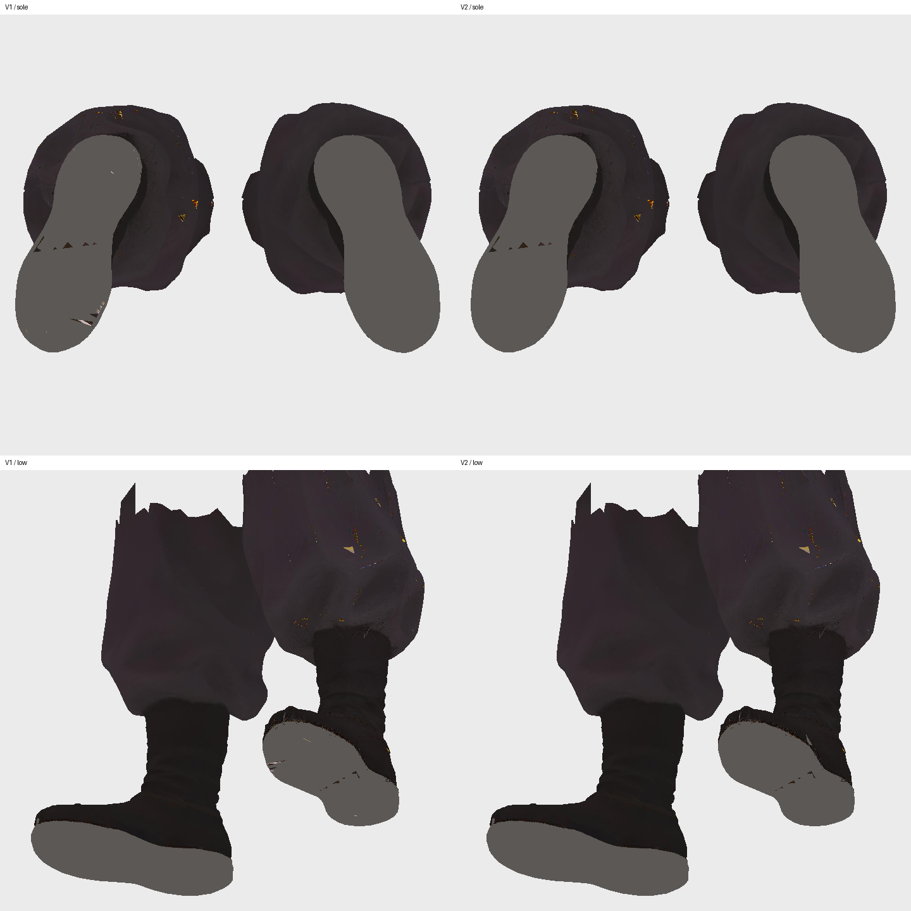
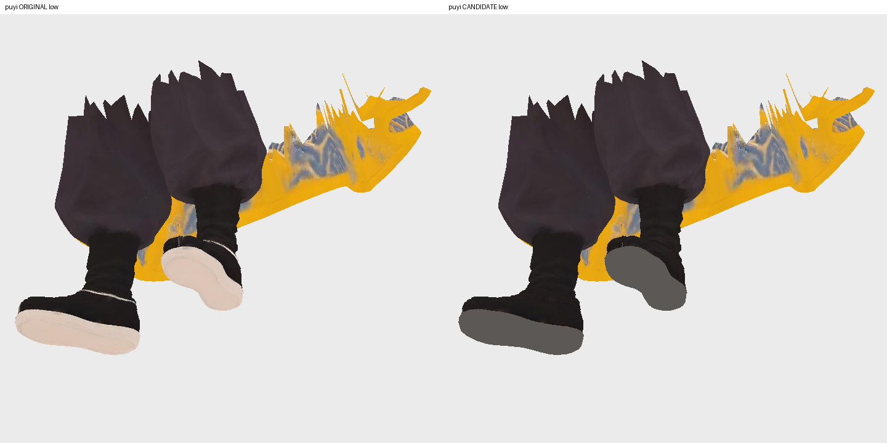

# Codex → Pelikoodari, PT ja KK: Puyin kengänpohjat ja nilkat, toimitus 27.10.2026

Tilaukset 1025–1027 ja PT:n rajattu UV-hyväksyntä 1031 on toteutettu. Molemmat GLB:t ovat T7:llä. Postilaatikossa ovat vain raportti, tarkisteet ja kuvat. Pelikoodarin peli- ja materiaalitarkistus sekä vienti hahmot-v4:ään ovat seuraava vaihe; niitä ei ole merkitty tehdyiksi.

## Käyttöön tarkistettavat tiedostot

Kansio: `/Volumes/T7 4TB/ChatGPT-Codex-active/ChatGPT/Matkakirja 2/output/juoksupeli-puyi-kengat-10251027-20261027/delivery-v2/`

| Tiedosto | Tavua | SHA256 |
|---|---:|---|
| puyi.glb | 10929672 | cf39e196e88abca3b99587d7dffb808f241e81747b84843bd11650a409d96c32 |
| puyi-perus.glb | 13716636 | 2b94044dac9da55df6c6ebe6eae668e084fb40e705166a33cedcc632d4b80e1a |

Lähteet ovat nykyiset CDN-mallit: viittamallin SHA256 766dc5a3d7074a9fca6f46ac49f16275557407d622bed011f0a8a2120a319796 ja perusmallin 6db6bec45f368f82c56da9987d4a4ba76f279fc7b5ca9046a2554f6c3673ab20. Alkuperäiset ja korjausvaiheet säilyvät.

## Muutos ja säilyminen

Pohjat ovat tummaa harmaanruskeaa huopaa ja nilkan vaalea raita on poistettu. Muutos on tehty väri- ja karheus/metallisuuskuviin. Normaalikartta, geometria, indeksit, luuranko, painot ja kaikki vanhat animaatiot säilyvät muuttumattomina.

PT:n hyväksynnän `6640c5369be0bd483615a825321611054d41f227` mukaisesti perusmallin 36 pohjakolmion 91 UV1-koordinaattia siirrettiin jo olemassa olevaan tasaiseen pohjavärialueeseen. V1:een nähden muuttui täsmälleen 660 binääritavua näissä UV1-tiedoissa; UV0 ja muut tiedot säilyivät. Tämä poistaa vaatteen kanssa jaettujen tekstuurialueiden vaaleat kohdat muuttamatta kaapua.

## QA ja rajat

- Tuotantotarkistus läpäisty: kummassakin 39 999 kolmiota ja yksi piirtokutsu. Aiemmat liikkeet ovat edelleen mukana.
- Kuvavertailussa vaaleat pohjalaikut poistuivat. Pohjissa näkyy vielä perittyjä tummia kolmiomaisia sävyeroja; täydellistä tasaista huopapintaa ei väitetä.
- Tiheässä pohjan näytteistyksessä viittamallin 306 936 näytteestä ei löytynyt yli 110:n värikanavaa. Perusmallin 375 095 näytteestä yksi on RGB 113/90/72 eli tummahko ruskea, ei valkoinen. Se jäi hyväksytyn 91 UV:n rajauksen ulkopuolelle, koska sama tekstuurikohta palvelee muuta vaatetta. Raaka yli-110-testi on siksi perusmallille FAIL; tulosta ei piiloteta.
- Viittamallin peritty juuriskaala 1,373 säilyi. Sen muuttaminen rikkoisi tekstuurikorjauksen rajauksen.
- Ei uusia Tripo-kutsuja, krediittejä tai kuvagenerointeja. Ei peli- eikä git-koodimuutoksia. Ei CDN-vientiä tai omistajan lopullista hyväksyntää tässä toimituksessa.

Paikallinen HANDOFF.json, SOURCE-INVENTORY.json, SHA256SUMS ja qa-kansio sisältävät säilymisen tavutarkistukset, PT-hyväksynnän sekä tiheän näytteistyksen tulokset. Kuittaa vastaanotto ja ilmoita peliarvion havainto mahdollisista jäljelle jäävistä näkyvistä sävyeroista; en aloita uutta mallinnusta niiden vuoksi ilman havaintoa pelissä.
