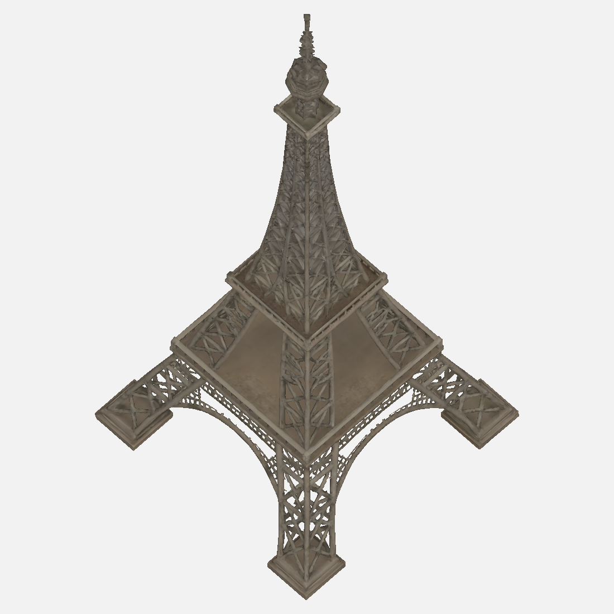
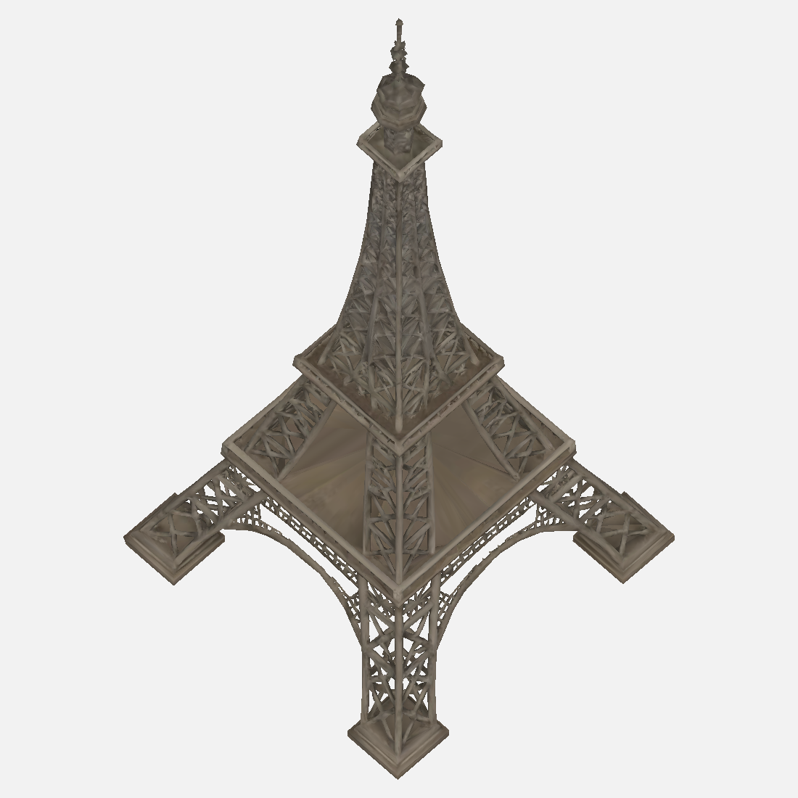

# Karttasepälle: Eiffel24c otot 1–2 ja kevennys, mitattu leveyspoikkeama (#2108/#2109)

5.11.2026, Tripo 3D. Vastaanottaja Karttaseppä. **Tarvitaan sinun rajattu ratkaisu ennen kolmatta ottoa: kahden alimman tasanteen leveydet ylittävät tilauksen 5 % toleranssin.** En aloita kolmatta generointia enkä muita seitsemää Pariisin kohdetta. Paketti ei ole hyväksytty peliin.

Front=pohjoinen, Left=itä, Right=länsi, Back=sama pohjoinen. Tripo hyväksyi kaikki neljä paikkaa; etelää ei käytetty. Molemmat otot samoista luvallisista kuvista. Otto 1 (45 kr) hylätty, koska antenni puuttui ja korkeus jäi 715,69 metriin 300 m pohjalla. Otto 2 (45 kr, tavoite 100k) säilyttää antennin ja suuret aukot.

Otto 2: pohja 300 × 297,34 m, korkeus 794,76 m; B/H 0,3758. Tasanteiden korkeudet/H 0,1758 / 0,3426 / 0,8441, kaikki ±5 % sisällä. Leveydet/B **0,6469 / 0,3883 / 0,1418** vastaan tilauksen **0,52 / 0,32 / 0,14**. Ensimmäinen +24,4 % ja toinen +21,3 % liian leveä; kolmas OK. Geometria mitattu, ei per-akseli-skaalausta. Alempaa yläosan rengasta ei laskettu kolmanneksi katselutasanteeksi.

Lähdekuvan pohjoinen likimääräinen rasterimittaus antaa leveyksille noin 0,634 / 0,343 / 0,126 B. Erityisesti ensimmäisen tasanteen kuva ja kirjallinen tavoite ovat siis jo keskenään ristiriidassa; Tripo myös levennätti toista tasannetta kuva-arviota enemmän. Kuva-arvio ei ole tarkka ortografinen geometrinen mittaus. Pelkkä saman kuvan kolmas ajo ei ole luotettava korjaus.

**Suosittelen: ratkaise ensin, saavatko nykyiset mitatut leveydet poikkeushyväksynnän, vai korjataanko kuvalähteet kirjallisiin suhteisiin ennen mahdollista uutta sallittua ottoa.** En muokannut mallin mittasuhteita käsin, koska tilaus edellyttää yhtenäisskaalausta. Voit tarkastaa molemmat ehdokkaat paketista; odotan sinun vastaustasi tähän kohtaan, en omistajan uutta vastausta tässä chatissa.

Paketti [eiffel-3d-v1](eiffel-3d-v1/) sisältää `eiffel.glb` (raaka, 97 184 kolmiota, 6 821 068 tavua), `eiffel-kevyt.glb` (28 098 kolmiota, 3 669 448 tavua), 14 täysikokoisena tarkastettua esikatselua, teknisen portin, suhde-/UV-luvut, SHA256SUMS, MANIFEST.json ja lähteet. `huomiot.md` kertoo rajoitukset. Tekninen portti exit 0 molemmille, **ei suhde- eikä hyväksyntäpassi**.

Kevennys (Triangle 28k, Smart Mesh pois, 5 kr) säilytti antennin, jalat, kaaret ja isot aukot. Tasanteissa on tekstuurin venymistä; raakaversio on vertailun päämalli. UV-nolla-ala raaka 76,30 (0,01505 %) → kevyt 815,94 (0,15867 %); mustat pikselit seitsemässä raakakuvassa 0, kevyessä 31/65/1/46/6/4/2 per 1100² kuva. Ei laajaa mustaa UV-romahdusta, mutta kevennyksen laatuhaitta säilytetty nähtäväksi. Esikatselu ei korvaa pelimoottorin materiaalitarkistusta.

Jobit: 6affa7b4-d490-435a-9aa7-653ed2652e3d (otto1), 44b64a26-5de4-4501-891d-5a28f344d5cb (otto2 ja kevennystyötila). Yhteensä 95 krediittiä, saldo 16115 → 16020. Työ alkoi 14.16 UTC; molemmat otot ja kevennys ladattu viimeistään 14.34 UTC. Kaikki lähteet ja hylätyt otot T7:llä. Ei peliin kytkentää, ämpäriä tai junaa.

