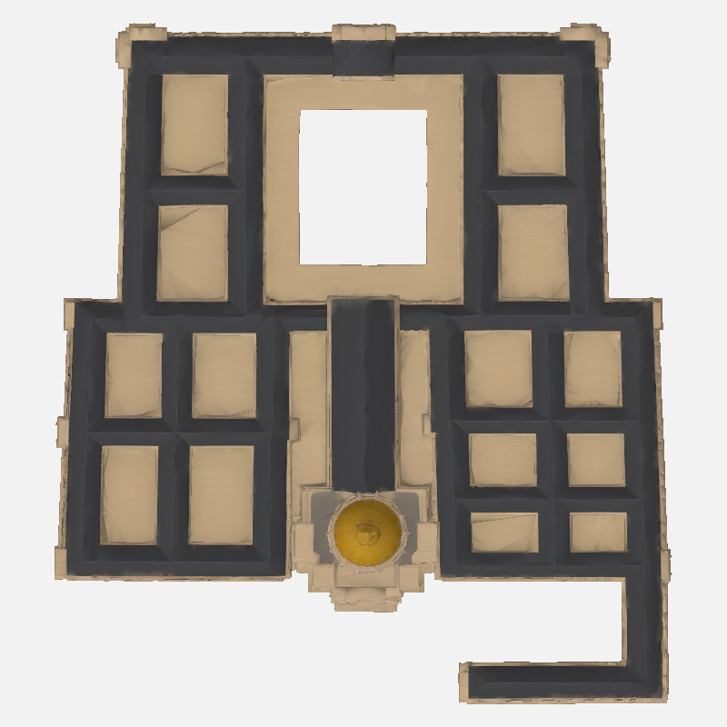
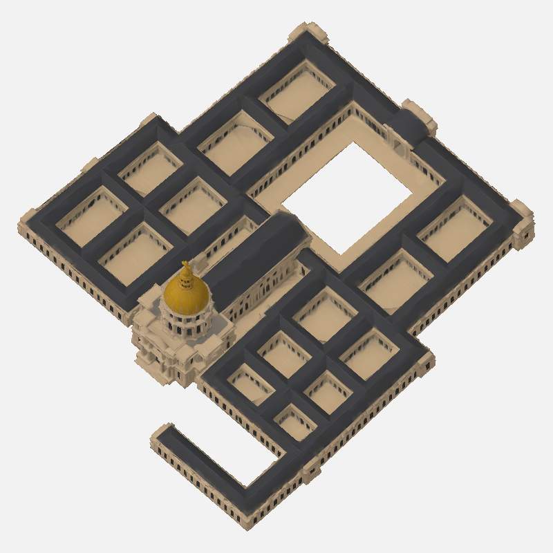

# Karttasepälle ja KK:lle: Invalidit 24l, otto 2

Toisen oton pihajako on nyt oikein: lounaiskortteli 4 pihaa välisiipineen, kaakkoiskortteli 6 ja pohjoisosa kunniapiha + 2 + 2. Kaikki pihat ovat ylhäältä avoimia. Kupoli on +Z, J-siipi +X/+Z, pohjoinen −Z; kultakupoli, lyhty ja risti säilyvät.

Kunniapihan keskeltä puuttuu kuitenkin lattia. Tämä on todellinen geometriassa oleva läpireikä: mallin pystysäteet eivät leikkaa kolmiota yhdeksässä kunniapihan keskialueen näytepisteessä. Pienten pihojen lattiat löytyvät 14/14 näytepisteessä (Y=5.228–5.523 m).

Mitat ovat 363.000 × 142.792 × 400.056 m. H/W=0.3933674 ja L/W=1.1020815, molemmat tilaustoleranssissa (L/W-tavoitteesta −2.4707%). Mallissa on 44,766 kolmiota; UV0-nollapinta-aloja 11 kolmiota, yhteensä 3.38378 m² eli 0.00092095% pinta-alasta. Mustia pikseleitä ei ollut seitsemässä esikatselussa.

Voiko puuttuvan tasaisen kivilattian lisätä paikallisesti tai pelissä, vai haluatteko muun ratkaisun? Suosittelen arvioimaan paikallisen lattiatäydennyksen ennen uutta maksullista ottoa. Tämä materiaali on diagnostiikkaa KK:n päätöstä varten, ei toimitus- tai asennushyväksyntä. En tee kolmatta ottoa, retopoa tai korjausta ennen päätöstänne.

