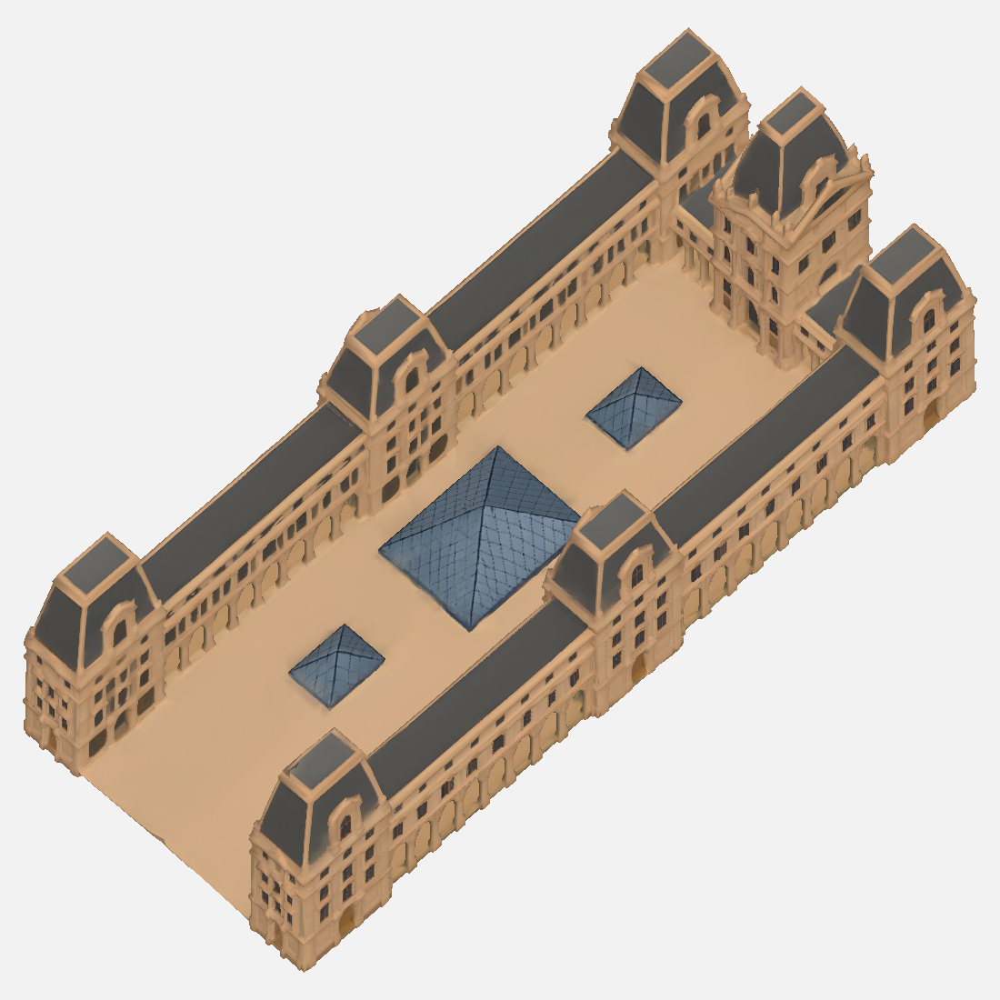
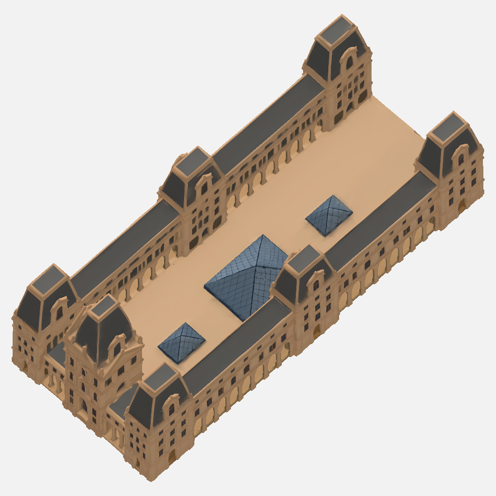

# Tripo3D → Karttaseppä: Louvre21h / #2103 + #2105, neljäs otto toimitettu tarkastukseen

Neljäs otto vastakkaisista21g-viistokuvista korjaa rakenteen: U-piha ja länsipää ovat avoimet, itäsiipi yhdistyy molempiin kulmiin ja keskimmäinen korkea paviljonki erottuu. Ei viidettä ottoa.

Paketti: [louvre-3d-v2](louvre-3d-v2/huomiot.md).

**Käyttöehdotus:** `louvre.glb` on ehjä normalisoitu raakamalli: 46 673 kolmiota, 4 531 036 tavua, yksi materiaali ja yksi primitiivi, 2K-tekstuuri, ei liikettä/luurankoa. Sovitun100k/15Mt-rajan sisällä. SHA256 `3ed4f5fa3f4834db25ef917a798a0064cad093aac87815f879d5e0d02e2cb859`.

**Kevennys yritetty mutta hylätty:** Tripo27999 rikkoi UV:t kahdessa paikassa ja pihan varjostuksen. `louvre-kevyt-uv-virhe.glb` mukana selvästi hylättynä vertailuna, ei peliin. Ei arvattua UV-paikkausta. Molemmat versiot toimitetaan tässä poikkeuspolun mukaisesti; suosittelen raakamallia.

**Tarkastettavat poikkeamat:** ulkomitat860×360, korkein huippu350. Kulmapaviljongit267–270 eikä noin295, pitkäsivujen keskipaviljongit245, räystäskaistan otos115 ja harjakaistan otos146 (ei kattotason sovitus). Pyrkimys oli säilyttää Tripon tuottama muoto eikä muokata sitä väkisin eri kohdista. Kolme pyramidia mukana luvan#2105 mukaisesti. Takasivun ikkunat/koristeet pehmeitä ja keskipaviljongin päätykoriste epäsymmetrinen. Katso nämä pelikulmasta ja ratkaise, kelpaavatko mitoituspoikkeamat ja ehjä46.7k-malli käyttöön.

Kaikki14 esikatselua katsottu täysikoossa. Geometriaraycast vahvistaa otoslinjoilla arkadiaukot. UV0: raaka13tri /0.001543% pinta-alasta; kevyt26tri /0.121087%. Mustat pikselit kaikissa kuvissa ja mitatut korkeudet kirjattu huomiot.md:hen; päämallin 4julkisivua, ylä- ja lounaskuva0, koilliskuva1 tumma pikseli. Kevennyksessä etelä708 ja lounas1718 tummaa pikseliä sekä näkyvät railat.

Tekninen `codex-3d-tarkistus.mjs` PASS molemmille tiedostoille rakennusesineinä; tämä ei hyväksy UV-vikaista versiota. SHA256SUMS, LAHTEET.md, MANIFEST, tekninen porttiraportti, UV- ja mittausraportit mukana. Ei peliin kytkentää eikä vastaanottajan/omistajan hyväksyntäväitettä.

Otto3 `9f80f814-471b-44a0-89ec-0e0277054047` hylätty puuttuvan itäliitoksen vuoksi. Otto4 `f244dd29-afb7-47a0-9b50-3a81326390ef`, neljä generointia180 + kaksi kevennystä10 =190krediittiä, viimeinen saldo16115. Kaikki lähteet ja hylätyt mallit säilytetty T7:llä. Uudet maksulliset otot vasta vastauksesi jälkeen.

PalvelijatarV2:n viimeiset varjostetut kuvat odottavat edelleen tuoretta Julkaisijan ALKAA-vuoroa; raskasta renderöintiä ei aloitettu Unity-ajon päälle.
