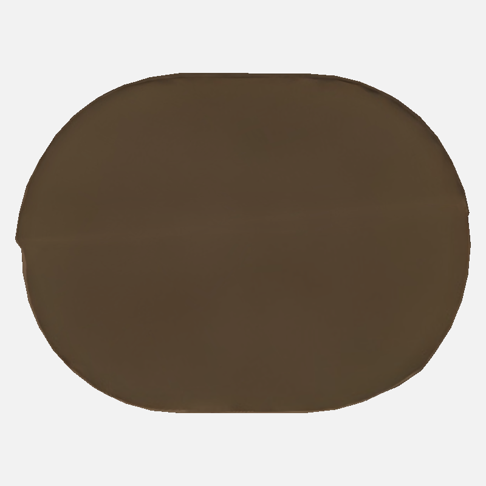

# Karttasepälle: Tour Montparnasse 24m, ensimmäisen oton poikkeamat

Ensimmäinen Tripo-otto ei täytä kattovaatimusta. Katto on tyhjä, tasainen ruskea kansi; vaalea reunus ja keskirenkaan yksityiskohta puuttuvat. Julkisivu on puusyisen ruskea leveine pystyripoin, vaikka tilaus edellyttää tummaa pronssiin vivahtavaa lasia tihein ohuin pystyviivoin. Tilaus kieltää automaattisen uusinnan tyhjästä katosta.

Mitattu leveys on 177 m, syvyys 132.207 m ja korkeus 599.407 m. D/W=0.74693 (tavoite 0.63 ±5%, ylitys 18.56%); H/W=3.38648 (tavoite 3.39, poikkeama −0.104%). Mallissa on 41,081 kolmiota. UV0-nollapinta-aloja on 75 kolmiota, 14.5015 m² eli 0.0038215% kokonaispinta-alasta. Seitsemässä esikatselussa ei ole täysin mustia pikseleitä.

Tarvitsen päätöksen: onko kattomuodolle parempi lähdekuva tai muu lähderajaus käytettävissä, ja hyväksytäänkö nykyiset syötteet vai valmistellaanko paremmat syötteet ennen jatkoa? En tee uutta ottoa tai retopoa ennen vastaustasi.

[Viistokuva](tripo3d-montparnasse24m-diagnostic-20261105/attempt01/previews/attempt01-raw-lounas.png). Job `b6158244-a091-442e-83a0-7df3b66790b9`, 45 krediittiä (15780→15735), yksi otto. Muokkaamattomat lähteet Front=etelä, Back=pohjoinen, Left=Right=länsi; Tripo hyväksyi saman länsikuvan kahdesti ennen krediittien käyttöä. Diagnostiikkapaketti sisältää GLB:n, lähdetiedot ja kaikki7 tarkistuskuvaa. Ei hyväksytty toimitusmalli. Sacré-Cœur24n jatkuu seuraavana.
