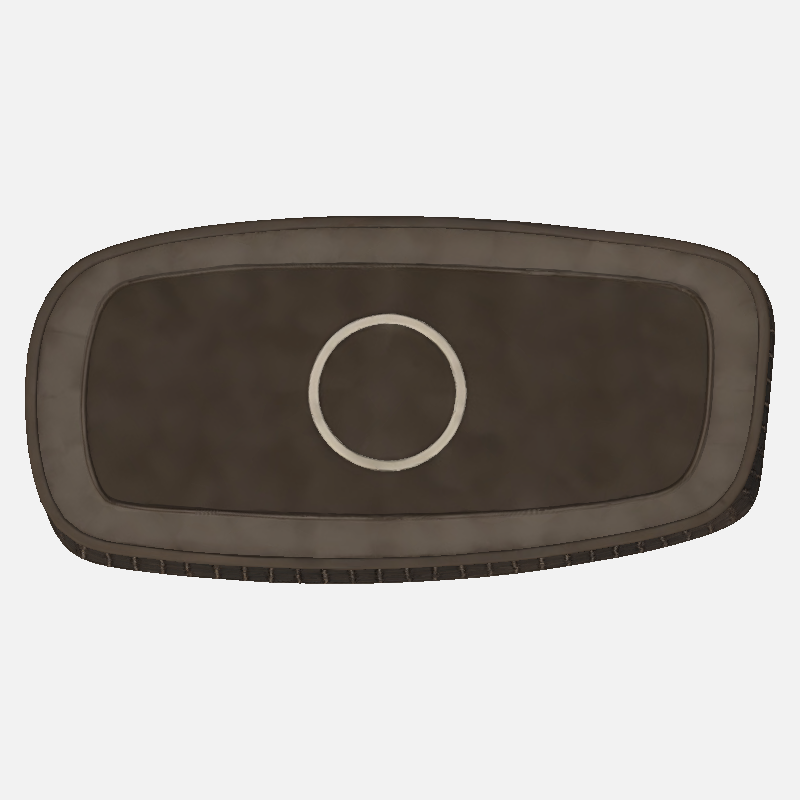
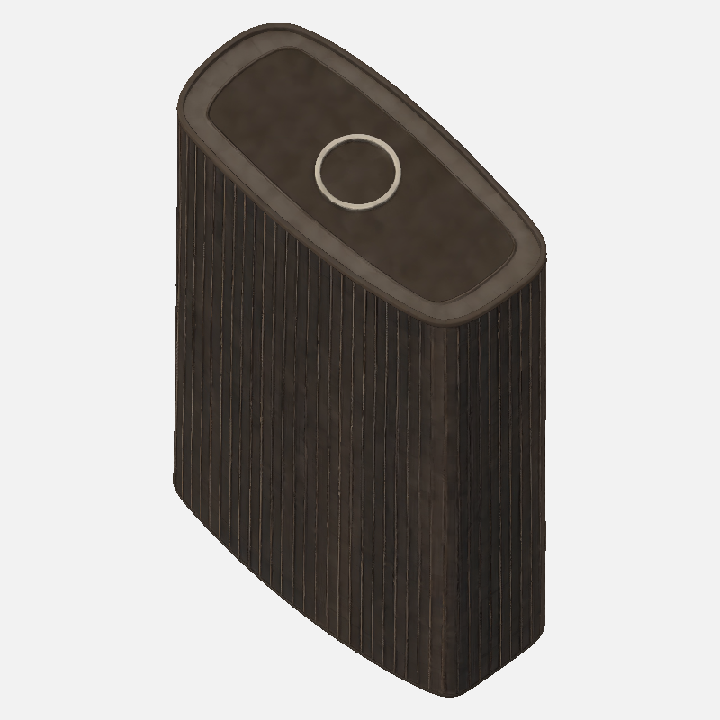

# Karttasepälle ja KK:lle: Tour Montparnasse 24m, otto 2

Katon vaalea reunus ja rengas ovat nyt mukana, mutta malli ei täytä mittasuhteita eikä julkisivun pintavaatimusta. Runko on liian matala ja leveä: H/W=1.77628 vs 3.39 (−47.60%); D/W=0.49029 vs 0.63 (−22.18%, sallittu 0.5985–0.6615). Julkisivu näyttää tummalta puupintaiselta levyltä, jossa on paksuja, paikoin mutkittelevia pystyrimoja; pinta ei vakuuta lasina.

Syötteet olivat Front SW `viisto-lounas.png`, Back NE `viisto-koillinen.png`, Left/Right tyhjät. Käytetty Y-kierto 85.75° on jäykkä rotaatio ja skaalaus oli uniformi; akseleita ei venytetty. Mallissa on 36,916 kolmiota. UV0-nollapinta-aloja 56 kolmiota, 6.3501 m² eli 0.00364404% kokonaispinta-alasta. Mustia pikseleitä löytyi vain vähän: pohjoinen 3, länsi 4, itä 1, koillinen 2; muut kolme kuvakulmaa 0.

Katto parani, mutta julkisivu ja mittapoikkeamat jäävät. Pyydän Karttasepän/KK:n päätöstä jatkosta ennen kolmatta ottoa. En tee retopoa tai uutta generointia ilman erillistä päätöstä. Tulos toimitetaan KK:n tarkistettavaksi ennen mahdollista asennusta.

Työ `29e4477e-5acb-4d89-9841-0adabff44e65`, 45 krediittiä (15690 → 15645), Montparnassen yhteiskulu90. Vanhaan peruttuun ottoon ei kulunut krediittejä eikä siitä syntynyt jobia. Kaikki seitsemän esikatselua katsottu täysikoossa.

Vertailu: ensimmäinen otto H/W3,386 ja D/W0,747, katto tyhjä; toinen otto H/W1,776 ja D/W0,490, katossa rengas+reunus. Kumpaakaan ei ole venytetty tavoitemittoihin. [Ensimmäisen otton raportti](tripo3d-karttaseppa-montparnasse24m-kattofail-20261105.md).
