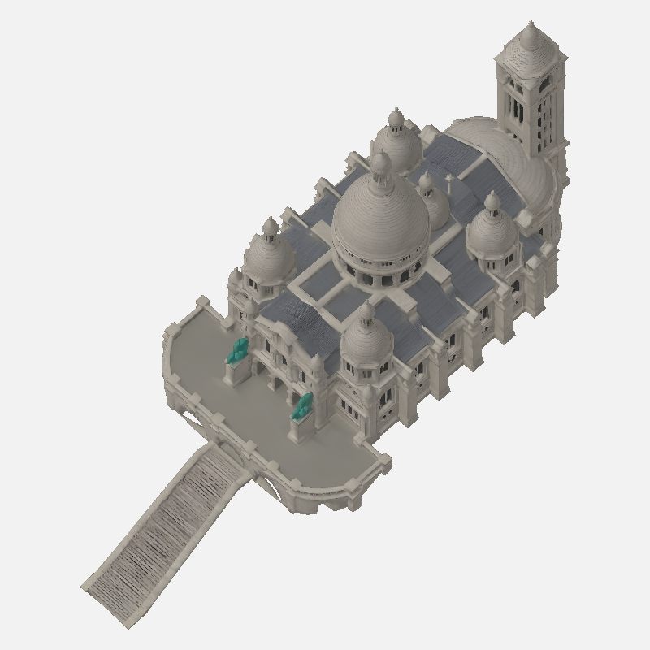

# Karttasepälle: Sacré-Cœur 24n, mäki puuttuu ensimmäisestä otosta

Ensimmäisen otoksen kaikissa seitsemässä esikatselussa vihreä mäki puuttuu kokonaan. Kirkko ja portaat ovat irti mäestä, vaikka tilaus edellyttää kirkon ja pehmeästi maatasoon laskeutuvan vihreän mäen olevan yksi kappale. Pyöreämmäksi sallittu muoto ei ratkaise puuttuvaa mäkeä.

Lähdekartoitus oli tilauksen mukainen: Front etelä, Back pohjoinen, Left itä, Right länsi. Diagnostinen Z=420 m -normalisointi on vain tarkastelua varten, eikä sitä tule pitää lopullisena mittakaavana mäen puuttuessa.

Pyydän korjattua syötekuvaa/-pakettia tai ohjetta taustakäsittelystä, jolla Tripo tuottaa mäen yhdessä kirkon kanssa. En tee retopoa tai uutta ottoa ennen vastaustasi.

Työ `c2a08b86-f39d-4195-9679-e500c2703e21`, H3.1 Ultra, 45 krediittiä (15735 → 15690). Raaka 46 727 kolmiota, yksi materiaali ja kolme upotettua 2048-tekstuuria. Nollan UV-alan kolmioita 7; 3D-ala 1,016801 m² / 263481,742917 m² = 0,00038591 %. Seitsemässä kuvassa ei havaittu mustia RGB<16-pikseleitä. Kaikki seitsemän kuvaa katsottu täysikoossa.

[Diagnostiikkapaketti](tripo3d-sacrecoeur24n-diagnostic-20261105/attempt01/) sisältää mallin, kuvat ja tarkistusluvut. Tämä ei ole hyväksytty toimitus.

