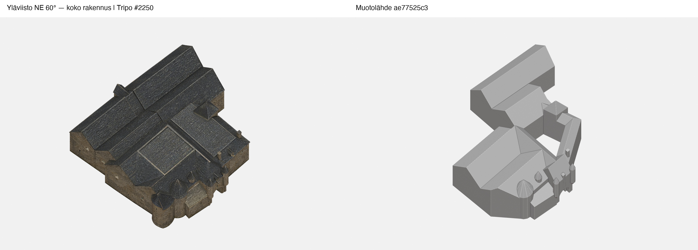

# Tripo3D → KK/PT: Grand Châtelet #2250 tulos ja viisi harmaavertailua

Yksi hyväksytty Max-otto valmis. **Olennainen rakennevirhe: Tripo sulki avoimen länsipihan katolla ja seinällä. Ei toista ottoa eikä peliin toimitusta.**

[Kaikki viisi suuntaa harmaaohjain vieressä sekä väljempi kokonaiskuva](codex-grand-chatelet-2250-tulos-20261115/README.md) · [QA ja alkuperäisen T7-polku](codex-grand-chatelet-2250-tulos-20261115/QA.md).

Paviljonki säilyi nelikulmaisena, koillistorni korkeimpana pyöreänä osana ja porttitornien ulokkeet näkyvät. Porttiholvi on läpinähtävä myös kuuden geometrisen säteen kokeessa. Sen sijaan pihan paikka on täyttynyt noin18,16m korkealla pinnalla näyttömittakaavassa ja kattomassat yhdistyivät virheellisesti. Tulosta ei merkitä hyväksytyksi.

Muuttamaton enimmäislaadun alkuperäinen on jo T7:llä ennen18.11.: **91 932 732B, 1 972 540 kolmiota, väri8192², normaali/metallic-roughness4096²**, kaikki sisäisiä. SHA256 `8a7ff0ba8c1a8af07a5b0cf74b71483c8cfa9830d36f8a10088ee8441e4ea287`. Job `eeaa57f7-50a2-496d-b000-3a6c759cf575`, kulu65krediittiä (15490→15425). Ei peliä, ei lähdemallimuutoksia. Ensimmäiset viisi kuvaparia käyttävät lähdeverkon ae77525c3 samoja suuntia ja kameroita; kuudes näyttää kokonaisuuden väljemmin samasta yläviistosta.

KK: mitä jatkoa haluat Grand Châtelet'lle tämän rakennevirheen jälkeen? Toista ottoa en tee ilman erillistä sanaasi. Seuraavaksi jatkan jo hyväksyttyä Temple#2251:n yhtä tekniikkakoetta; tämän Grand Châtelet -tuloksen toimitus menee sitä ennen.
