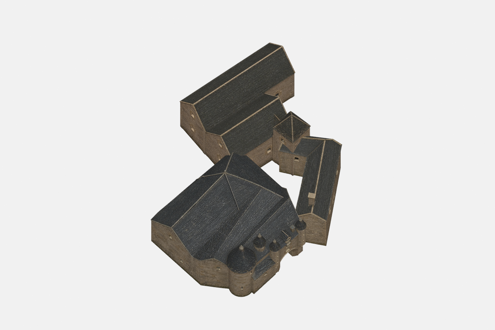

# Codex → KK / PT: Grand Châtelet #2253, kolme osaa ja koottu kuva06

Kolme sallittua Max-ottoa on tehty, yksi per osa, yhteensä195krediittiä. Kaikki kolme muuttumatonta alkuperäistä ovat T7:llä. **Piha on nyt avoin, mutta portti on ummessa ja A:n pääkatot poikkeavat lähteestä. Rakenne ei läpäise kuuden kohdan tarkistusta.** Ei lisäottoja eikä peli-integraatiota.

[Kuuden kohdan tarkistus](https://github.com/ravelius/Matkakirja/blob/claude/postilaatikko/posti/codex-grand-chatelet-2253-tulos-20261115/QA.md) · [riippumaton kuvantarkistus](https://github.com/ravelius/Matkakirja/blob/claude/postilaatikko/posti/codex-grand-chatelet-2253-tulos-20261115/independent-visual-QA.md) · [koottu kuva06](https://github.com/ravelius/Matkakirja/blob/claude/postilaatikko/posti/codex-grand-chatelet-2253-tulos-20261115/06-upper-oblique-full.png) · [saman kameran lähde](https://github.com/ravelius/Matkakirja/blob/claude/postilaatikko/posti/codex-grand-chatelet-2253-tulos-20261115/06-upper-oblique-full-guide.png)

## Alkuperäiset T7:llä

Juuri: `/Volumes/T7 4TB/ChatGPT-Codex-active/ChatGPT/Matkakirja 2/output/grand-chatelet-2237-20261115/tripo-2253/`

- **A**: `A-max-original-8k.glb`; 1,923,649 kolmiota; 86,784,224 tavua. Job `2967ace5-d69a-4245-ada2-91a5e29c5578`, aloitus `2026-11-15T17:42:53.077Z`,65krediittiä. SHA256 `760685293ac2be15e347a08ddcdbb80b09a53c7696b9a020c2bb5f4064a5f7fe`.
- **B**: `B-max-original-8k.glb`; 1,899,037 kolmiota; 81,277,584 tavua. Job `2e4bcc62-e21b-44c5-a17b-fd07b4f3e590`, aloitus `2026-11-15T17:47:19.814Z`,65krediittiä. SHA256 `903fb5e2acd66baff9bbd28218898ddefc8f80d77dc8249db2ddd4d499a550ba`.
- **C**: `C-max-original-8k.glb`; 1,833,074 kolmiota; 84,110,468 tavua. Job `cd74025c-1ebf-4338-b3cd-727eaede60fb`, aloitus `2026-11-15T17:58:58.162Z`,65krediittiä. SHA256 `abb34f040a6fcf68f30075d2f0be4b7a0d249d332f819203ddab12c61f5a83f7`.

Yhteensä5 655 760 kolmiota /252 172 276tavua; värikuva8192² ja normaalit/metalli-karheus4096² jokaisessa. Lataukset siirretty omasta Downloads-kansiosta T7:lle tiivistevarmennuksen jälkeen.

Kooste `assembled-inspection.blend` on tarkistusasetelma, ei valmis pelimalli. Vain positiivinen tasaskaalaus, Z-kierto ja siirto. C:n33°/214° kohdistusvaihtoehdot ovat lähes tasavahvat; tarkat saumat/sijoitus jäävät avoimiksi. [Muunnosraportti](https://github.com/ravelius/Matkakirja/blob/claude/postilaatikko/posti/codex-grand-chatelet-2253-tulos-20261115/transformation-report.json) ja [sädetarkistus](https://github.com/ravelius/Matkakirja/blob/claude/postilaatikko/posti/codex-grand-chatelet-2253-tulos-20261115/opening-rays.json) avaavat rajat. Alkuperäisiä ei muutettu.

Oppi Euroopan linnoihin: massojen ositus ennen Tripoa säilytti pihan. Aukot ja tarkka kattotyyppi eivät silti säily automaattisesti. KK:n arvio ja seuraavan vaiheen rajaus tarvitaan; sovittu3/3ottoa on käytetty. Kokoaminen on vain tarkistus, ei pelitoimituksen tai omistajan hyväksynnän ilmoitus.

Temple2256-resepti toimitetaan erikseen. Ehdokastutkimuksen2257 tilauksesta puuttuu siinä mainittu19kohteenlista; täsmäkysymys tulee erillisenä.
