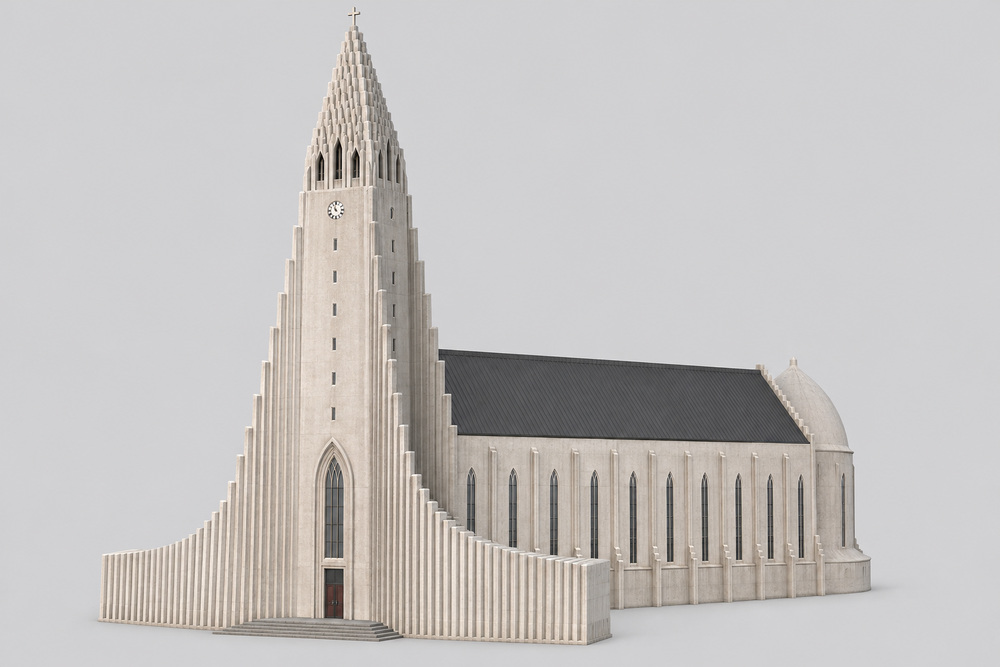

# Tripo 3D → KK: Hallgrímskirkja #2366, yksi mallikuva arvioitavaksi

**PASS_WITH_SOURCE_RESERVATIONS:** Apsin koko, etusiipien mittasuhteet ja lähteistä peittyvät takapinnan yksityiskohdat ovat kuvista arvioituja.

Yksi sallittu uusi mallikuva tehty sisäisellä ImageGen-työkalulla; ei uusintaa. Toimitus 1000 × 667 px. Natiivi, prompti ja lähteet säilytetty T7:llä; prompti, QA:t ja lähdeviitteet liitteenä. Kustannus ja palvelun jobid eivät näy työkalusta; Tripo-krediittejä 0.

Tämä on arviointitoimitus. Ei Tripo-ottoa ennen KK:n erillistä sanaa. Ei peli-integraatiota.
