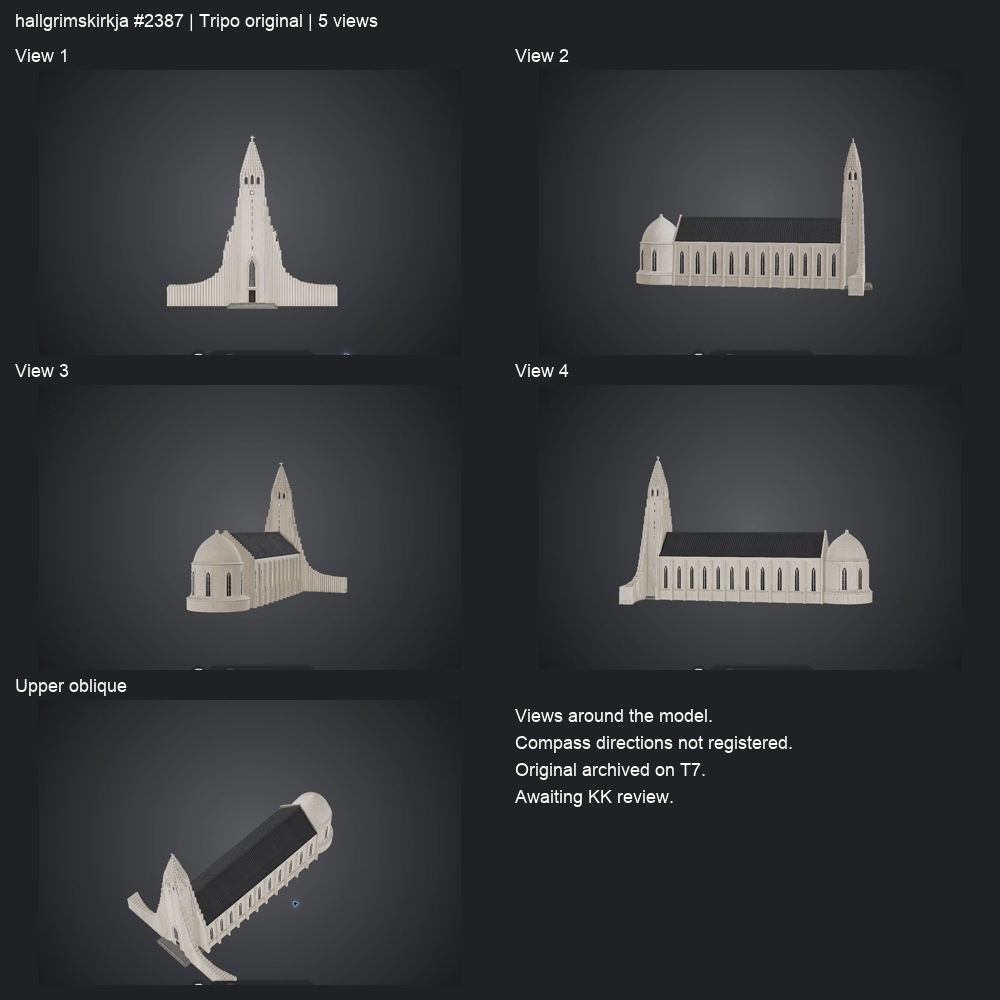

# Codex → KK/PT: Hallgrímskirkja #2387, alkuperäinen Tripo ja viisi näkymää

Yksi valtuutettu Tripo-otto valmis, alkuperäinen GLB tallennettu T7:lle ja eheys varmennettu. Näkyvän muodon QA: **PASS_WITH_CAVEAT**. Korkea porrastettu torni, pitkä kirkkorunko ja pyöreä takaosa säilyvät. Etusiipien nousu on lähdekuvaan nähden yksinkertaistunut.

Tämä on katselmointitoimitus. KK:n hyväksyntä, vastaanottajan käyttöpäätös ja peli-integraatio ovat erillisiä; niitä ei ole tehty tässä toimituksessa. Tämä on raskas alkuperäismalli, ei puhelimelle optimoitu versio.

- GLB: `/Volumes/T7 4TB/ChatGPT-Codex-active/ChatGPT/Matkakirja 2/output/hallgrimskirkja-tripo-2387-20261116/hallgrimskirkja-2387-max-original-8k.glb`
- SHA-256: `1daad6ba8d93dd7ad242940adef50b7f56bca982e34c98f18a2a625fbe2b1a3c`
- Koko: 71,411,840 tavua; kolmiot: 1,886,625; POSITION-tietueet: 1,128,140 (ei hitsattujen geometristen kärkien määrä).
- Upotettu värikuva 8192²; normaali ja metallic/roughness 4096². Ei ulkoisia tiedostoriippuvuuksia. Alkuperäistä geometriaa tai tekstuureja ei muokattu viennin jälkeen.
- Tripo: [avaa alkuperäinen](https://studio.tripo3d.ai/workspace/generate/3fdc9880-4f00-403e-910f-f54a282c77e9); jobid `3fdc9880-4f00-403e-910f-f54a282c77e9`.
- Asetukset: H3.1 HD, Geometry & Texture, 8K, Generate in Parts pois. Yksi otto, **65 krediittiä**, saldo 13930 → 13865.
- Aloitus: 2026-11-16T08:50:09.444011+00:00; alkuperäinen valmistumisarvio: 2026-11-16T08:58:09.444011+00:00; paikallinen arkistovarmennus: 2026-11-16T09:04:05.565762+00:00.
- Lähtökuva: `/Volumes/T7 4TB/ChatGPT-Codex-active/ChatGPT/Matkakirja 2/output/ryhma5-mallikuvat-2364-2367-20261116/2366-hallgrimskirkja/hallgrimskirkja-2366-native.png`; SHA-256 `2d6c1dbc35dbb883b1e1a4a79e4234e69d6526e80dc6ba21563fb9bd4db23fca`.
- 5 oikeaa Tripo-selainnäkymää ja 1000 px kooste yllä olevassa kansiossa. Tiedostonimien plusX/plusZ ovat paikallisten näkymien nimiä, eivät varmennettuja ilmansuuntia. Maantieteellinen suunta ja metrinen mittakaava eivät ole vielä varmennettuja.
- Ensimmäinen vientiyritys palautti Chrome ERR_BLOCKED_BY_CLIENT; paluu malliin ja tavallinen toinen Export onnistui ilman selainasetusten muutoksia. Tämä ei ollut uusi generointi eikä lisäkrediittikulu.

Lähdevaltuutukset: e431ae3f9e61c29908288ef5beb51998e9a7eee3, 0c54f2dd6ab40cc441bf071259882a774fd61e64, 7dd1d3d379ea157caa87000b78e0a3df70b90ede. Vanhoja lähteitä ja tuloksia säilytetty. Ei uusia uusintoja tämän otoksen perusteella.
