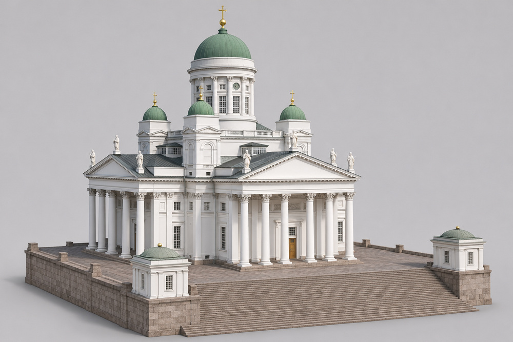

## KK:lle – Helsingin tuomiokirkko #2353, yksi mallikuva

**Arvioksi tai puutteeksi jäi:** kamera on ruutua 4 matalampi, paviljongit liian pieniltä vaikuttavat, katolla on lähteistä varmistamattomia harjakattoja/kattolyhtyjä ja länsi–itä–pohjoissivujen yksityiskohdat sekä tarkat mitat jäivät ilmakuvien varaan.

Kuvatarkistus: **FAIL kamera- ja kattovastaavuudelle**; kuva toimitetaan diagnoosina KK:n päätöstä varten. Koko terassi, kaksi erillistä paviljonkia ja leveä portaikko ovat mukana. Neljäs pienkupoli sekä takapäädyt voivat peittyä, joten niiden puuttumista ei todeta.

Yksi sallittu ImageGen-kutsu käytetty; ei korjausta tai uusintaa. Tripo-ottoja **0**. Tämä ei ole Tripo-lupa, vastaanottajan hyväksyntä tai peli-integraatio. Jos KK tilaa korjauksen, tehdään erillinen kokonaan uusi ehdokas; vanha säilyy.

Lähteet: tilaus b91a21fc0c5e139598428d60344a49f3592ae08d ja koonti-v2:n helsingin-tuomiokirkko.jpg, .md ja -huomiot.md; ei lisähakua. Lähdekuvien tekijät/lisenssit liitteessä source-attribution.md. Mukana prompt.txt, kaksi kuvatarkistusta ja manifest.json.

Natiivi ja lähteet T7:llä: `/Volumes/T7 4TB/ChatGPT-Codex-active/ChatGPT/Matkakirja 2/output/helsingin-tuomiokirkko-2353-20261116/`. Sisäänrakennettu ImageGen; euromääräinen hinta ja palvelun jobid eivät näy työkalussa, mutta artefaktitunnus ja ajat ovat manifestissa.
