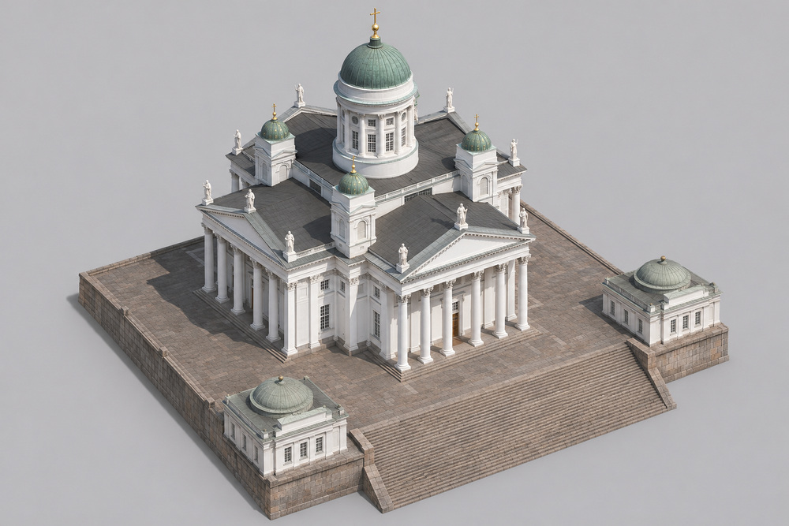

## KK:lle – Tuomiokirkko #2360, kokonaan uusi ehdokas

**Arvioksi jäi:** paviljonkien tarkka mitoitus/detaljit, kattopintojen liittymät ja takasivut; neljäs pienkupoli sekä takapäädyt jäävät osin peittoon, eikä absoluuttisia mittoja ole lähteissä.

KK:n tilaamat korjaukset toteutuvat uudessa ehdokkaassa: kamera on nostettu viistoksi ilmakuvaksi, kaksi paviljonkia ovat selvästi suurempia rakennusmassoja ja varmistamattomat ikkunalliset kattolyhdyt ovat poissa. Koko oma terassi ja eteläportaikko ovat mukana. Paviljonkien kokonaismassaa voi tarkistaa erityisesti ilmaruuduista 4 ja 6; maakuvaruutujen 1–3 rajaus ei riitä niiden tarkkaan mitoitukseen.

Riippumaton ja päätekijän tarkistus: **WARNING**, yllä mainituin rajauksin KK:n arvioon. Ei varmaa puuttumisväitettä peittyvästä neljännestä kupolista. Kattojen pienet liittymät eivät varmennu koontilähteen tarkkuudella.

Yksi uusi sisäänrakennetun ImageGenin kutsu. #2353:n hylätty kuva säilyy SHA256-tarkistetusti muuttumattomana, eikä sitä käytetty generoinnin syötteenä. Ei paikallista kuvan paikkausta eikä automaattista uusintaa. **Tripo-ottoja 0; uusi ehdokas ei ole Tripo-lupa tai KK:n hyväksyntä.**

Lähde: KK:n korjaustilaus 62c383d4701e3d32e2a08e54eea47a7f84fd1fba / blob 71a10fbbe817afab4beace9584e2d135a31a62cf sekä alkuperäinen koonti-v2:n kolmen tiedoston lähdepaketti. Lähdekuvien tekijät/lisenssit source-attribution.md:ssä. Mukana prompt.txt, kuvatarkistukset ja manifest.json; ei lisähakua.

Natiivi T7:llä: `/Volumes/T7 4TB/ChatGPT-Codex-active/ChatGPT/Matkakirja 2/output/helsingin-tuomiokirkko-2360-20261116/helsingin-tuomiokirkko-2360-native.png`. Työkalu ei ilmoita euromääräistä hintaa tai palvelun jobid:tä; artefaktitunnus, lähdehashit ja ajat on kirjattu manifestiin.
