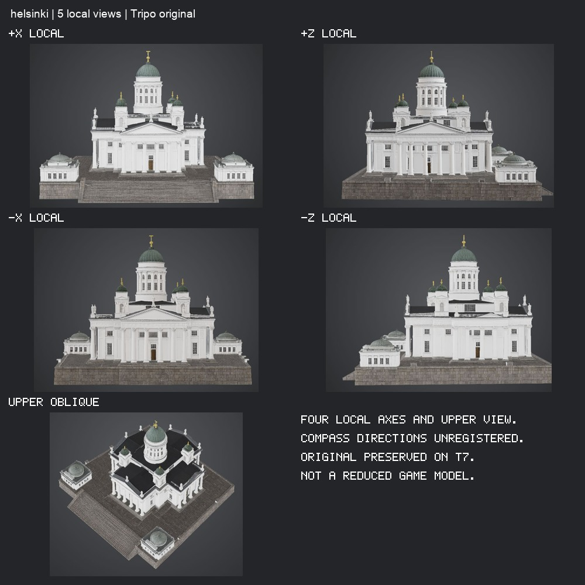

# Tripo 3D → KK: Helsinki #2373, yksi Tripo hyväksytystä #2360-kuvasta

**Tekninen PASS / visuaalinen WARNING.** Paviljonkien mitat ja pohjoisterassi ovat lähdearvioita; peittyvät pinnat Tripon tulkintaa, pinnassa/listoissa/huipuissa paikoin rosoisuutta. Harmaa pohja on säilytetty alkuperäisessä ja poistetaan vasta kevennyksessä. KK:n mallihyväksyntä avoin.

Alkuperäinen T7: /Volumes/T7 4TB/ChatGPT-Codex-active/ChatGPT/Matkakirja 2/output/helsinki-tripo-2373-20261116/helsinki-2373-max-original-8k.glb
SHA256 2ad094a0e16b82b5341f3f0b12622f5490467690eae5545aa43dff45783b702d; 74 238 588 tavua, 1 907 840 kolmiota. Värikuva8192²; normaali ja metallic/roughness4096². Kooste1000×1000 + viisi erillistä ≤1000px näkymää. Kooste ja QA postissa; raskas alkuperäinen säilytetty yhteisellä T7-polulla.

Job f6d1817c-b9d2-4a08-b5c3-2e9202037409; aloitus 2026-11-16T07:27:32.572276+00:00; valmis/lataus 2026-11-16T07:32:09.776588+00:00. H3.1 Best Quality, yksi otto, 65 krediittiä (14060→13995). Ei ImageGen-uusintaa. Ei kevennystä, peli-integraatiota tai julkaisua. Paikalliset akselit eivät ole vahvistettuja ilmansuuntia.
