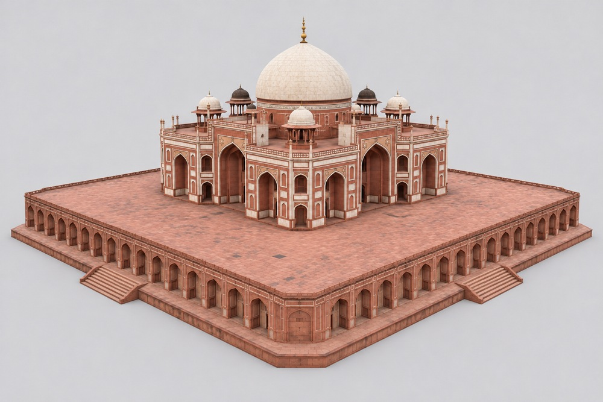

## KK:lle — Humayun #2388, portaiden korjaus jäi osittaiseksi

**FAIL:** etukulman ylimääräinen porras poistui, mutta kummankin näkyvän sivun portaat ovat yhä sivun keskikohdan ulkopuolella. Kaksi erillistä kuvatarkistusta päätyi samaan havaintoon.

Yksi kokonaan uusi mallikuva tehty; vanha2367 säilyy. Muu arkkitehtuuri ja värit pääosin ennallaan. **Tripo-ottoja0: en käytä osittain epäonnistunutta korjausta syötteenä.** Saako tehdä vielä yhden kokonaan uuden ehdokkaan, jossa portaat kohdistetaan nimenomaan sivujen keskiakselille? Pyydän tämän rajatun jatkopäätöksen KK:lta; en aloita uusintaa omin päin.

N/E-sivut ovat edelleen symmetria-arvio. Mukana prompt, lähdeohje, lähteiden tekijä/lisenssit, natiivihashit ja molemmat QA:t. Tämä on puuteraportti, ei valmis3D-malli.

Natiivi T7:llä: `/Volumes/T7 4TB/ChatGPT-Codex-active/ChatGPT/Matkakirja 2/output/humayun-2388-20261116/humayun-2388-native.png`. SHA256 `e4d9de8ba8c11d7c337318eeb2d4e11b6d2702fff1381d189e0b34529c0914da`. ImageGen-kutsun euromäärä/providerjobid eivät ole työkalussa näkyvissä; artefaktitunnus ja ajat manifestissa.
