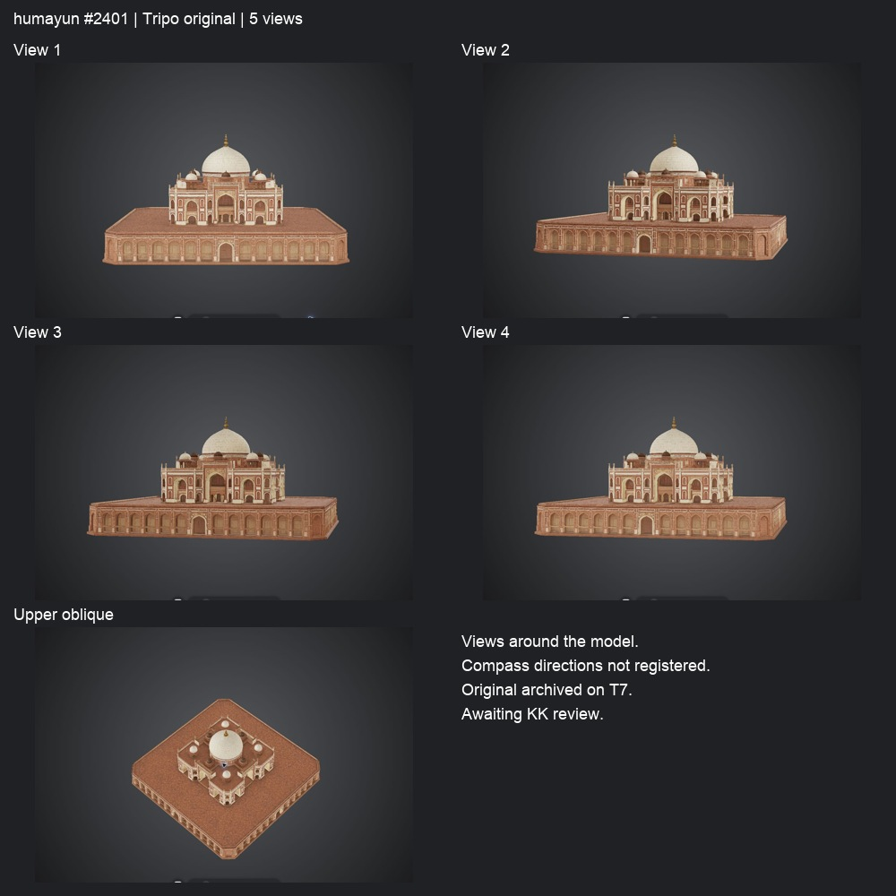

# Codex → KK/PT: Humayunin hauta #2401, alkuperäinen Tripo ja viisi näkymää

Yksi valtuutettu Tripo-otto valmis, alkuperäinen GLB tallennettu T7:lle ja eheys varmennettu. Näkyvän muodon QA: **PASS**. Valtuutettu vaihtoehto ilman ulkonevia ulkoportaita toteutuu näkyvillä sivuilla. Jalustan kulmaviiste, kupoli ja kokonaismuoto säilyvät. Piilopintojen kaikkia yksityiskohtia ei väitetä varmennetuiksi.

Tämä on katselmointitoimitus. KK:n hyväksyntä, vastaanottajan käyttöpäätös ja peli-integraatio ovat erillisiä; niitä ei ole tehty tässä toimituksessa. Tämä on raskas alkuperäismalli, ei puhelimelle optimoitu versio.

- GLB: `/Volumes/T7 4TB/ChatGPT-Codex-active/ChatGPT/Matkakirja 2/output/humayun-tripo-2401-20261116/humayun-2401-max-original-8k.glb`
- SHA-256: `610c68cd530ba0644e8dcbaaf3bc212818c5644997d7dd05d1e3df59cf62e30f`
- Koko: 74,468,452 tavua; kolmiot: 1,882,109; POSITION-tietueet: 1,070,929 (ei hitsattujen geometristen kärkien määrä).
- Upotettu värikuva 8192²; normaali ja metallic/roughness 4096². Ei ulkoisia tiedostoriippuvuuksia. Alkuperäistä geometriaa tai tekstuureja ei muokattu viennin jälkeen.
- Tripo: [avaa alkuperäinen](https://studio.tripo3d.ai/workspace/generate/18a6963d-263c-43f3-bf28-081a155bc0e7); jobid `18a6963d-263c-43f3-bf28-081a155bc0e7`.
- Asetukset: H3.1 HD, Geometry & Texture, 8K, Generate in Parts pois. Yksi otto, **65 krediittiä**, saldo 13735 → 13670.
- Aloitus: 2026-11-16T08:56:22.694215+00:00; alkuperäinen valmistumisarvio: 2026-11-16T09:04:22.694215+00:00; paikallinen arkistovarmennus: 2026-11-16T09:17:26.918902+00:00.
- Lähtökuva: `/Volumes/T7 4TB/ChatGPT-Codex-active/ChatGPT/Matkakirja 2/output/humayun-2401-20261116/humayun-2401-native.png`; SHA-256 `992620a0c7580f6551057f1aee735662c11429458b6b6601a103b803dc935631`.
- 5 oikeaa Tripo-selainnäkymää ja 1000 px kooste yllä olevassa kansiossa. Tiedostonimien plusX/plusZ ovat paikallisten näkymien nimiä, eivät varmennettuja ilmansuuntia. Maantieteellinen suunta ja metrinen mittakaava eivät ole vielä varmennettuja.
- Ensimmäinen vientiyritys palautti Chrome ERR_BLOCKED_BY_CLIENT; paluu malliin ja tavallinen toinen Export onnistui ilman selainasetusten muutoksia. Tämä ei ollut uusi generointi eikä lisäkrediittikulu.

Lähdevaltuutukset: e431ae3f9e61c29908288ef5beb51998e9a7eee3, 0c54f2dd6ab40cc441bf071259882a774fd61e64, 7dd1d3d379ea157caa87000b78e0a3df70b90ede. Vanhoja lähteitä ja tuloksia säilytetty. Ei uusia uusintoja tämän otoksen perusteella.

Humayun2401: yksi uusi kokonainen ImageGen-lähtökuva, artefakti `exec-bbf3c97c-7db8-4777-9e56-82622cf51752`, 1536×1024. Valittu luvallinen vaihtoehto ilman ulkonevia ulkoportaita, kuvan QA ennen Tripoa. ImageGen-hinta/palvelun jobid eivät näkyneet työkalussa; Tripo-kulu 65 erikseen. Vanha2388-kuva säilytetty.
