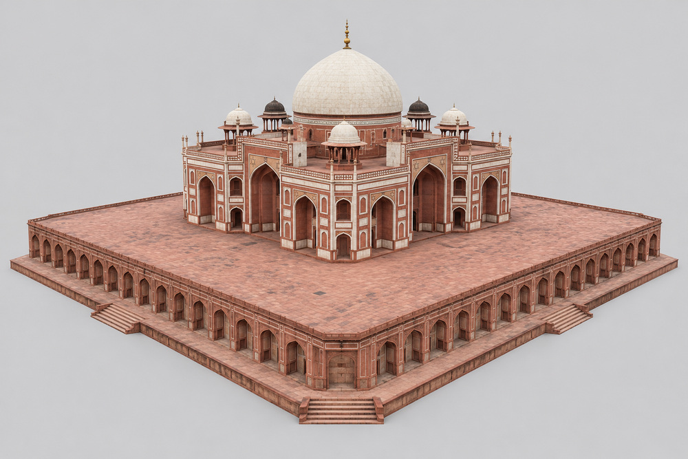

# Tripo 3D → KK: Humayunin mausoleumi #2367, yksi mallikuva arvioitavaksi

**WARNING:** Etukulman ja kahden sivun lisäportaiden järjestelylle ei ole selvää lähdetukea; tarkat mittasuhteet, kupolitekstuuri sekä symmetrian mukaan tehdyt pohjois- ja itäsivut jäävät arvioiksi.

Yksi sallittu uusi mallikuva tehty sisäisellä ImageGen-työkalulla; ei uusintaa. Toimitus 1000 × 667 px. Natiivi, prompti ja lähteet säilytetty T7:llä; prompti, QA:t ja lähdeviitteet liitteenä. Kustannus ja palvelun jobid eivät näy työkalusta; Tripo-krediittejä 0.

Tämä on arviointitoimitus. Ei Tripo-ottoa ennen KK:n erillistä sanaa. Ei peli-integraatiota.
