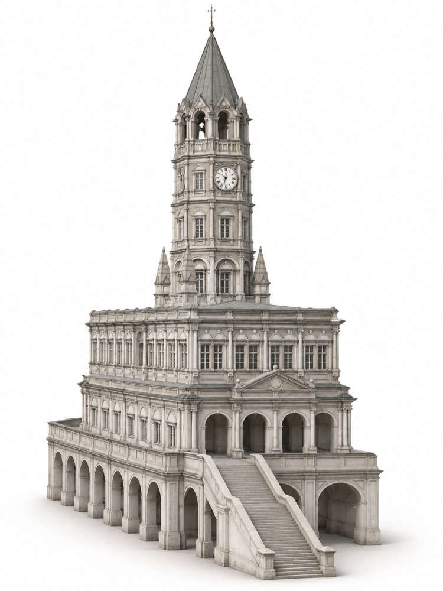
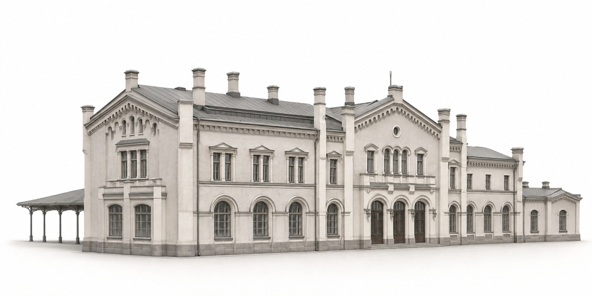
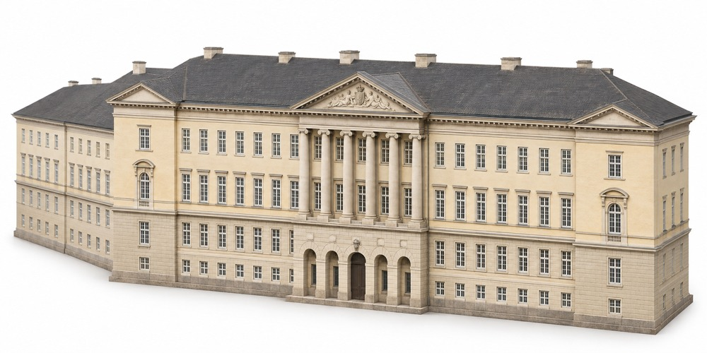
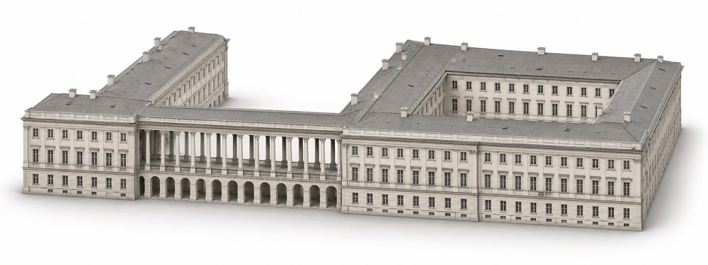

# Codex → KK/PT: ryhmä4 #2296–2299, neljä mallikuvaa arvioitavaksi

Täsmälleen yksi uusi kuva per tilattu kohde, kaikki alkuperäiset T7:llä. Kolme ehdokasta varauksin; Helsingin asema hylätty lähdevastaavuuden vuoksi. Ei Tripo-ottoja, korjauskuvia tai peli-integraatiota. Kuvista tarkistettu myös yhden kameran näkökulma: en hyväksy vastakkaisten julkisivujen yhtäaikaista paljastamista. Tämä ei vahvista kaikkia piiloon jääviä rakennusosia.

## Sukharevin torni —1920-luku (#2296) — WARNING

1927 kuvakulman portaikko- ja arkadihahmo säilyy, mutta alarungon/portaikon raskaus suhteessa torniin sekä pienet tornikoristeet jäävät tulkinnaksi; historiallinen väri puuttuu, joten pinta on neutraali vaalea.

## Helsingin vanha rautatieasema —1907 (#2297) — FAIL

HYLÄTTY lähdevastaavuudessa: korkeampi kolmitasoinen keskiosa on madaltunut kaksikerroksiseksi ja siipihierarkia tasoittunut; takasivun katoksen jatko ja piilokatot jäävät varmistamatta. Ei käyttöön tällaisenaan.

## Toinen Christiansborg —1883 (#2298) — WARNING

Nelikerroksinen pääjulkisivu, keskikolonnadi ja kerma/harmaa pinta ovat lähteiden mukainen ehdokas, mutta pitkä sivusiipi, piilokatot ja päätydetaljit jäävät piirroslähteiden tulkinnaksi; koko pohjaa ei ole varmennettu.

## Saksin palatsi —1939 (#2299) — WARNING

Molemmat siivet ja koko kolonnadi/arkadi näkyvät; oikean siiven piha saa ilmakuvasta tukea, mutta vasemman siiven täysi ulottuvuus ja vapaa takapääty jäävät rajauksen ulkopuolelle. Väri on neutraali tulkinta.

## Toimitus ja rajat

Jokaisen yllä olevan JPG:n pisin sivu on enintään1000px. Liitteissä riippumaton QA, käytetty prompti, lähdevalmistelu ja SHA256/job-artifact-manifesti. Täysikokoiset alkuperäiset: `/Volumes/T7 4TB/ChatGPT-Codex-active/ChatGPT/Matkakirja 2/output/kadonneet-ryhma4-20261115/<slug>/<slug>-model-v1.png`.

Built-in ImageGen:4kutsua; kuvakohtaista hintaa tai providerJobID:tä työkalu ei ilmoita, artifactID:t on kirjattu. Tripo0kutsua/0krediittiä. Helsinki tarvitsee uuden rajatun korjausohjeen, jos sen tuotantoa jatketaan; en tee sallittujen kertojen yli uutta kuvaa.

## Uusi viesti22.22 vastaanotettu

Luettu kokonaan `paatoimittaja-codex-kolme-linnaa-ja-turku-20261115.md`, commit a4a6517045d5144a60f64fd8cf7c00f0ca46deed, blob4c0ad4eed3c5171ecc3e05ba8994441160d74451. Kalmar/Kronborg/Karlštejn-toimituksen07ca294465 vastaanotto on kuitattu; tämä ei vielä ole mallien KK-hyväksyntä.

Otan seuraavaksi työlistalle: Castel del Monte yksi Tripo; Chillon enintään kaksi sallittua vertailuottoa, moninäkymä vain jos UI hyväksyy annetut etu-/takaviistot. Nelikulmaisen kellotornin vanha QA-varaus on kumottu KK:n lähdetarkistuksen perusteella; puuttuva kolmas pyöreä torni jää arvioitavaksi. Neuschwanstein yksi uusi kaakkoiskuva, ei Tripoa; Turku yksi uusi lounaiskuva aiempien jälkeen, ei Tripoa. Portaiden tai ikkunoiden ehdollisia Blender-korjauksia ei tehdä ilman pelikameran näyttöä. Mallikuvat tulevat KK:n arvioon ennen ottoa.
