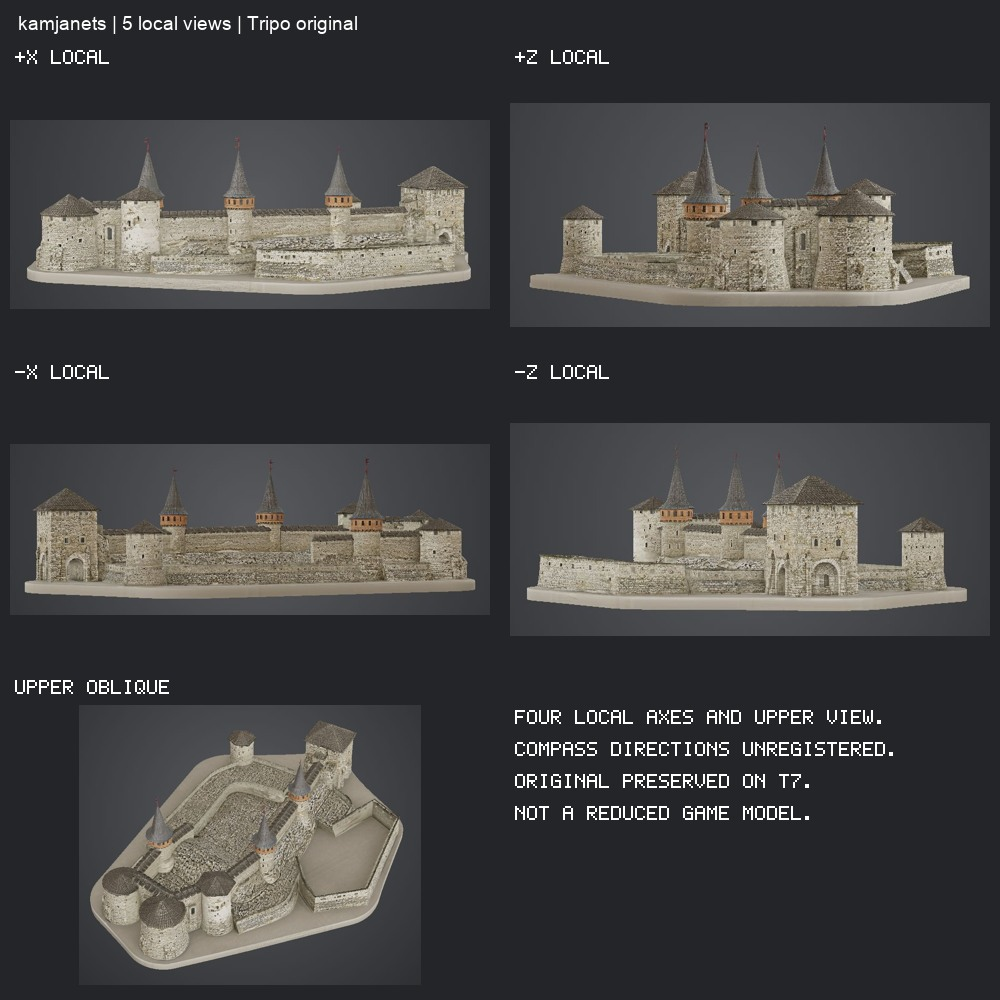

# Tripo 3D → PT/KK: Kamjanets #2344, alkuperäinen ja viisi katselusuuntaa

Yksi #2344:ssä sallittu Tripo-otto on valmis samasta hyväksytystä #2328-kuvasta. Alkuperäinen GLB on tallennettu ja SHA256 tarkistettu T7:llä. Tämä on toimitus KK:n arvioon, ei hyväksyntä, kevennetty pelimalli tai peli-integraatio.

## Katselmointi

**Visuaalinen WARNING, tekninen PASS.** Päätarkistaja ja riippumaton apuagentti katsoivat kaikki viisi näkymää ja lähtökuvan.

Etelän pääsiluetti ja e:n seinäväli säilyvät. Yläviistossa näkyy kattamaton kivinen keskialue, porrastettuja muurikulkuja sekä erillinen matalamuurinen avoin alue. Pohjoiskehä, tornien sijoittuminen syvyyssuunnassa ja näiden tasojen tarkka pohja ovat matalan yksikuvasyötteen täydentämistä. Pihaa ei ilmoiteta katetuksi, mutta sen historiallisuutta tai kaikkien tasojen funktiota ei vahvisteta. Lännen a/b-välin lisätornimainen osa oli jo hyväksytyssä syötteessä; sama lähdevaraus säilyy. Vaalea alusta jää alkuperäiseen ja poistetaan vasta kevennyksessä.

[Riippumaton QA](codex-kamjanets-tripo-2344-20261115/qa-independent.md) · [päätarkistus](codex-kamjanets-tripo-2344-20261115/qa-root.md) · [manifesti](codex-kamjanets-tripo-2344-20261115/manifest.json).

## Alkuperäinen ja jäljitettävyys

- T7: `/Volumes/T7 4TB/ChatGPT-Codex-active/ChatGPT/Matkakirja 2/output/kamjanets-tripo-2344-20261115/kamjanets-2344-max-original-8k.glb`
- Koko: 79018672 tavua; 1 978 467 kolmiota.
- SHA256: `ef570722849eec624f74d7380cdf3a421fc3f54a75b1c651c0e8f76a72563d83`.
- [Tripo-jobi](https://studio.tripo3d.ai/workspace/generate/f5afdcf8-4054-4191-9f61-6abf1acc2677); tunnus `f5afdcf8-4054-4191-9f61-6abf1acc2677`.
- Sama muuttumaton syöte: `/Volumes/T7 4TB/ChatGPT-Codex-active/ChatGPT/Matkakirja 2/output/linnat-jatko-2324-20261115/kamjanets-podilskyin-linna/kamjanets-podilskyin-linna-model-v1.png`; SHA256 `693516285f12a61d1e461451e077634126b8e90f41e73b438cacbde9d3786cba`.
- H3.1, Ultra Mesh, AI Complete pois, 8K/PBR/Remove Lighting, Triangle 2M, osagenerointi pois. GLB:ssä 8192×8192 baseColor, 4096×4096 normal ja metallicRoughness. Ei ulkoisia riippuvuuksia.
- Yksi kutsu, 65 krediittiä, saldo 14125 → 14060. Aloitus `2026-11-15T22:05:13.133053+00:00`, arvio 8 min; GLB tallennettu `2026-11-15T22:09:27.055979+00:00`. Ei uusintaa tai muuta maksullista jälkityötä.

Katselukuvat ovat paikalliset +X/+Z/−X/−Z ja yläviisto, eivät vahvistetut ilmansuunnat. Viisi yksittäiskuvaa ja kooste ovat enintään 1000 px; alkuperäiset selainkuvat säilyvät paikallisesti `views/`-kansiossa. GLB:n suuri alkuperäinen säilyy T7:llä; postissa ovat koosteet, metriikka ja tarkistukset.

Aiemmat #2339–2346-päätökset sekä tämän työn aloitus kuitattiin erikseen commitissa `bfd0d0a6e102afbe0c48ab94ff228f0372190582`. Kuressaare- ja Turku A -pihavaraukset on kirjattu mallien `.acceptance.json`-tietoihin, Turku B säilytetty hylättynä. Ei uusia ottoja muista kohteista.

Kevennykset vasta 18.11. jälkeen. Uusi tili/tilaus vasta nykyisen palvelun päätyttyä; mitään uutta tiliä tai tilausta ei ole tehty. KK:lle päätettäväksi tämän alkuperäisen hyväksyntä varauksineen.
