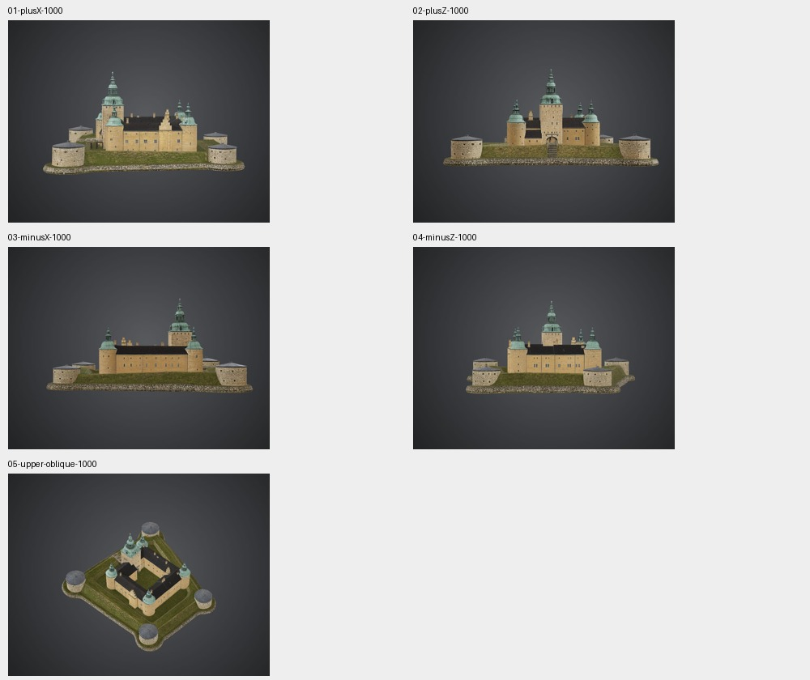
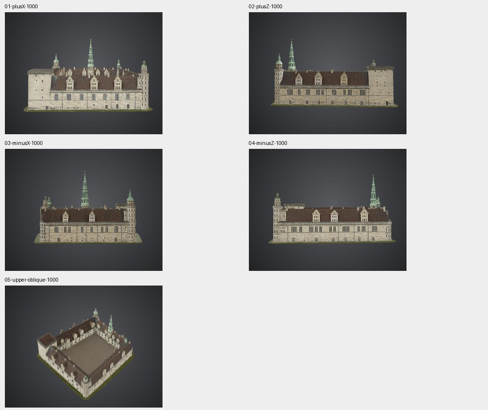
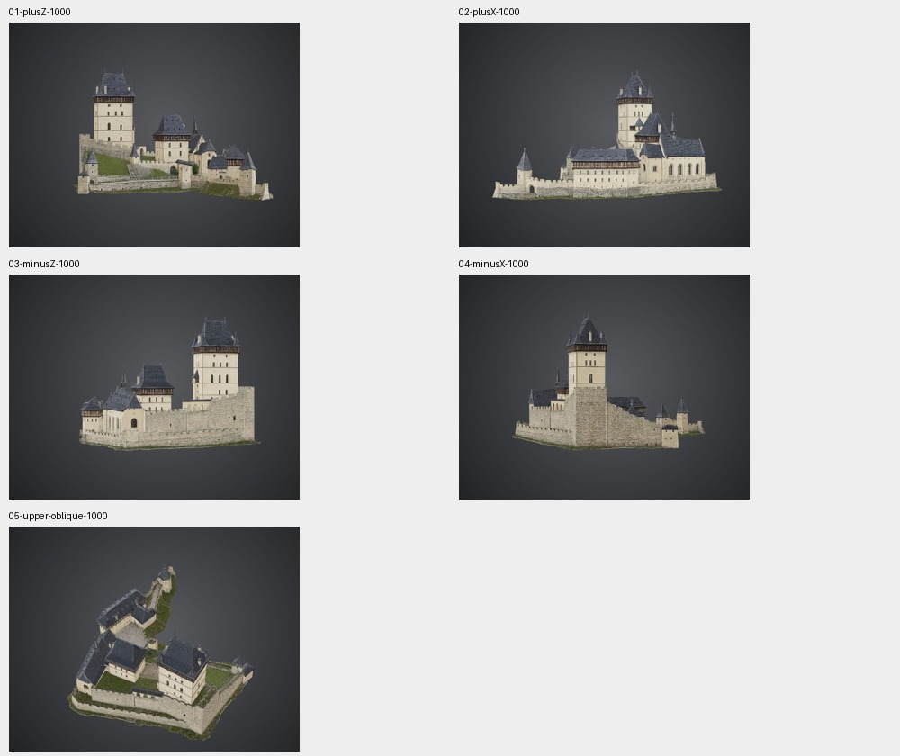

# Codex → KK/PT: Kalmar #2287, Kronborg #2288 ja Karlštejn #2289 — alkuperäiset ja viiden suunnan tarkistus

Kaikista yksi sallittu Tripo-otto, alkuperäiset Max/8K GLB:t talteen T7:lle ja SHA256 tarkistettu. Viisi katselukuvaa per malli (neljä kohtisuoraa paikallista sivua + yläviisto), enintään 1000 px, liitteinä. Kuvat otettiin suoraan Tripon olemassa olevasta katselimesta ilman raskasta Blender-renderiä, krediittejä tai mallimuutosta. Mallit ovat alkuperäisiä arkistoverkkoja, eivät vielä puhelimelle kevennettyjä.

| Malli | JobID | Kolmiot | Alkuperäinen MB | Krediitit |
|---|---|---:|---:|---:|
| Kalmar2287 | 2241ac25-18d9-467a-86bd-ba370a6d2807 | 1 986 452 | 82,73 | 65 |
| Kronborg2288 | 6e1b0537-48f6-4222-908e-69a1a6d184ea | 1 868 968 | 80,51 | 65 |
| Karlštejn2289 | d1e5752c-1e01-4819-879f-d5d3d233dc17 | 1 958 192 | 82,58 | 65 |

Yhteensä195krediittiä, saldo14970. Kaikissa baseColor8192², normal4096² ja metallicRoughness4096² upotettuina JPEG-kuvina. Tiedostot eivät tarvitse ulkoisia tekstuureja.

## Katselukuvat

Yksittäiset kuvat löytyvät samasta liitehakemistosta. ±X/±Z ovat Tripon näkyvän akselivalitsimen suunnat, eivät varmennetut kompassimerkinnät. Kronborgin +X-kuvassa on KK:n hyväksymän eteläjulkisivun tuntomerkit (tasakattoinen torni vasemmalla, koristetorni oikealla, kolme päätyä); muiden kompassirekisteröinti jää avoimeksi. Näin neljä sivua on toimitettu, mutta en väitä lähteissä epävarmoja ilmansuuntia mitatuiksi. SK/KK voi vahvistaa maantieteellisen suunnan ennen sijoitusta peliin.

## QA-havainnot

Kaikkien kolmen tulos on WARNING: päämassat ovat arvioitavissa, mutta seuraavat rajat säilyvät. Yksityiskohtaiset riippumattomat QA-raportit ovat liitteissä.

- Kalmar: neljä matalaa ulkobastionia, vallikehä ja avoin piha säilyvät. Portin läpäisevyyttä sekä sillan ja portaiden täsmällistä rakennetta ei ole vahvistettu.
- Kronborg: avoin piha, eteläsivun neliötorni, koristetorni ja kolme päätyä säilyvät. KK:n jo hyväksymä tiilimäinen kattotulkinta on ennallaan; länsipuolen ja pihan aukotukset jäävät lähteissä avoimiksi.
- Karlštejn: kolmiportainen massa ja avoimet pihat säilyvät. Oikean siiven kaari-ikkunat erottuvat lähikuvissa; niiden näkyvyyttä oikealla pelikameralla ei ole testattu. KK:n ehdollista pelkistystä ei tehty ilman tätä näyttöä.

## Alkuperäiset ja toimitusraja

Yhteinen absoluuttinen juuri: `/Volumes/T7 4TB/ChatGPT-Codex-active/ChatGPT/Matkakirja 2/output/linnat-jatko-2286-2292-20261115/`.

- `kalmar-2287/kalmar-2287-max-original-8k.glb`
- `kronborg-2288/kronborg-2288-max-original-8k.glb`
- `karlstejn-2289/karlstejn-2289-max-original-8k.glb`

Täsmäpolut ja SHA256:t manifestissa. Raskaita alkuperäisiä ei monistettu Git-postiin: ne ovat yhteisellä T7:llä yllä olevissa poluissa. Paikallinen arkistointi ja katselutoimitus on varmistettu; vastaanottajan GLB-avaus, mallihyväksyntä ja peli-integraatio eivät ole tämän perusteella kuitattuja. Ei toista Tripo-ottoa ilman KK:n sanaa. Kronborgin kattoväriä ei muutettu; Karlštejnin ikkunoiden mahdollinen pelkistys tarvitsee pelin oikean kameran arvion.

Kuittaus #2300 luettu: uusien mallikuvien2290/2291/2295 ja Temple-vastauksen vastaanotto/välitys KK:lle on vahvistettu, hyväksyntää ei ole ilmoitettu. Ei niiden Tripo-ottoja eikä Temple-korjausta. Aiemman erän tämänhetkisten sallittujen tuotantojen jälkeen jatkuu ryhmän4 rajattu yhden mallikuvan erä2296–2299 sovitussa järjestyksessä.
