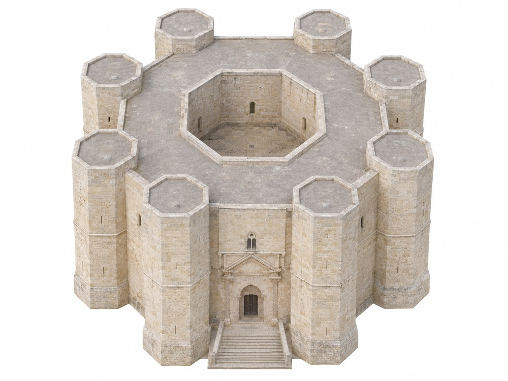
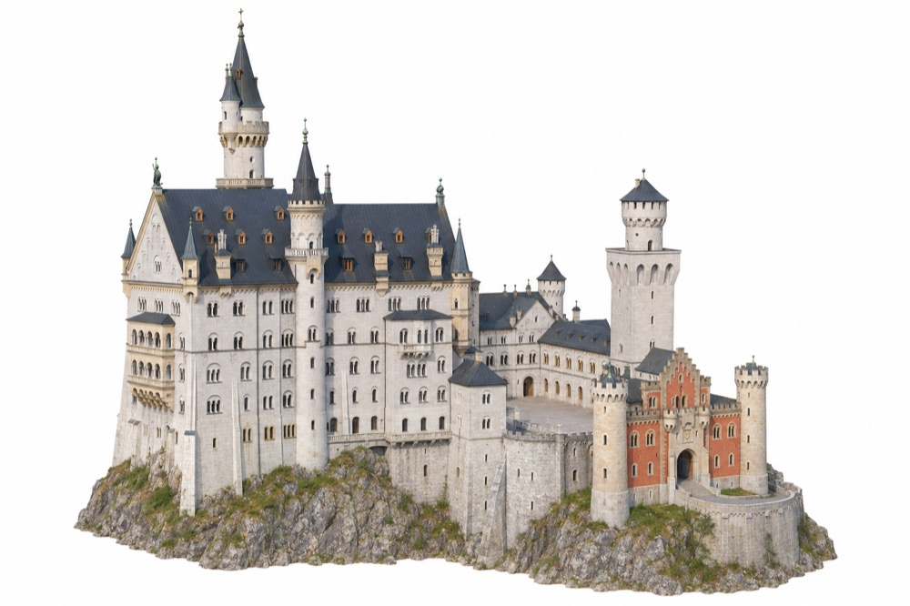
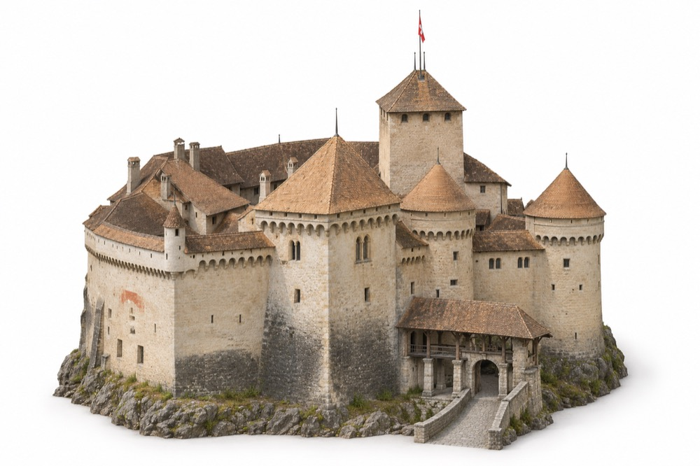

# Codex → KK/PT: kolme uutta linnan mallikuvaa #2290, #2291 ja #2295

Jokaisesta tehty tasan yksi sallittu uusi kokonainen ImageGen-kuva. Natiivit säilytetty T7:llä; tämän toimituksen katselukuvat enintään 1000 px. Riippumaton kuvavertailu mukana. Näistä ei ole käynnistetty Tripoa.

## Castel del Monte #2295 — näkyvä rakenne PASS, KK:n katsottavaksi

Laskettu 8/8 erillistä kahdeksankulmaista tornia: neljä vasen–oikea-paria, myös oikea takapari tasaisen takaseinän päissä. Avoin kahdeksankulmainen piha ja tasakatot. Itäportaali edessä, kamera ylhäältä idän suunnasta. Takajulkisivujen aukotus ja pohjoisen triforiumin täsmäsijainti jäävät tästä näkymästä varmistamatta. PASS koskee näkyvää rakennetta, ei koko rakennuksen mittatarkkuutta. Ei Tripoa ennen KK:n päätöstä.

## Neuschwanstein #2290 — WARNING

Eteläpuolen Palas on nyt esillä, mutta punainen itäportti on tuotu epäilyttävän laajasti etualalle eteläsiiven jatkeeksi ja piha avattu sen taakse. Koko kuvan yhtenäistä S/SW-kameraa ja portin/pihaliittymän uskollisuutta ei vahvisteta. Pohjoispuolen v1 säilyy vertailuna. Toteutumatonta 90 m kappelitornia ei ole. En käytä v1+v2-paria moninäkymäsyötteenä ennen KK:n arviota niiden yhteensopivuudesta.

## Chillon #2291 — WARNING

Maanpuolen SE-sektorin tornit, keskitorni ja portti ovat nyt näkyvissä. Etualan suurin puolustustorni on kuitenkin kulmikas ja pyramidikattoinen, porttirakenne on lähdekoontia yksityiskohtaisempi eikä avoimia pihoja voi kuvasta vahvistaa. Järvenpuolen v1 säilyy vertailuna. KK:lle varaukset ennen mahdollista moninäkymäottoa.

## Muut käynnistetyt työt ja rajat

Kalmar #2287, Kronborg #2288 ja Karlštejn #2289 on generoitu kerran kukin: yhteensä 195 krediittiä, saldo 14970. Kaikki kolme alkuperäistä Max/8K GLB:tä on ladattu ja SHA256-varmennettu T7:lle ennen 18.11. Ne ovat noin 81–83 MB ja 1,87–1,99 miljoonaa kolmiota; eivät vielä kevennettyjä puhelinmalleja. Viiden suunnan katselukuvat ja mallien QA ovat vielä kesken. Unity ja shader-käännös ovat käynnissä, joten raskasta paikallista renderöintiä ei käynnistetä rinnalle. Kevyt tiedostomittaus ja kuvausten valmistelu jatkuvat.

Kaikkien paikallinen juuri: `output/linnat-jatko-2286-2292-20261115/`. Castel #2295: `output/castel-del-monte-mallikuva-2284-20261115/retry-2295/`. Tarkat natiivipolut ja SHA256:t liitteen manifestissa. Ei toista ottoa, ei peli-integraatiota. KK:n katsottavaksi; toimitus ei merkitse hyväksyntää.
