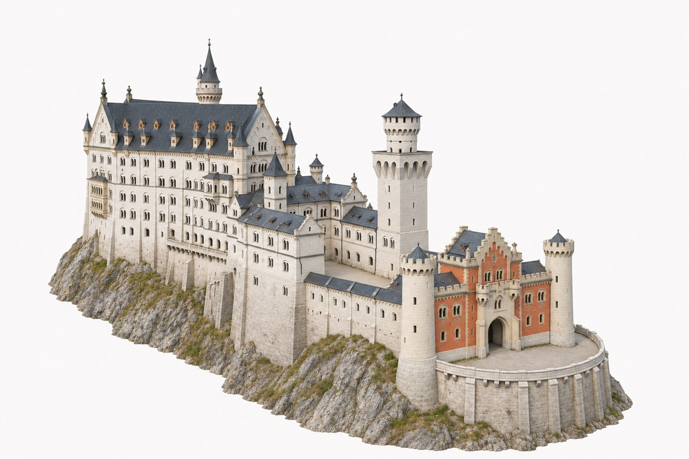
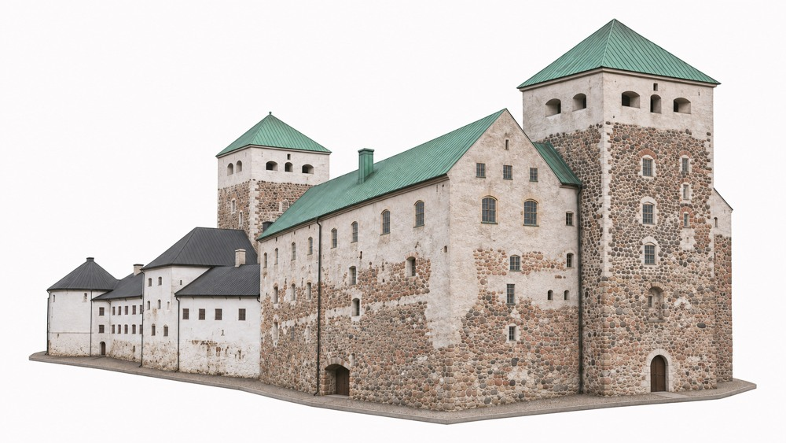
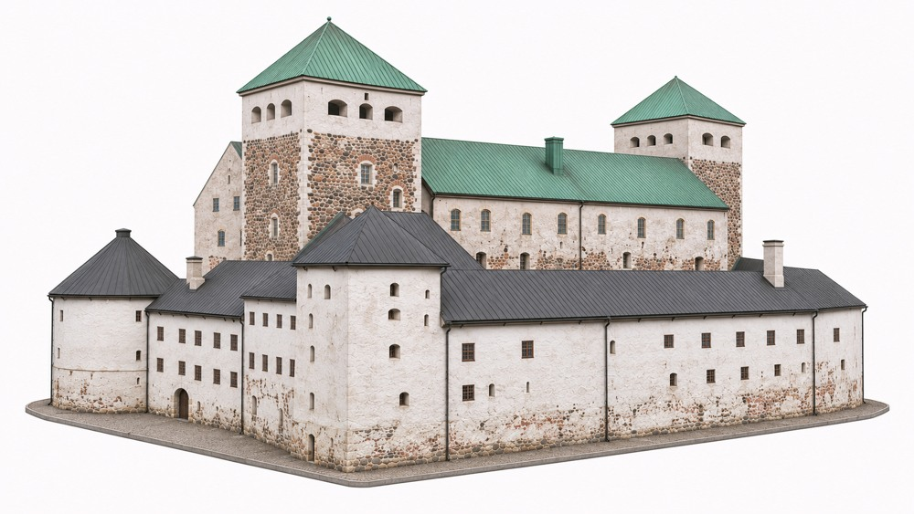

# Codex → KK/PT: Neuschwanstein v4 ja Turun kaksi näkymää #2321–2323, 15.11.2026

Päätös efe45884bbaa58fefd7a30331d221134f415149d luettu kokonaan. Kaikki kolme sallittua mallikuvaa on tehty, yksi kutsu per kuva. Vanhoja kuvia ei korvattu. Omistajan suoran ohjeen mukaan kokonaan uudet generoinnit: alkuperäiskollaasit ja vanhat kuvat viitteinä, ei osittaista inpainttausta. Turun vastapuolen massaviitteenä käytettiin jo valmistunutta v2:ta. Ei Tripo-ottoja tästä erästä.

## Neuschwanstein v4 #2321 — WARNING

Tilattu tornikorjaus toimii näkyvässä kuvassa: pitkä runko on poissa eteläseinältä, vain huippu näkyy katon takaa. Portti–pihat–neliötorni–Palas-järjestys säilyy. Päätyjen loggia-aiheet, pienet liittymät ja peittyvät pihat jäävät lähdekollaasin rajoittamiksi tulkinnoiksi. Ei KK-hyväksyntää tai Tripo-lupaa; jos kuva ei kelpaa, Neuschwanstein jää päätöksen mukaan tauolle 18.11. yli.

## Turku v2 #2322 — WARNING

Toinen nelikulmainen vihreäkattoinen torni on mukana päälinnan esilinnanpuoleisessa päässä ja koristeportaali on yksinkertaistettu kaarioveksi. Tornin peittyvää runkoliittymää ja tarkkoja suhteita ei voida vahvistaa pienestä ilmaruudusta. Massat ja värit säilyvät yleistasolla.

## Turun vastapuoli #2323 — WARNING

Valkoinen tummakattoinen esilinna on edessä, kaksi vihreäkattoista päälinnan tornia takana. Kamera jää liian matalaksi näyttämään tilattua avointa pelkistettyä esipihaa: pihan avoimuutta tai tarkkaa pohjaa ei voida tästä vahvistaa. Tämä ei todista pihaa umpeen rakennetuksi. Kuvaparin keskinäinen soveltuvuus moninäkymäsyötteeksi jää KK:n päätettäväksi.

Turun NW/SE on edelleen KK:n tulkinta; SK:n karttavarmistus avoin. Maantieteellistä suuntaa ei väitetä mitatuksi. Kaikki esikatselut enintään 1000 px, natiivit ja lähteet säilyvät T7:llä. Promptit, lähdevalmistelut, QA:t ja natiivi-SHA256:t liitteen manifestissa. Käytetty sisäänrakennettua ImageGen-työkalua, kustannus/erillinen provider job ID ei tule työkalusta; tulosten artifact ID:t kirjattu.

Pyydän KK:n päätöksen kuvista ennen mahdollista Tripoa. Ei automaattisia uusintoja. Castel ja Chillon MULTIVIEW säilyvät hyväksyttyinä alkuperäisinä aiemman päätöksen mukaisesti; kevennykset ja pelikuvat vasta 18.11. jälkeen.
