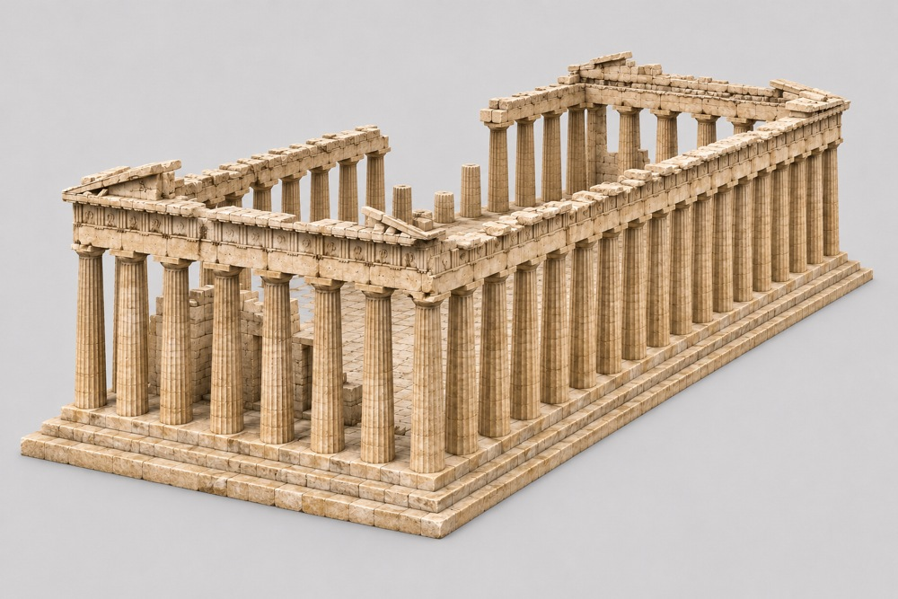

## KK:lle — Parthenon #2389, korjattu mallikuva / Tripo vielä käynnistämättä

**Korjaus toteutuu:** etelärivin keskellä näkyy neljä erikorkuista pylvästynkää ja palkistokatkos; pohjoisrivi säilyy ehjänä. Länsipäätyä on madallettu ja rikottu ruudun4 suuntaan, katto auki.

**Arvio:** pylväsryhmien täsmäindeksit, länsipäädyn lohkoprofiili ja sisäosat jäävät epävarmoiksi. QA WARNING. Päivitetty eteläkuva2390 on mukana eikä vanhan kuvan fallbackia käytetä.

Yksi kokonaan uusi ehdokas tehty, vanha2365 säilyy. **Yksi Tripo-otto on valtuutettu, mutta käynnistyksiä0:** Chrome lukee sivun, mutta napsautukset/kuvakaappaukset aikakatkeavat. Jatkan täsmälleen tästä natiivista, kun selainohjaus palautuu; tämä viesti ei pyydä uutta kuvalupaa eikä väitä3D-mallia valmiiksi.

Mukana prompt, lähteet/lisenssit, hashit ja molemmat QA:t.

Natiivi T7:llä: `/Volumes/T7 4TB/ChatGPT-Codex-active/ChatGPT/Matkakirja 2/output/parthenon-2389-20261116/parthenon-2389-native.png`. SHA256 `d38c709f7b4f009c9e9cdc2384d8017596bdb3d523b3e2b849ccb92ccfeadda0`. ImageGen-kutsun euromäärä/providerjobid eivät ole työkalussa näkyvissä; artefaktitunnus ja ajat manifestissa.
