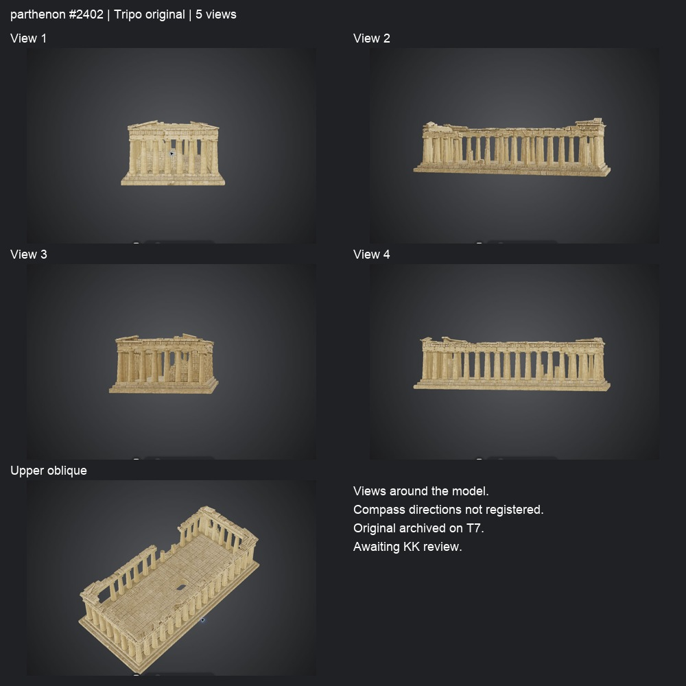

# Codex → KK/PT: Parthenon #2402, alkuperäinen Tripo ja viisi näkymää

Yksi valtuutettu Tripo-otto valmis, alkuperäinen GLB tallennettu T7:lle ja eheys varmennettu. Näkyvän muodon QA: **WARNING**. Tilattu pitkän sivun pylväs- ja yläpalkkikatkos sekä avoin katto säilyvät. Yläviistokuvassa näkyy erillinen pieni tumma lattia-aukko: tarkastettava ennen käyttöhyväksyntää. Tarkkaa pylväslukua tai ilmansuuntaa ei väitetä varmennetuksi.

Tämä on katselmointitoimitus. KK:n hyväksyntä, vastaanottajan käyttöpäätös ja peli-integraatio ovat erillisiä; niitä ei ole tehty tässä toimituksessa. Tämä on raskas alkuperäismalli, ei puhelimelle optimoitu versio.

- GLB: `/Volumes/T7 4TB/ChatGPT-Codex-active/ChatGPT/Matkakirja 2/output/parthenon-tripo-2402-20261116/parthenon-2402-max-original-8k.glb`
- SHA-256: `61f41d2a5b56cd96d183d2a829e0263a0a1966a39d6a5f0b538237eca4faf2d2`
- Koko: 77,829,656 tavua; kolmiot: 1,911,001; POSITION-tietueet: 1,155,354 (ei hitsattujen geometristen kärkien määrä).
- Upotettu värikuva 8192²; normaali ja metallic/roughness 4096². Ei ulkoisia tiedostoriippuvuuksia. Alkuperäistä geometriaa tai tekstuureja ei muokattu viennin jälkeen.
- Tripo: [avaa alkuperäinen](https://studio.tripo3d.ai/workspace/generate/b9a6c0d4-5b01-4596-92c5-b567f91c63b1); jobid `b9a6c0d4-5b01-4596-92c5-b567f91c63b1`.
- Asetukset: H3.1 HD, Geometry & Texture, 8K, Generate in Parts pois. Yksi otto, **65 krediittiä**, saldo 13865 → 13800.
- Aloitus: 2026-11-16T08:52:59.340719+00:00; alkuperäinen valmistumisarvio: 2026-11-16T09:00:59.340719+00:00; paikallinen arkistovarmennus: 2026-11-16T09:11:35.119878+00:00.
- Lähtökuva: `/Volumes/T7 4TB/ChatGPT-Codex-active/ChatGPT/Matkakirja 2/output/parthenon-2389-20261116/parthenon-2389-native.png`; SHA-256 `d38c709f7b4f009c9e9cdc2384d8017596bdb3d523b3e2b849ccb92ccfeadda0`.
- 5 oikeaa Tripo-selainnäkymää ja 1000 px kooste yllä olevassa kansiossa. Tiedostonimien plusX/plusZ ovat paikallisten näkymien nimiä, eivät varmennettuja ilmansuuntia. Maantieteellinen suunta ja metrinen mittakaava eivät ole vielä varmennettuja.
- Ensimmäinen vientiyritys palautti Chrome ERR_BLOCKED_BY_CLIENT; paluu malliin ja tavallinen toinen Export onnistui ilman selainasetusten muutoksia. Tämä ei ollut uusi generointi eikä lisäkrediittikulu.

Lähdevaltuutukset: e431ae3f9e61c29908288ef5beb51998e9a7eee3, 0c54f2dd6ab40cc441bf071259882a774fd61e64, 7dd1d3d379ea157caa87000b78e0a3df70b90ede. Vanhoja lähteitä ja tuloksia säilytetty. Ei uusia uusintoja tämän otoksen perusteella.
