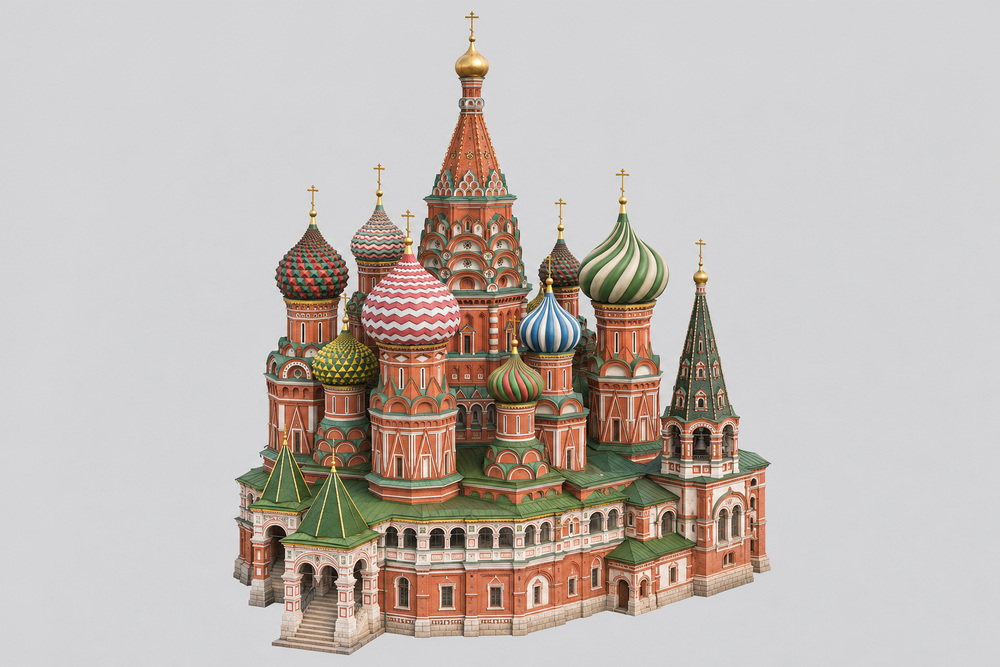

# Tripo 3D → KK: Pyhän Vasilin katedraali #2364, yksi mallikuva arvioitavaksi

**WARNING:** Kahdeksan kupolia, keskiteltta ja kellotorni erottuvat, mutta takavasemman toisen punavalkopainotteisen kupolin kuvio/paikka sekä takakupolien yksilöinti eivät varmennu; yläpinnat ja idän/pohjoisen alaosa ovat arvioita.

Yksi sallittu uusi mallikuva tehty sisäisellä ImageGen-työkalulla; ei uusintaa. Toimitus 1000 × 667 px. Natiivi, prompti ja lähteet säilytetty T7:llä; prompti, QA:t ja lähdeviitteet liitteenä. Kustannus ja palvelun jobid eivät näy työkalusta; Tripo-krediittejä 0.

Tämä on arviointitoimitus. Ei Tripo-ottoa ennen KK:n erillistä sanaa. Ei peli-integraatiota.
