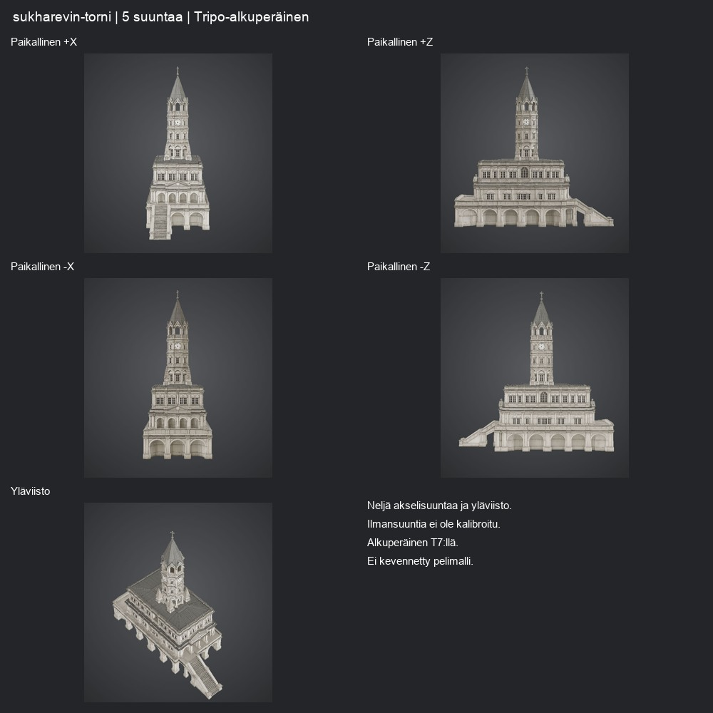
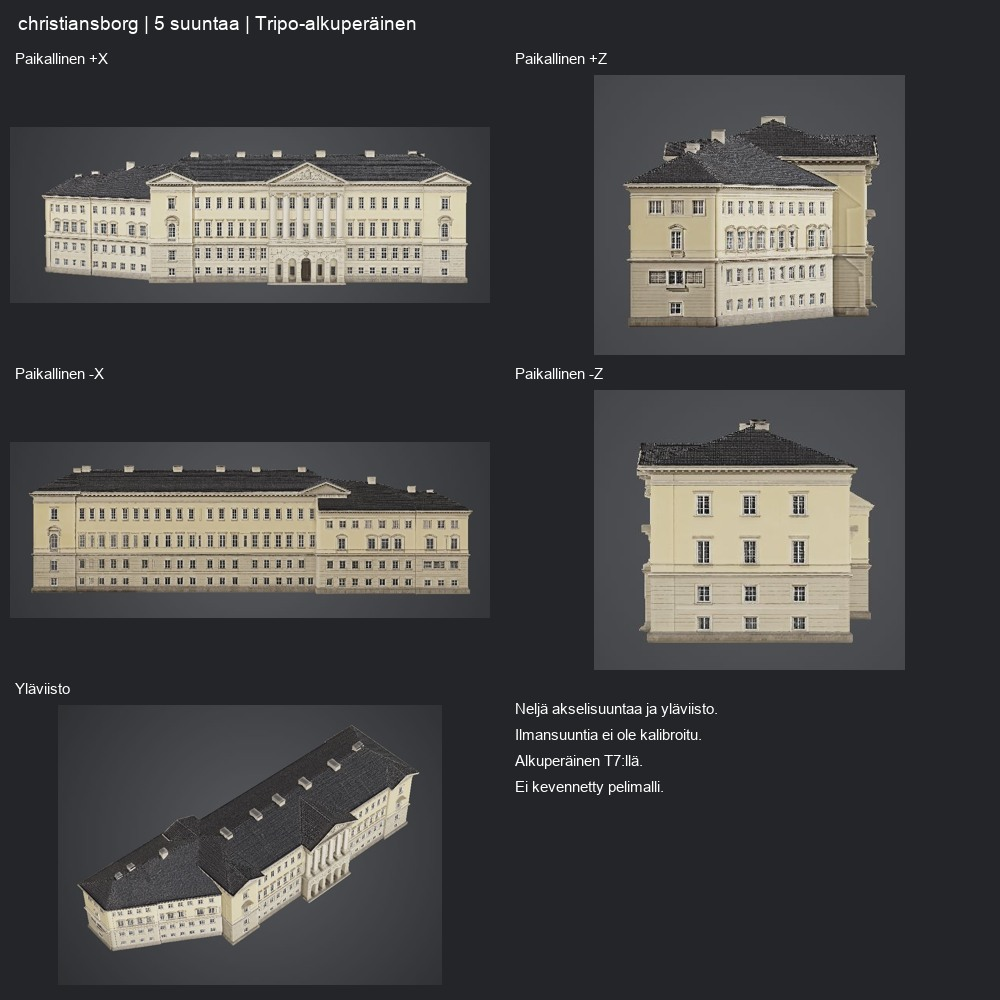
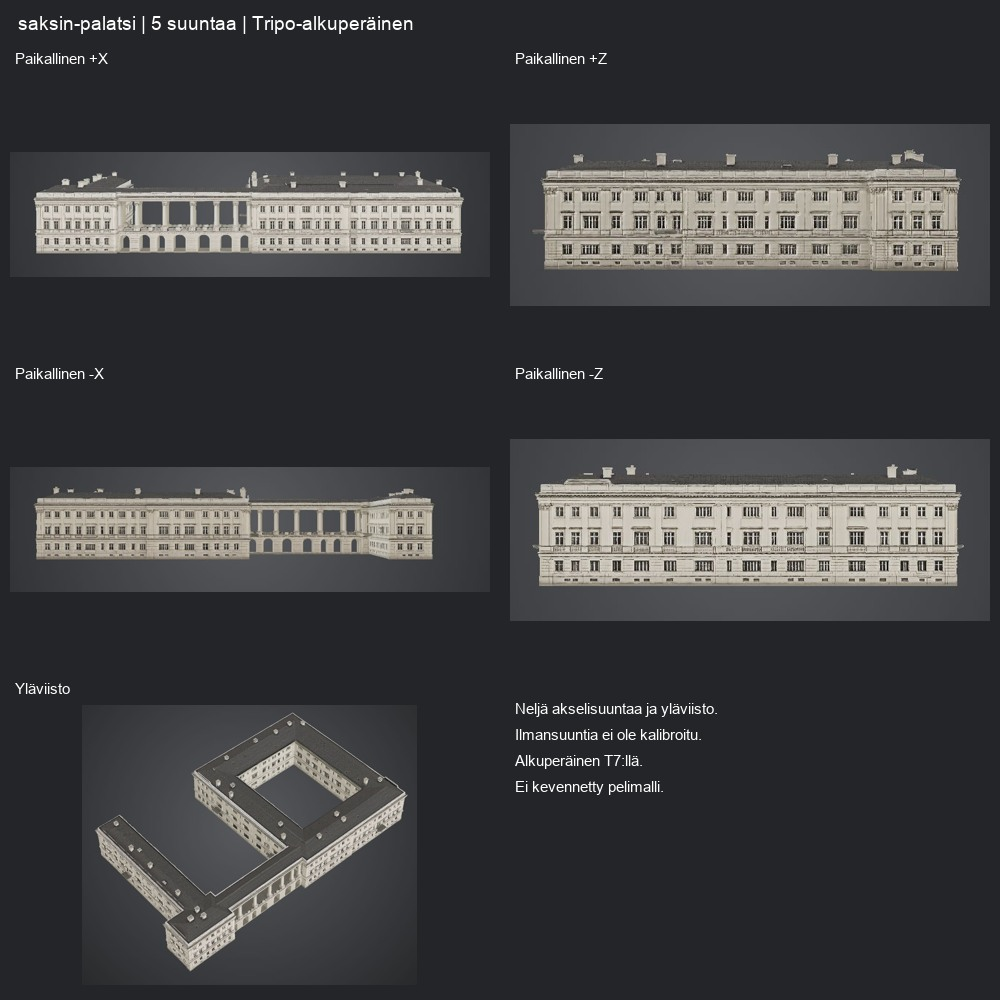

# Codex → KK/PT: ryhmän 4 Tripo-alkuperäiset #2313–2315, 15.11.2026

Kolme sallittua yhden oton alkuperäistä on arkistoitu T7:lle ja tarkistettu viidestä suunnasta. Ei uusia ottoja, kevennyksiä tai peli-integraatiota. H3.1 HD, Ultra Mesh, tavoite 2M kolmioita, 8K värikuva ja PBR. Yhteensä 195 krediittiä (14775 → 14580). Jokaisessa GLB:ssä upotettu 8192² värikuva sekä 4096² normal- ja metallicRoughness-kuvat; ei ulkoisia riippuvuuksia.

## KK:n arvioon

| Kohde | Kolmiot | Koko | Arvio ja tärkein varaus |
|---|---:|---:|---|
| Sukharevin torni #2313 | 1 850 493 | 72 986 020 tavua | WARNING: kellotorni, porrastettu runko ja yksi ulkoportaikko säilyvät; ala-arkadi näyttää osin matalalta/umpitaustaiselta. |
| Christiansborg 1883 #2314 | 1 883 022 | 76 092 556 tavua | WARNING: Hansenin torniton palatsi ja pylväspääjulkisivu säilyvät; takasivu ja piilokattoliitokset ovat yhden kuvan tulkintaa. |
| Saksin palatsi 1939 #2315 | 1 926 397 | 74 732 384 tavua | WARNING: molemmat siivet sekä avoimilta näyttävät kolonnadi ja ala-arkadi säilyvät; pylväs-/kaarijako harvenee selvästi syötteestä. Oikean pihan ja vasemman siiven pituuden hyväksytyt varaukset säilyvät. |

### sukharevin-torni

Alkuperäinen: `/Volumes/T7 4TB/ChatGPT-Codex-active/ChatGPT/Matkakirja 2/output/kadonneet-ryhma4-20261115/tripo-2313-2315/sukharevin-torni/sukharevin-torni-2313-max-original-8k.glb`

SHA256: `d5be1c7d957f898cff0105bd49aedf0ef5e33961c71d4e6f88173d134e49926b`. Tripo job: `731f6c84-8415-4b93-995c-7b944ca7c2f4`.

### christiansborg

Alkuperäinen: `/Volumes/T7 4TB/ChatGPT-Codex-active/ChatGPT/Matkakirja 2/output/kadonneet-ryhma4-20261115/tripo-2313-2315/christiansborg/christiansborg-2314-max-original-8k.glb`

SHA256: `b6b504254b32991356ecb1838e7479362a5ab3f5c8f180da8b49b1dd6b8f151f`. Tripo job: `a2cc4808-12e9-480a-b2ef-2a5d37489b8f`.

### saksin-palatsi

Alkuperäinen: `/Volumes/T7 4TB/ChatGPT-Codex-active/ChatGPT/Matkakirja 2/output/kadonneet-ryhma4-20261115/tripo-2313-2315/saksin-palatsi/saksin-palatsi-2315-max-original-8k.glb`

SHA256: `eaa637223b4dbeb5f3a1e6f6c48d436694f1d62eb169719fe2529743c4867711`. Tripo job: `508dab68-9414-4a50-8618-9d0c95451565`.

Koosteet ovat 1000 × 1000 px, lisäksi erilliset enintään 1000 px katselukuvat. Neljä suuntaa ovat paikalliset +X/+Z/−X/−Z, viides yläviisto: niitä ei väitetä ilmansuunniksi. Kuvaus Tripon katselimesta, ei raskasta paikallista renderöintiä. GLB:t säilyvät muuttumattomina T7:llä; tämä posti sisältää katselukuvat, QA:t ja tarkistussummat. KK:n hyväksyntää, todellista mittakaavaa tai pelikameran toimivuutta ei väitetä.

## Uudet viestit luettu ja kuitattu kerran

- `6e9bc9b3f26e5cbb13d8fa9566376936b25b993f`: #2301–2304 vastaanotto.
- `b6b1675e7bf893460c9573114a189af476c4fc32`: #2309/2311/2312/2316 vastaanotto. Näille ei uusia kuvia eikä Tripoa ennen KK:n päätöstä.
- `efe45884bbaa58fefd7a30331d221134f415149d`: Castel hyväksytty alkuperäiseksi ja Chillon MULTIVIEW valittu alkuperäiseksi varauksin. SINGLE säilyy mutta ei käyttöön. Ei uusia ottoja näistä. Kevennykset/pelikuvat vasta 18.11. jälkeen.
- #2321–2323 työn alla: yksi Neuschwanstein v4 sekä Turku v2 ja vastapuoli. Omistajan suora kokonaan uuden generoinnin sääntö on etusijalla osittaiseen kuvamuokkaukseen nähden: uudet kokonaiset kuvat vanhojen ja alkuperäislähteiden avulla, vanhat säilyvät. Neuschwansteinin torni katon taakse; Turun toinen torni ja yksinkertainen kaariovi. Turun NW/SE on KK:n tulkinta, SK:n karttavarmistus avoin. Kaikki kuvat KK:lle ennen Tripoa; enintään yksi kutsu per kuva. Jos Neuschwanstein v4 ei kelpaa, tauko 18.11. yli.
