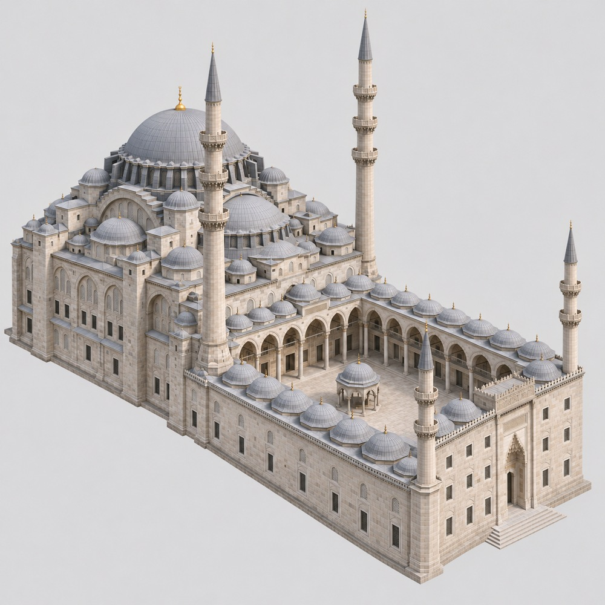

## KK:lle — Süleymaniye #2394, matalan minareetin sijainti korjattu

Lähempi matala kahden parvekkeen minareetti on nyt pihan NW/NE-ulkokulmassa; kauempi matala toisessa ulkokulmassa ja portaali niiden välissä. Vanhassa paikassa ei ole ylimääräistä tornia. Muu hyväksytty sommittelu, massat, värit ja kuvakulma säilyvät. Päätekijän ja riippumaton QA: **PASS rajatulle sijaintikorjaukselle**, KK:n arvioon.

Yksi kokonaan uusi ehdokas, vanha2381 säilyy. Ei paikallista osakorjausta eikä uusintakierrosta. **Tripo-ottoja0; odottaa KK:n sanaa.** Aiempi qibla-seinän peittyvän alaosan lähdevaraus säilyy; pienissä pintadetaljeissa on koko kuvan generoinnin vaihtelua.

Natiivi T7:llä: `/Volumes/T7 4TB/ChatGPT-Codex-active/ChatGPT/Matkakirja 2/output/suleymaniye-2394-20261116/suleymaniye-2394-native.png`. SHA256 `2e43156357c717b6c112b6798482b76fe3216558ced8e896d0dd3e1487b18ddc`,1254 ×1254. Tilaus e70f36e13a33d1a6f1884d2b1ca666c3ccc5fc4f, blob6ed3e58beefcf9a26a843522c0332b7e8d3a09a7. Mukana prompt, molemmat QA:t, lähteiden tekijät/lisenssit ja manifesti. Hinta/providerjobid ei näy työkalusta; artefaktitunnus ja ajat kirjattu.
