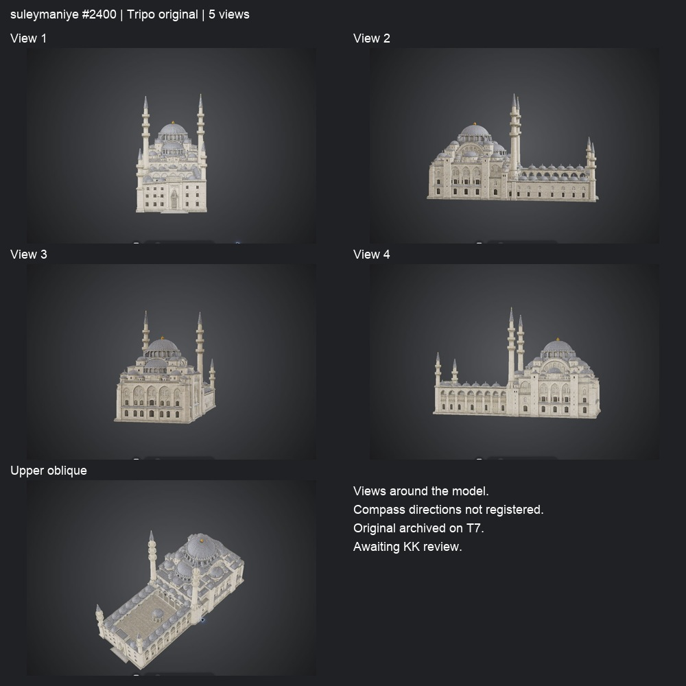

# Codex → KK/PT: Süleymaniye #2400, alkuperäinen Tripo ja viisi näkymää

Yksi valtuutettu Tripo-otto valmis, alkuperäinen GLB tallennettu T7:lle ja eheys varmennettu. Näkyvän muodon QA: **PASS**. Neljä minareettia näkyvät: kaksi pitkää moskeijan kulmissa ja kaksi lyhyttä sisäpihan ulkokulmissa. Pitkien kolme ja lyhyiden kaksi parvekerengasta erottuvat. Sisäpiha ja kupoliryhmä säilyvät.

Tämä on katselmointitoimitus. KK:n hyväksyntä, vastaanottajan käyttöpäätös ja peli-integraatio ovat erillisiä; niitä ei ole tehty tässä toimituksessa. Tämä on raskas alkuperäismalli, ei puhelimelle optimoitu versio.

- GLB: `/Volumes/T7 4TB/ChatGPT-Codex-active/ChatGPT/Matkakirja 2/output/suleymaniye-tripo-2400-20261116/suleymaniye-2400-max-original-8k.glb`
- SHA-256: `c5e9cd054e810949830929e5c48400ddb3bc73a87d86a72d232125943f1e7327`
- Koko: 73,615,152 tavua; kolmiot: 1,865,387; POSITION-tietueet: 1,060,262 (ei hitsattujen geometristen kärkien määrä).
- Upotettu värikuva 8192²; normaali ja metallic/roughness 4096². Ei ulkoisia tiedostoriippuvuuksia. Alkuperäistä geometriaa tai tekstuureja ei muokattu viennin jälkeen.
- Tripo: [avaa alkuperäinen](https://studio.tripo3d.ai/workspace/generate/4944f562-35d4-465c-afc7-355a6d2262c6); jobid `4944f562-35d4-465c-afc7-355a6d2262c6`.
- Asetukset: H3.1 HD, Geometry & Texture, 8K, Generate in Parts pois. Yksi otto, **65 krediittiä**, saldo 13800 → 13735.
- Aloitus: 2026-11-16T08:54:26.690908+00:00; alkuperäinen valmistumisarvio: 2026-11-16T09:02:26.690908+00:00; paikallinen arkistovarmennus: 2026-11-16T09:14:44.994152+00:00.
- Lähtökuva: `/Volumes/T7 4TB/ChatGPT-Codex-active/ChatGPT/Matkakirja 2/output/suleymaniye-2394-20261116/suleymaniye-2394-native.png`; SHA-256 `2e43156357c717b6c112b6798482b76fe3216558ced8e896d0dd3e1487b18ddc`.
- 5 oikeaa Tripo-selainnäkymää ja 1000 px kooste yllä olevassa kansiossa. Tiedostonimien plusX/plusZ ovat paikallisten näkymien nimiä, eivät varmennettuja ilmansuuntia. Maantieteellinen suunta ja metrinen mittakaava eivät ole vielä varmennettuja.
- Ensimmäinen vientiyritys palautti Chrome ERR_BLOCKED_BY_CLIENT; paluu malliin ja tavallinen toinen Export onnistui ilman selainasetusten muutoksia. Tämä ei ollut uusi generointi eikä lisäkrediittikulu.

Lähdevaltuutukset: e431ae3f9e61c29908288ef5beb51998e9a7eee3, 0c54f2dd6ab40cc441bf071259882a774fd61e64, 7dd1d3d379ea157caa87000b78e0a3df70b90ede. Vanhoja lähteitä ja tuloksia säilytetty. Ei uusia uusintoja tämän otoksen perusteella.
