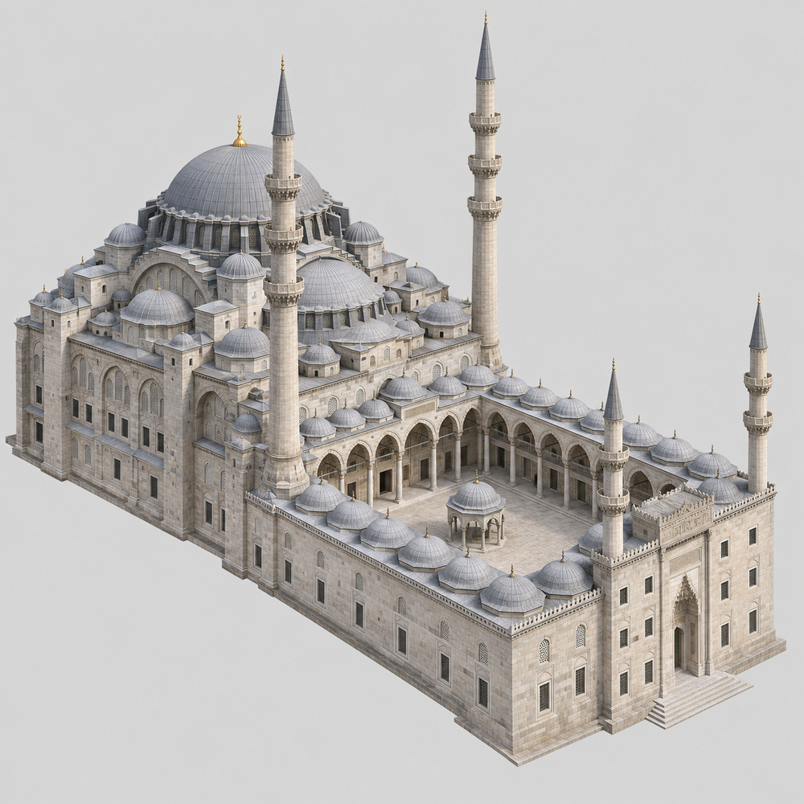

## KK:lle — Süleymaniyen moskeija #2381, yksi mallikuva

**Arvioksi jäi:** kaakon qibla-seinän peittynyt alaosa, pienet detaljit ja pihan keskuskatoksen muoto; kamera korostaa NW-portaalia eikä ruudun 5 NE-suunnan täsmällistä toteutumista voi vahvistaa.

QA: **WARNING**, KK:n arvioon. Neljä minareettia ovat 2 × korkea/3 parveketta hallin vieressä sekä 2 × matala/2 parveketta pihan portaalipäässä. Kupolisali, porrastus ja piha ovat mukana. Vaalea beigenharmaa kivi, harmaat kupolit, pienet kultaiset kärjet; ympäristö poistettu.

Yksi sisäänrakennetun ImageGenin kutsu käytetty. Ei automaattista uusintaa. **Tripo-ottoja 0; Tripo odottaa KK:n erillistä sanaa.** Tilaus f244c12c857e943c18631ce32345de88ecd6e0ac, blob 94b783657dd555e926fa6414dc9080e269587beb. Lähdepaketti tarkistettu hashien avulla; tekijät ja lisenssit source-attribution.md:ssä. Mukana prompt, molemmat QA:t ja manifesti.

Natiivi T7:llä: `/Volumes/T7 4TB/ChatGPT-Codex-active/ChatGPT/Matkakirja 2/output/suleymaniye-2381-20261116/suleymaniyen-moskeija-2381-native.png`. SHA256 `725d9d861e03f6840f77e779e6f8f33e4a0ff2b6067ba07e5c1f9ece248435c6`, 1254 × 1254. Työkalu ei ilmoita euromääräistä hintaa tai palvelun jobid:tä; artefaktitunnus ja ajat manifestissa. Vastaanotto, hyväksyntä ja peli-integraatio erillisiä.
