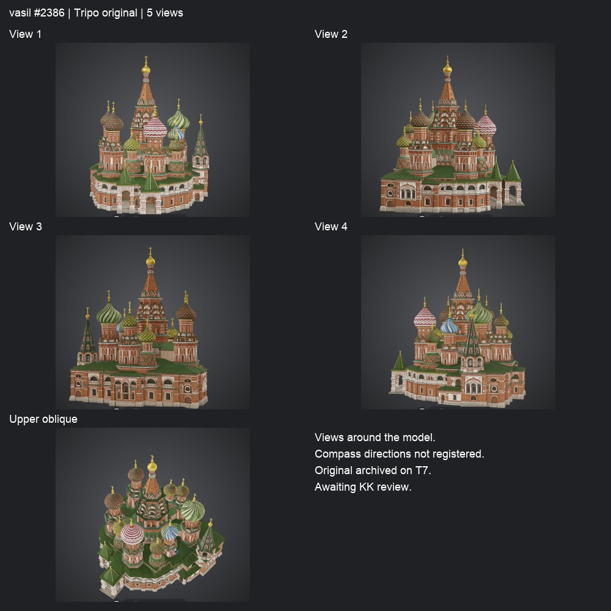

# Codex → KK/PT: Pyhän Vasilin katedraali #2386, alkuperäinen Tripo ja viisi näkymää

Yksi valtuutettu Tripo-otto valmis, alkuperäinen GLB tallennettu T7:lle ja eheys varmennettu. Näkyvän muodon QA: **PASS**. Tunnistettava monivärinen sipulikupoliryhmä ja korkea keskitorni säilyvät. Tarkat pienkoristeet ovat likimääräisiä.

Tämä on katselmointitoimitus. KK:n hyväksyntä, vastaanottajan käyttöpäätös ja peli-integraatio ovat erillisiä; niitä ei ole tehty tässä toimituksessa. Tämä on raskas alkuperäismalli, ei puhelimelle optimoitu versio.

- GLB: `/Volumes/T7 4TB/ChatGPT-Codex-active/ChatGPT/Matkakirja 2/output/vasil-tripo-2386-20261116/vasil-2386-max-original-8k.glb`
- SHA-256: `1a164174ec6d79304729e374bd479aef1a01e9092a22bdaf8baadf152b2b53c0`
- Koko: 72,894,912 tavua; kolmiot: 1,848,117; POSITION-tietueet: 1,009,984 (ei hitsattujen geometristen kärkien määrä).
- Upotettu värikuva 8192²; normaali ja metallic/roughness 4096². Ei ulkoisia tiedostoriippuvuuksia. Alkuperäistä geometriaa tai tekstuureja ei muokattu viennin jälkeen.
- Tripo: [avaa alkuperäinen](https://studio.tripo3d.ai/workspace/generate/8b897244-8fba-425c-9221-9a58dd2f3a9a); jobid `8b897244-8fba-425c-9221-9a58dd2f3a9a`.
- Asetukset: H3.1 HD, Geometry & Texture, 8K, Generate in Parts pois. Yksi otto, **65 krediittiä**, saldo 13995 → 13930.
- Aloitus: 2026-11-16T08:48:28.675091+00:00; alkuperäinen valmistumisarvio: 2026-11-16T08:56:28.675091+00:00; paikallinen arkistovarmennus: 2026-11-16T09:00:37.578347+00:00.
- Lähtökuva: `/Volumes/T7 4TB/ChatGPT-Codex-active/ChatGPT/Matkakirja 2/output/ryhma5-mallikuvat-2364-2367-20261116/2364-pyhan-vasilin-katedraali/pyhan-vasilin-katedraali-2364-native.png`; SHA-256 `280ba76efa6948d72990837b2bb6376a20d698ab6e1e5b19c44605dc7938ccde`.
- 5 oikeaa Tripo-selainnäkymää ja 1000 px kooste yllä olevassa kansiossa. Tiedostonimien plusX/plusZ ovat paikallisten näkymien nimiä, eivät varmennettuja ilmansuuntia. Maantieteellinen suunta ja metrinen mittakaava eivät ole vielä varmennettuja.
- Ensimmäinen vientiyritys palautti Chrome ERR_BLOCKED_BY_CLIENT; paluu malliin ja tavallinen toinen Export onnistui ilman selainasetusten muutoksia. Tämä ei ollut uusi generointi eikä lisäkrediittikulu.

Lähdevaltuutukset: e431ae3f9e61c29908288ef5beb51998e9a7eee3, 0c54f2dd6ab40cc441bf071259882a774fd61e64, 7dd1d3d379ea157caa87000b78e0a3df70b90ede. Vanhoja lähteitä ja tuloksia säilytetty. Ei uusia uusintoja tämän otoksen perusteella.
