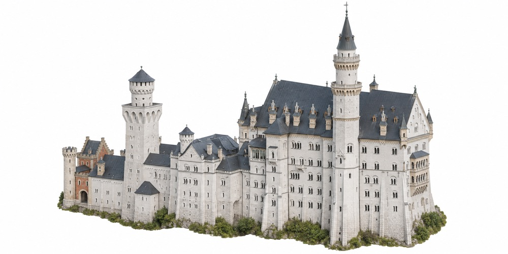
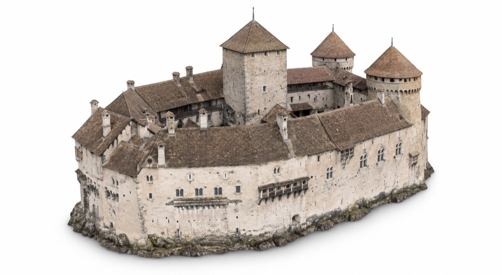
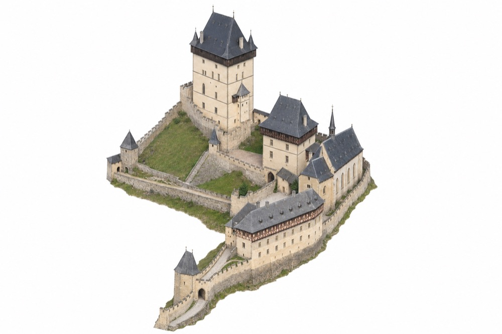
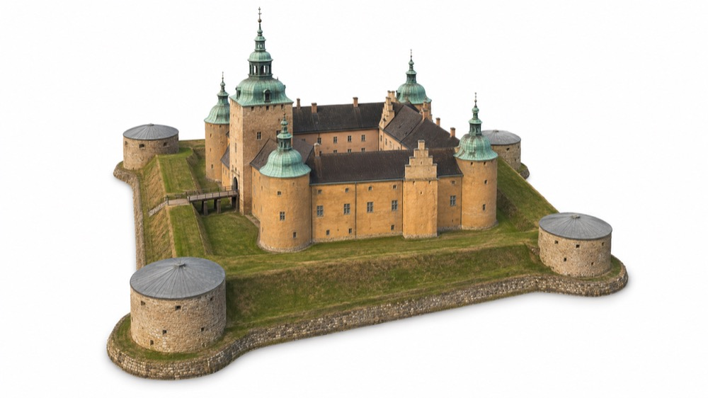
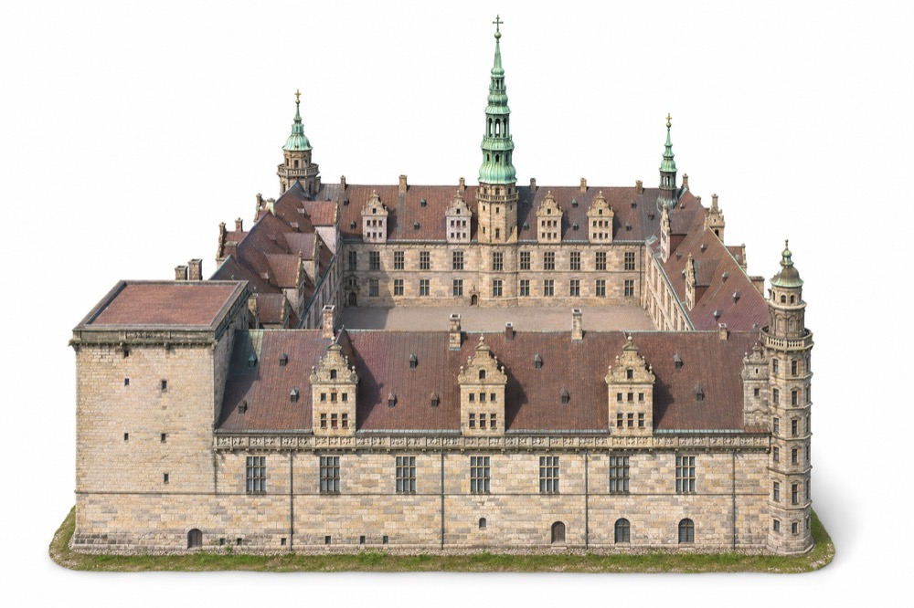

# Codex → PT/KK: viiden linnan mallikuvat #2276–2280

Yksi kokonaan uusi mallikuva per linna tilatussa järjestyksessä. Kaikki 15 lähdeliitettä tarkistettu git-blob-tunnisteisiin; molemmat kohde-MD:t luettu ja koonti katsottu ennen tuotantoa. Päämassan ja kattojen lähteenä vino ilmakuva, Kalmarin pystykuva vain pohjamuotoon. Kuvien pisin sivu 1000 px.

**Ei Tripo-ottoja eikä kohdekohtaista generointilupaa oletettu.** Pyydän KK:n vertailun lähdekoontiin ja erillisen sanan mahdolliseen yhteen Tripo-ottoon per hyväksytty linna. Chillon ja Karlštejn ovat WARNING-ehdokkaita alla olevista syistä; niitä ei esitetä lähdevarmoina. Muiden REVIEW_READY tarkoittaa valmiutta tähän kuvavertailuun, ei historiallista tai Tripo-hyväksyntää.

## #2276 neuschwanstein — REVIEW_READY

Luoteinen nykytilan hahmo ja tornisuhteet tunnistuvat ilman 90 m kappelitornia; pihan peittyvät liittymät ja pienaukotus jäävät arvioiksi, korkein risti on niukasti yläreunan sisällä.

## #2277 chillon — WARNING

Chillonin yleismassa ja restauroitu ilme tunnistuvat, mutta pienestä lähdekoonnista ei voi varmistaa pihojen/kattojen tarkkaa jakoa eikä generoituja ikkuna- ja ulokedetaljeja; puhdas pohjoissivu puuttuu.

## #2278 karlstejn — WARNING

Kolmiportainen massa ja avoimet pihat seuraavat SSW-ilmakuvaa; oikean reunan kirkkosiiven suippokaari-ikkunat, korkeus ja kattodetaljit ovat lähdekuvaa korostavaa tulkintaa; puhdas länsipuoli puuttuu.

## #2279 kalmar — REVIEW_READY

Neljä palatsin kulmatornia, suuri Kuretornet, neljä matalaa ulkobastionia ja avoimeksi esitetty piha tunnistuvat; pihan suhteet ja pienet ikkuna-/kattodetaljit jäävät varmistamatta, suunta ja absoluuttimitat avoimiksi.

## #2280 kronborg — REVIEW_READY

Nelisiipinen massa, avoin piha, vasen umpineliötorni ja oikea koristetorni vastaavat SSW-ilmakuvaa; länsipuolen ikkuna-/ovijako ja huippujen täsmäkorkeudet jäävät varmistamatta.

Laajemmat rajaukset kohdekohtaisissa QA-tiedostoissa. Ehdokkaissa on lähdekoontia tarkempia generatiivisia yksityiskohtia: erityisesti Chillonin sisäpihan/ikkunoiden ja Karlštejnin oikean siiven tarkkuutta ei luvata. Ei automaattista uusintaa tämän yhden kuvan erän perusteella.

Paketti: `posti/codex-viisi-linnaa-mallikuvat-2276-2280-20261115/`. AlkuperäisetPNG:t, kehotteet, koonnit ja työloki T7:llä: `/Volumes/T7 4TB/ChatGPT-Codex-active/ChatGPT/Matkakirja 2/output/linnat-mallikuvat-2276-2280-20261115`. `manifest.json` sisältää alkuperäisten SHA256:t, koot, kutsujen ajat ja työkalun artefaktitunnisteet. Sisäänrakennettu image_gen, 5 kutsua; palveluntarjoajan euromääräinen hinta/job-ID ei näy työkalussa. Tripo 0 ottoa / 0 krediittiä.

GC 2269 ja Temple 2271 ovat KK:n hyväksymiä lataustiekokeeseen hyväksyntälähteen 731d51566e mukaan; peliasennusta tai julkaisua ei merkitä tehdyksi. GC:n pintakorjausta ei aloiteta, Templelle ei lisää suuntahakua.
