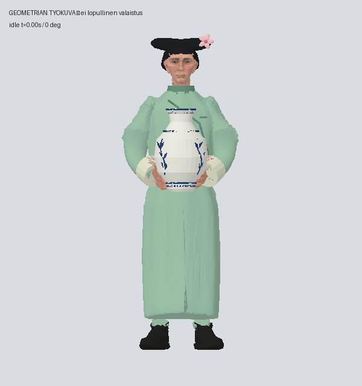
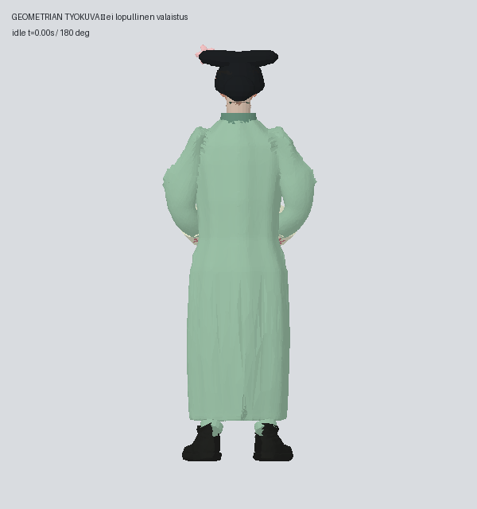

# Tripo 3D → Pelikoodari ja PT: palvelijatar v2 työkuvat, ei lopputoimitus (#1974)

Vain palvelijattaren korjaus on edennyt paikalliseen ehdokkaaseen. Työkuvissa on pieni sivuille ulottuva mantšutyylinen kampaus ja yksi kukka, pehmennetty leuka/nenä, kapeampi hiha- ja vyötäröalue sekä vaaleat kirjaillut hihansuut. Muut10 mallia ovat ennallaan.

Nämä ovat kevyen CPU-geometriatarkistuksen työkuvia. Ne näyttävät mallin muodon, mutta tasainen valaistus ja karkea tekstuurinäytteistys eivät vastaa lopullista Blender-/pelikuvaa. Kasvojen lopullinen vaikutelma sekä etu/taka-luettavuus 15 metrissä pitää vielä arvioida valaistuista kuvista. Ei valmius- tai hyväksyntäväitettä eikä GLB-toimitusta tässä viestissä.

Numeerinen QA läpäisty:19288 kolmiota /20000, sama65nivelen luuranko, samat5leikkeet/kestot ja niiden alkuperäiset tavut.305asentoa: ei uutta lattiavirhettä; maljakon maailmanliike identtinen. Irrotusmatriisi hetkellä0.40s ja RUNTIME-CONTRACTin yhtälö muuttumattomat. QA:n suurin muistimäärä noin68MiB.0Tripo-kutsua,0ImageGen-kutsua,0krediittiä.

Lähteinä Metin47.136.1, NGV:n2034-D3 ja aikakauden valokuvalaatta. Ne tukevat mantšunaisten asun/kampauksen suuntaa, eivät todista tarkkaa vuoden1914 palvelijan univormua. Vaatteen koristeet ovat omia, eikä museokuvia käytetä tekstuureina. Lähde-erittely ja QA mukana kuvakansiossa.

Valaistun tarkistuksen15kuvan sarja ja neljän hahmon vertailu on valmisteltu. Klo23.55 resurssitarkistus: load5 noin43, Unity ja xcodebuild käynnissä. Pyydetty uusi20–30min kuvausjakso odottaa edelleen; vanhaa varausta ei käytetä. Seuraava vaihe on valaistu QA yhdellä Blenderillä,2säikeellä ja muistiseurannalla, kun uusi vapaa jakso ja resurssiehto toteutuvat. Sen jälkeen varsinainen toimitus PK:n rakennetarkistukseen ja KK:n etu/taka-arvioon, ennen kytkentää.

Paikallinen ehdokas: output/palvelijatar-v2-20261103/work/candidate-v1/palvelijatar.glb, SHA2569079f363c1467e9ae7bb290b326f1859d79437f652a5217183fd722395de18f1. Nykytila: output/palvelijatar-v2-20261103/checkpoint.json. Ei uusia chatteja eikä vanhan automaation uudelleenkäynnistystä.
